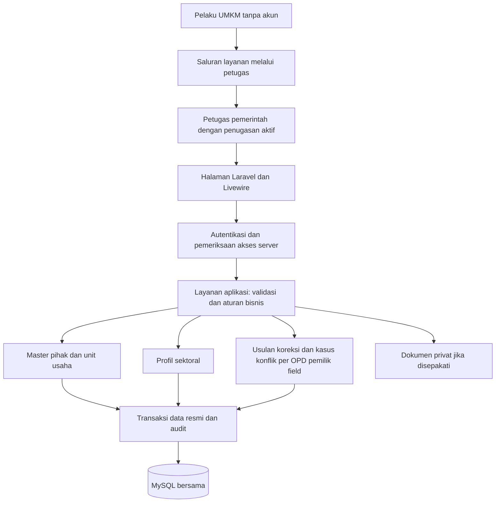
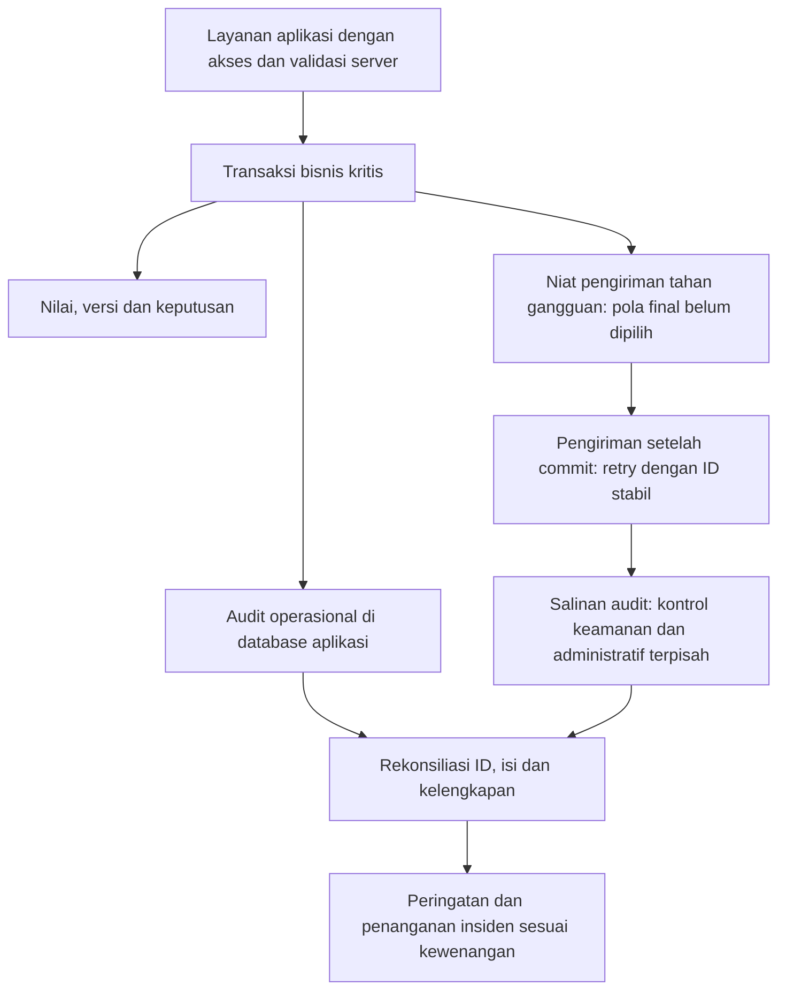
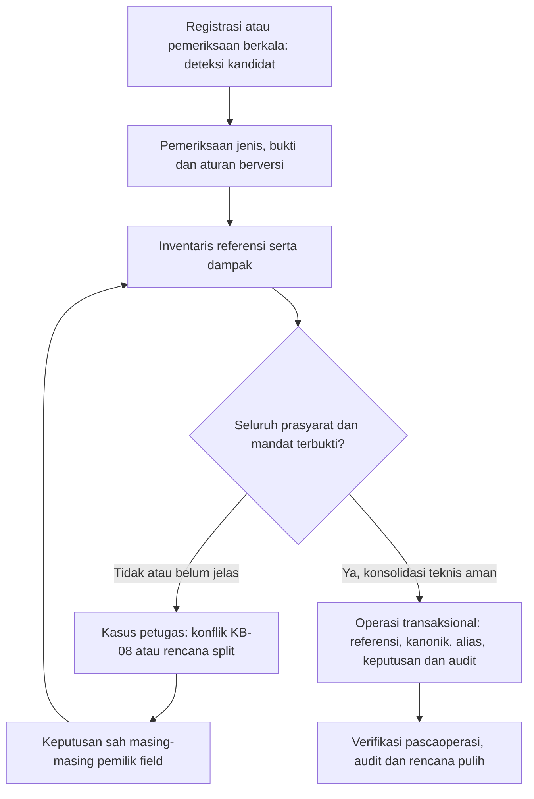
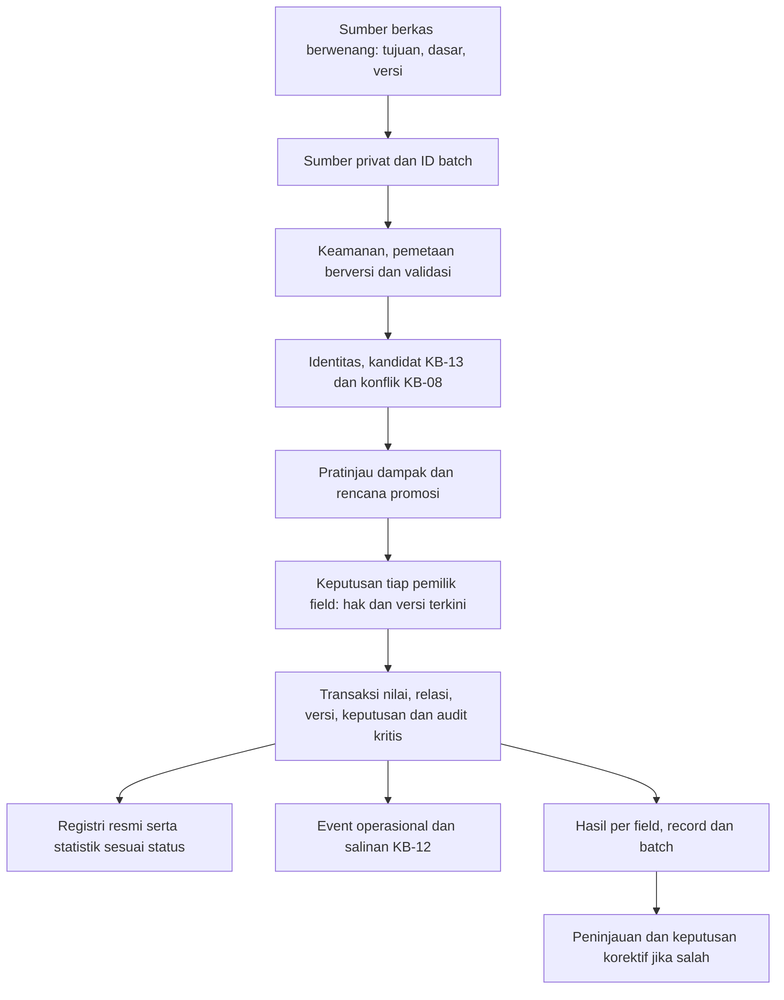

# Rancangan arsitektur awal

**Status terkini G1-B3.3 — 7 November 2026:** pemilik menerima baseline lokal sampai B3.2 dengan catatan MySQL/HTTP/browser belum diverifikasi independen dan menyetujui pengesahan awal C2 lokal sintetis. Baca [kontrak 36](36-kontrak-pengesahan-awal-c2-g1b33.md), [matriks 37](37-matriks-kewenangan-c2-g1b33.md), [panduan 38](38-panduan-pengesahan-awal-g1b33.md), [hasil 39](39-laporan-hasil-g1b33.md) dan [manifest 40](40-manifest-perubahan-g1b33.md). C2 hanya paket minimum induk, oleh pengesah bermandat berbeda dari pembuat; field/sektor tidak ikut sah. Satu migrasi maju menambah tiga tabel C2; tidak ada paket baru atau rewrite. Hentikan pada B3.3. Field operasional, K1–K4 penuh, pangan lengkap, E1, impor/integrasi, salinan audit eksternal, data nyata, G5/G7 dan deployment tetap tertutup. Model KB/DT dan konflik E1/KB-11 tetap. Pernyataan izin lama di bawah merupakan riwayat fase terkait.

**Riwayat izin G1-B3.2 — 7 November 2026:** pemilik menerima baseline lokal G1-A/B1/B2/B3.1 dengan catatan tes MySQL dan HTTP B3.1 belum diverifikasi ulang independen, lalu menyetujui antarmuka A3/pengajuan sintetis terbatas. Registri, formulir berulang, tinjau, pengajuan/pengembalian/revisi/pengajuan ulang memakai sesi server dan domain B2. Baca [kontrak 32](32-kontrak-antarmuka-registrasi-g1b32.md), [panduan 33](33-panduan-alur-registrasi-g1b32.md), [hasil 34](34-laporan-hasil-g1b32.md) dan [manifest 35](35-manifest-perubahan-g1b32.md). Tidak ada migrasi/paket baru. C2/field operasional, K1–K4 penuh, E1, data nyata, G5/G7, salinan audit eksternal dan deployment tetap tertutup. Hentikan pada B3.2. Model KB/DT tetap; konflik E1/KB-11 terbuka. Pernyataan izin/perencanaan terdahulu di bawah dibaca sebagai riwayat fase terkait, bukan batas izin terbaru atau izin lanjutan.

**Riwayat izin G1-B3.1 — 6 November 2026:** pemilik menerima baseline lokal G1-B2 dengan catatan tes MySQL belum diverifikasi independen, lalu menyetujui autentikasi/otorisasi/penguatan audit lokal sintetis. Login dan profil baca-saja terikat sesi server; mutasi bisnis/C2/field operasional/K1–K4/ekspor tetap ditutup. Baca [kontrak 27](27-kontrak-autentikasi-audit-lokal-g1b31.md), [rancangan audit 28](28-rancangan-salinan-audit-independen.md), [panduan 29](29-operasi-autentikasi-lokal-g1b31.md), [hasil 30](30-laporan-hasil-g1b31.md) dan [manifest 31](31-manifest-perubahan-g1b31.md). G1-B3.2/G5/G7/data nyata/produksi belum diizinkan. Model KB/DT tetap; E1/KB-11 terbuka. Status izin/autentikasi lama di bawah adalah riwayat, bukan mandat fase selanjutnya.

**Pelaksanaan terbatas G1-A — 6 November 2026:** [fondasi lokal selesai](17-laporan-hasil-g1a.md), Laravel/Livewire/Tailwind tersedia tanpa DB. Tujuh folder modul hanya batas konseptual, belum implementasi domain. Konfigurasi koneksi diblokir; log teknis bukan audit bisnis KB-12. Pernyataan perencanaan/belum coding di bawah adalah riwayat sebelum izin terbaru. G1-B/produksi belum diizinkan, model KB/DT tetap.

Status: **rancangan arsitektur, mempertahankan KB-01–KB-08 dan diselaraskan dengan KB-09 Model B**, 5 November 2026. MVP ditetapkan sebagai Registri Induk UMKM + satu sektor percontohan **Industri Pengolahan Pangan**. Pembagian teknis, penetapan OPD/petugas, wilayah pilot, SOP dan standar bukti yang belum disetujui tetap terbuka/usulan; tidak ada izin implementasi.

Tambahan KB-10: **Model B disepakati — rincian kewenangan kelembagaan masih terbuka**. Penilaian skala menghitung usulan, kemudian satu petugas berwenang memverifikasi/mengesahkan. KB-01–KB-09 dan sektor MVP tetap; KBLI kegiatan, skala dan status keputusan dipisah. Tidak ada kode atau skema database dibuat.

KB-12 **Model B disepakati pada tingkat model bisnis/prinsip arsitektur**: audit operasional dalam database aplikasi dan salinan dengan kontrol terpisah. Teknologi/lokasi/jadwal/pengelola belum final; KB-01–KB-11 dipertahankan, rincian KB-17 dan angka dan bukti kapasitas KB-18 belum final.

KB-13 Model C rekonsiliasi otomatis kini disepakati dengan sepuluh prasyarat bersama dan mandat sah. Deteksi/pencegahan prioritas MVP; merge historis produksi belum aktif. Model KB-01–KB-12 tetap, rincian algoritme/bukti/OPD/SOP belum final.

KB-14 Model B audit kesiapan sebelum konfigurasi/deployment disepakati; **hosting BELUM DAPAT DINILAI**, seluruh kondisi aktual belum diketahui. Laravel/Livewire/MySQL baseline kandidat target; penetapan teknis final menunggu bukti, bukan ditentukan dari label cPanel.

KB-15 Model B impor bertahap terverifikasi kini didokumentasikan: staging privat sebelum usulan/pengesahan, tanpa nilai resmi langsung. Impor manual masih rancangan bersyarat, bukan perluasan otomatis KB-09; integrasi OSS/Dukcapil/OPD tidak aktif. Hosting KB-14 tetap BELUM DAPAT DINILAI.

KB-16 **Model B — Registri Program dan Riwayat Layanan Pembinaan UMKM disepakati sebagai dokumentasi fase lanjutan setelah MVP KB-09**, 5 November 2026. Registri/pangan tetap MVP pertama; program belum boleh dibangun. KB-01–KB-15 dipertahankan; rincian KB-17 dan KB-18, rincian organisasi/SOP dan izin masih terbuka. Hosting KB-14 tetap BELUM DAPAT DINILAI.

KB-17 **Model B — Operasional Terkelola Berbasis Risiko disepakati sebagai kebijakan dan spesifikasi dokumentasi**, 5 November 2026. Frekuensi/retensi backup, angka RPO/RTO, lokasi/teknologi/kunci, SLA dan pengelola belum final; tidak ada izin operasi server. KB-01–KB-16 dipertahankan, angka dan bukti kapasitas KB-18 belum final dan hosting KB-14 BELUM DAPAT DINILAI.

KB-18 **Model C — Perencanaan Kapasitas Skala Kabupaten Sejak Awal disepakati sebagai dokumentasi**, 5 November 2026. Arsitektur mencakup Kabupaten Sinjai dengan satu SSOT; MVP KB-09 tetap registri/pangan. Infrastruktur awal mengikuti kebutuhan terverifikasi, angka contoh hanya asumsi/proyeksi. Hosting dan kapasitas final **BELUM DAPAT DINILAI**; rincian/izin belum final.

## Pintu masuk baseline konsolidasi

[Baseline KB-01–KB-18](10-baseline-konsolidasi-kb01-kb18.md) menjadi pintu masuk terkini untuk scope MVP, KA-01–KA-09, DT-001–036, epic dan G0–G7. Dokumen ini tetap sumber rancangan teknis; seluruh status usulan/rincian/fasilitas tidak berubah menjadi final. G0 siap ditinjau, G1 coding belum lulus; hosting/kapasitas BELUM DAPAT DINILAI.

Rancangan identitas boleh disiapkan secara bertahap pada pekerjaan lokal sintetis yang kelak diizinkan, tetapi akses dan audit/privasi mendasari seluruh jalur bisnis sejak awal. EPIC-03/07 bukan fitur yang ditunda sampai sesudah modul master terbuka. Salinan audit yang disimulasikan lokal bukan bukti kendali independen produksi.

Status registrasi awal/field/profil sektoral terpisah; verifikator induk bukan superuser. **DT-007 Model C — Verifikasi Bertingkat Berbasis Cakupan DISEPAKATI**: agregasi per objek/lingkup/tahap adalah evaluasi dari katalog sah berversi, bukan pengesahan baru. DT-003 B A3+B1+C2 kini dipilih; rincian katalog operasional/bukti/transisi/pemilik tetap terbuka DT-003/005/009/033. Mesin skala KB-10 dan impor manual staging bukan otomatis seluruhnya fitur wajib MVP: rincian aktivasi DT-031/032; program/merge historis berisiko tidak masuk scope MVP. Tidak ada izin membangun dari arsitektur ini.

## Tujuan dan batas cakupan

SIJAI UMKM menyediakan satu sumber data resmi pemerintah daerah untuk melayani pelaku UMKM. OPD berbagi identitas unit usaha, tetapi kewenangan atas data tetap dibatasi menurut tugas masing-masing. Sesuai KB-06 Model A, petugas pemerintah yang ditunjuk menggunakan aplikasi; pelaku menyampaikan permintaan melalui petugas tanpa akun login. Satu aplikasi bersama tidak berarti semua petugas boleh membaca atau mengubah semua data.

MVP yang disepakati mencakup akun petugas internal, penugasan/kewenangan field, registri pihak/orang/badan/unit, hubungan pihak-usaha, kegiatan, lokasi/cabang, Profil Umum minimum/status NIB, Profil Industri Pengolahan Pangan, pengesahan, koreksi/konflik, audit dan laporan dasar. Cabang yang memenuhi KB-01 serta penambahan produk/merek tidak otomatis membuat unit baru. Program bantuan/pelatihan, marketplace/penjualan, stok bahan baku, akuntansi, integrasi OSS/Dukcapil, impor massal, aplikasi mobile terpisah dan analitik lanjutan di luar MVP; fitur lain yang belum disepakati tidak ditambahkan.

## Pilihan teknologi

| Pilihan pengguna | Fungsi | Ketentuan |
| --- | --- | --- |
| Laravel 13 | Kerangka aplikasi dan aturan pada server | Dipakai jika lingkungan memenuhi syarat; jangan menurunkan versi diam-diam |
| Livewire 4 | Interaksi formulir dan halaman melalui Laravel | Kompatibilitas versi paket tepat dibuktikan setelah izin instalasi |
| MySQL | Penyimpanan relasional bersama | Usulan MySQL 8.4 LTS; versi akhir mengikuti kelayakan dan keputusan hosting |
| Tailwind CSS | Gaya tampilan yang konsisten | Versi tepat belum dikunci; aset dibuat menggunakan Vite pada lingkungan build |
| Modular monolith | Pembagian tanggung jawab dalam satu aplikasi | Satu repository, satu penerapan aplikasi, satu database utama secara logis |

Pemeriksaan persyaratan terkini dan rujukan resmi dirangkum pada [checklist hosting](07-checklist-hosting-cpanel.md). Tidak diperlukan pembelian layanan atau pemasangan paket untuk menyusun rancangan ini.

## Alur sistem yang diusulkan

Halaman, layanan aplikasi, modul, dan database berada dalam satu aplikasi. Diagram menunjukkan batas tanggung jawab, bukan layanan mikro atau server terpisah. Semua jalur penulisan memakai pemeriksaan yang sama; tidak boleh ada jalur khusus dari komponen antarmuka langsung ke pembaruan resmi tanpa aturan kewenangan.

## Batas modul yang diusulkan

| Modul | Tanggung jawab | Batas yang dijaga |
| --- | --- | --- |
| Identitas dan Akses | Akun individual petugas, keanggotaan OPD, peran, izin, cakupan unit/wilayah dan masa penugasan | Tidak ada akun pelaku; hubungan pemilik bisnis tidak otomatis menjadi kewenangan petugas |
| Referensi | OPD, wilayah, sektor, jenis peran, klasifikasi kegiatan dan versinya | OPD bukan pihak badan usaha pelaku UMKM |
| Penilaian skala UMKM, rancangan KB-10 | Input ekonomi berperiode/bercakupan, aturan berversi, usulan dan keputusan pengesahan | Satu aplikasi/SSOT; bukan penetapan legalitas/bantuan. Mesin tidak mengesahkan; OPD/petugas resmi dan SOP belum final |
| Master UMKM | Pihak, orang, badan usaha, unit berbasis kesatuan operasional, keterkaitan lokasi/cabang, hubungan pihak-unit, kegiatan dan identitas eksternal | Satu master bersama; cabang yang memenuhi KB-01 tetap bagian induk, bukan profil induk baru otomatis |
| Profil Umum | Tampilan gabungan data master pada satu unit | Merupakan tampilan logis; bukan salinan baru nama, pemilik, atau alamat master |
| Profil Sektoral | Industri Pengolahan Pangan: pengait kegiatan, produk, bahan baku/peralatan dan pengukuran produksi per periode | Merujuk ID unit yang sama; merek/produk bukan unit baru; tidak menumpuk record berulang dalam satu kolom |
| Tata Kelola Data | Katalog field, penanggung jawab, verifikasi terdistribusi per OPD, koordinasi pengelola utama, usulan koreksi, kasus/subkasus, bukti dan keputusan | Koordinator tidak mengambil alih pengesahan nilai; konflik nilai oleh pemilik field, sengketa kewenangan melalui mekanisme organisasi yang sah |
| Riwayat dan Audit | Riwayat nilai resmi, event operasional dan pengiriman/rekonsiliasi salinan terlindungi KB-12 | Event kritis atomik dengan bisnis, salinan berkontrol terpisah; tidak memberi hak edit nilai atau hapus audit biasa |
| Laporan Dasar | Pencarian/daftar dan rekap pihak, unit, lokasi/kegiatan, NIB/verifikasi, profil industri, produk dan produksi | Membaca SSOT sesuai akses; jumlah usaha tidak berganda, draf tidak dihitung terverifikasi, satuan produksi berbeda tidak dijumlah tanpa konversi baku |

Referensi bukti terlindungi merupakan kebutuhan rancangan konflik sesuai KB-08; bentuk dokumen, kebutuhan unggah dan standar bukti masih harus ditetapkan. Modul program pengembangan dapat dirancang kemudian setelah kebutuhan bisnisnya disepakati.

## Rincian sektor percontohan KB-09

Profil Industri Pengolahan Pangan membaca identitas unit dari master dan mengaitkan kegiatan yang sudah tercatat. Usulan pengait profil-kegiatan memungkinkan beberapa kegiatan pada satu unit tanpa menduplikasi profil induk. Produk, bahan baku, peralatan dan pengukuran disimpan sebagai record terkait; kamus memisahkan field wajib, kondisional, opsional dan berkala.

Produksi berupa pengukuran produk dengan nilai numerik, satuan, periode, sumber dan status verifikasi; tanggal pengukuran, versi dan riwayat turut dicatat. Januari dan Februari menjadi catatan terpisah. Kapasitas dan realisasi tidak dicampur, dan satuan berbeda tidak dijumlah otomatis tanpa konversi baku. Pengukuran baru atau koreksi tidak menghapus riwayat lama. Draf profil dan status verifikasi pengukuran tidak saling mengesahkan secara otomatis.

Usulan fungsi pengampu UMKM, perindustrian dan perizinan diterjemahkan ke katalog field yang dapat dikonfigurasi setelah penetapan sah. Nama OPD resmi bukan bagian tetap logika aplikasi. Rincian ada pada [kamus data](kamus-data-mvp-kb09.md) dan [matriks kewenangan](matriks-kewenangan-mvp-kb09.md); keduanya dokumen rancangan, bukan database atau kode.

## Tambahan rancangan KB-10 — penilaian dan referensi kegiatan

Layanan penilaian membaca input ekonomi, tujuan, periode/cakupan dan versi aturan yang sah, lalu menghasilkan usulan. Usulan tidak langsung mengisi kategori disahkan. Satu petugas dengan hak aktif memeriksa dan memutus; keputusan, versi dan audit harus konsisten. Penolakan/perlu koreksi tidak menghapus hasil lama. Rancangan ini memakai layanan aplikasi dalam modular monolith, tanpa aplikasi, database atau layanan eksternal baru.

Modal dan penjualan tahunan memiliki tujuan/semantik waktu berbeda serta hasil terpisah. Modal mengecualikan tanah/bangunan tempat usaha; penjualan parsial tidak dianualisasi otomatis; kosong tidak dianggap nol; hasil belum layak tidak dipaksa Mikro. Nilai di luar batas tidak dipaksa Menengah. Ambang dan sumber hanya dirujuk dari bagian KB-10 pada [dokumen keputusan](06-keputusan-bisnis.md), agar perubahan aturan tidak menghasilkan angka tandingan di beberapa modul.

Unit adalah jangkar operasional penilaian internal, sementara cakupan hukum pelaku/multiunit/cabang harus diperiksa sebelum pengesahan administratif. Relasi pemilik dan cabang tidak menjadi rumus agregasi/pemisahan legal otomatis. Produksi fisik pangan tidak otomatis menjadi rupiah penjualan tahunan. Input ekonomi dan versi/cakupannya tetap dapat ditelusuri.

Katalog kegiatan yang sama diperluas untuk kode/versi KBLI 2025 dan riwayat 2020. Relasi kegiatan–KBLI dan penetapan peran utama/tambahan berperiode menjaga beberapa kegiatan pada satu unit, termasuk pengolahan dan perdagangan. Kegiatan utama aktif tidak ganda tanpa kebijakan sah; pemetaan pecah/gabung adalah kandidat yang diperiksa, bukan penggantian kode OSS atau pembuatan unit baru.

Rancangan field/relasi serta hak pengesah ada pada [kamus konseptual](kamus-data-mvp-kb09.md) dan [matriks kewenangan](matriks-kewenangan-mvp-kb09.md). Nama berkas lama dipertahankan. Kewenangan klasifikasi, SOP modal/penjualan, cakupan hukum dan tahun buku nonkalender tetap terbuka; bukan keputusan teknologi atau organisasi yang ditebak.

## Susunan repository kelak

Usulan folder Laravel tetap memakai susunan standar, dengan kelompok domain di `app/Modules/`. Setiap kelompok dapat mempunyai model, layanan tindakan, aturan akses, dan komponen Livewire sesuai kebutuhan. Aset tampilan tetap dikelola melalui `resources/`, migrasi melalui `database/migrations/`, dan pemeriksaan melalui `tests/` agar alat Laravel tetap mudah digunakan. Nama dan pemetaan namespace dibuktikan saat implementasi; tidak membutuhkan paket modularitas khusus.

Modul lain membaca data melalui layanan atau kontrak yang jelas. Perubahan data master dilakukan oleh layanan Master UMKM. Modul Tata Kelola memeriksa izin dan memanggil layanan tersebut dalam satu transaksi dengan audit. Hindari dua modul yang sama-sama bebas memperbarui kolom yang sama.

Susunan folder aplikasi tersebut hanya rancangan. Berkas kerja yang dibuat/diubah pada tahap ini berupa dokumentasi di `docs/` dan panduan `AGENTS.md`, tanpa kerangka aplikasi.

## Makna SSOT

Pusat identitas adalah **unit usaha**, dengan ID internal stabil yang tidak bergantung pada nama atau nomor dokumen eksternal. Profil induk merupakan gabungan data terkait unit, bukan satu tabel raksasa. Data orang dan badan usaha tetap memiliki identitasnya sendiri dan dapat dipakai beberapa unit.

KB-01 Model C menetapkan unit berdasarkan **kesatuan operasional**. Cabang tetap bagian usaha induk jika pemilik sama dan cabang teridentifikasi sebagai bagian induk. Lokasi/cabang dapat dibedakan dalam data operasional tanpa otomatis menjadi profil induk baru. Kesamaan pemilik saja tidak menggabungkan usaha yang berbeda. Cara membuktikan keterkaitan, menilai pemilik bersama/pergantian pemilik, dan menyimpan lokasi masih perlu dirinci; tidak ditetapkan dengan dugaan teknis.

KB-03 Model B menetapkan **registrasi bertahap**. Usaha tanpa NIB tetap dapat didata pada tahap awal dengan ID internal; NIK/NIB tetap identitas eksternal terpisah. Minimum konseptual registrasi kini mengikuti DT-003 B A3+B1+C2. Rincian katalog/bukti/standar pemeriksaan belum ditetapkan; NIB tidak wajib pada draf, pengajuan maupun pengesahan induk. Status pendataan, verifikasi dan legalitas harus dibedakan agar pendataan awal tidak dianggap penerbitan atau pengesahan dokumen resmi.

Profil Umum membaca fakta resmi dari master. Profil Sektoral menyimpan atribut sektor saja dan merujuk ID unit yang sama. Jika nama unit berubah, seluruh profil membaca nama resmi terbaru melalui hubungan itu. Profil sektoral tidak menyimpan kolom nama resmi tandingan.

Satu orang yang mengelola dua unit tetap satu orang dengan dua hubungan. Perubahan atribut orang memengaruhi seluruh profil yang merujuknya; karena itu target koreksi harus jelas apakah orang, badan usaha, unit, kegiatan, atau hubungan. Lihat [model data](03-entitas-dan-relasi.md).

Usulan, draf, dan sumber pendukung disimpan terpisah dari nilai resmi. Profil menampilkan status data secara jelas. Sesuai KB-05/KB-07, profil awal dibuat petugas registrasi dan disahkan satu verifikator berbeda; draf bukan profil terverifikasi. Penunjukan dan bukti minimum masih harus ditetapkan.

## Kewenangan dan konsistensi

- KB-02 Model B menetapkan verifikasi terdistribusi: OPD memverifikasi data dalam kewenangannya, sedangkan pengelola utama mengoordinasikan proses, tindak lanjut dan mutu. Tidak ada persetujuan tambahan koordinator yang otomatis diwajibkan untuk setiap perubahan field.
- Satu katalog mencatat pemilik setiap field bisnis resmi, termasuk atribut profil sektoral dan hubungan. Masa penugasan tidak boleh tumpang tindih.
- Penulis resmi harus memiliki izin aksi, berada dalam cakupan objek yang diizinkan, dan bertindak untuk OPD penanggung jawab yang masih aktif. Izin membaca diperiksa tersendiri.
- Permintaan dari browser tidak dipercaya untuk menetapkan OPD, peran, field yang boleh ditulis, maupun hubungan kuasa. Semua diperoleh ulang dan diperiksa di server.
- Livewire memanggil layanan aplikasi yang memeriksa akses pada setiap aksi. Ketentuan ini selaras dengan [panduan keamanan Livewire](https://livewire.laravel.com/docs/4.x/security).
- Penyimpanan resmi, riwayat perubahan, dan keputusan yang menerapkannya dilakukan dalam satu transaksi. Bila riwayat gagal disimpan, perubahan resmi ikut dibatalkan.
- Nomor versi objek dipakai untuk mendeteksi perubahan serentak. Usulan berbasis versi usang perlu pemeriksaan ulang agar tidak menimpa perubahan sah terbaru; konflik versi tidak otomatis sengketa substansi K4 DT-009.
- Pencabutan hak pengguna atau perpindahan penanggung jawab berlaku saat aksi dijalankan, termasuk persetujuan usulan lama.
- Sesuai KB-07 Model C, satu petugas berwenang cukup untuk pengesahan field yang memenuhi prasyarat. Profil baru tetap mengikuti pemisahan pembuat/pengesah. Konflik terbuka tidak diselesaikan melalui perubahan biasa.
- Sesuai KB-08 Model A, satu kasus konflik lintas field mempunyai subkasus per OPD pemilik. Pengelola utama memantau sesuai akses tanpa hak pengesahan nilai otomatis. Sengketa tentang pemilik field mengikuti mekanisme kelembagaan, bukan koreksi nilai.
- Pengesahan salah diperbaiki dengan keputusan dan versi baru yang merujuk keputusan sebelumnya. Dugaan identitas sama tidak memicu penggabungan otomatis; sengketa kepemilikan tanpa dasar penyelesaian ditangguhkan. Status kasus, nilai, versi dan audit harus konsisten.

Detail alur dan matriks hak ada pada [tata kelola data](04-tata-kelola-data.md); ringkasan model KB-01–KB-08 serta aturan dan penerimaan KB-08 pada [dokumen keputusan](06-keputusan-bisnis.md). Penetapan OPD/peran konkret, SOP dan bukti minimum masih terbuka. [Laporan audit](08-audit-konsistensi-dokumentasi.md) membedakan model yang disepakati dari keputusan turunannya.

## Perlindungan data lintas modul — KB-11 Model B

Keputusan KB-11 menambah lapisan kebijakan bersama dalam aplikasi yang sama, tanpa master atau aplikasi per OPD. Empat label akses internal dan contoh pemetaan ada pada [kamus](kamus-data-mvp-kb09.md). Label tersebut bukan kategori hukum UU PDP. OPD pemilik field tetap pemutus nilai sesuai KB-08, tetapi tidak otomatis Pengendali secara hukum atau pembaca seluruh data pihak.

Layanan aplikasi kelak memeriksa peran, OPD, wilayah, field/objek, tindakan, tujuan/dasar dan penugasan aktif. Baca, ubah, usul, sahkan, unduh, ekspor dan administrasi akses terpisah; kondisi tanpa izin ditolak. Pemeriksaan berlaku juga untuk pencarian, API bila kelak disepakati, dokumen privat, audit, hasil turunan dan pekerjaan tertunda. Kewenangan diperiksa kembali ketika ekspor dijalankan dan file diambil. Hak admin teknis/pengelola utama bukan hak sensitif menyeluruh.

Permohonan hak subjek menjadi jenis layanan pada permohonan yang sudah ada, dengan riwayat keputusan dan tenggat hukum. Pelaku tetap tanpa akun; satu permohonan pemilik tidak membuka data pribadi pemilik lain. Verifikasi pemohon tidak otomatis menunda tenggat. Koreksi nilai tetap memakai layanan KB-07/KB-08, bukan jalur penulisan baru.

Fungsi persetujuan ekspor, catatan akses sensitif, insiden serta kebijakan/tindakan retensi mengikuti model konseptual pada [entitas](03-entitas-dan-relasi.md). Gunakan audit/penugasan/riwayat yang sama bila fungsinya sesuai. Tidak berarti membuat tabel atau API sekarang. Ekspor/publikasi perlu tujuan dan cakupan sah; agregat berisiko identifikasi ulang ditahan untuk pemeriksaan.

Gerbang sebelum data nyata: peran hukum/organisasi, tujuan/dasar, akses final, JRA, penilaian risiko dan DPIA yang diperlukan, serta izin eksplisit. Pengesah manusia pada klasifikasi KB-10 tidak menghilangkan risiko penggabungan/pemrofilan. Retensi/pemusnahan tidak memakai angka tebakan atau audit pribadi abadi. Standar kriptografi, kunci, backup dan integritas teknis KB-12 tetap terbuka; kebijakan aplikasi tidak menjamin pengelola database tidak bisa mengakses data langsung.

## Privasi, audit, dan operasi

Usulan teknis: data sensitif tidak tampil di daftar umum; lampiran privat diakses melalui pemeriksaan server; data uji sepenuhnya sintetis. Akun aplikasi database memakai hak secukupnya. Rahasia disimpan pada pengaturan lingkungan di luar repository dan tidak disalin ke laporan.

Riwayat dibedakan menjadi riwayat nilai resmi dan log kejadian keamanan/operasi. Pembacaan audit dibatasi dan ikut dicatat jika diperlukan. Data sebelum/sesudah yang sensitif perlu penyamaran atau enkripsi sesuai kebijakan, tanpa menghilangkan kebutuhan penelusuran oleh petugas berwenang.

Audit aplikasi dirancang hanya dapat ditambah oleh proses bisnis biasa; penyusutan arsip yang sah merupakan proses terpisah, berwenang dan tercatat. Ini belum mencegah pengelola database mengubah data langsung; model salinan dengan kontrol terpisah sudah disepakati melalui KB-12, sedangkan lokasi/media/teknologi/pengelolanya belum final dan tidak otomatis harus berupa server tertentu. Retensi, pemusnahan, dan akses data ditetapkan pemilik kebijakan; dokumen ini tidak mengklaim kepatuhan hukum tertentu.

Lingkungan pengembangan, staging, dan produksi dipisah. Usulan awal mengutamakan permintaan web biasa; worker terus-menerus, Redis, WebSocket, dan layanan pencarian khusus tidak menjadi kebutuhan awal otomatis. Jika pekerjaan berat kelak disepakati, pilihan antrean mengikuti kemampuan hosting dan batas durasi, bukan dijalankan paksa di permintaan web.

Simpan waktu kejadian secara konsisten, usulan UTC, lalu tampilkan menurut zona waktu pemerintah daerah yang akan ditetapkan. Zona waktu komputer tidak otomatis menentukan zona waktu layanan.

## Risiko desain dan penanganan awal

| Risiko | Penanganan yang diusulkan |
| --- | --- |
| Duplikasi unit antar-OPD | Deteksi/pencegahan KB-13; konsolidasi otomatis hanya terbukti aman/bermandat, ambigu/substantif oleh petugas, satu kanonik dengan asal/alias terlacak |
| Kebingungan orang, badan usaha, dan unit | Definisi bisnis, contoh data sintetis, relasi banyak-ke-banyak |
| Nilai berbeda pada Profil Umum dan Sektoral | Master bersama dan referensi ID; tanpa salinan nilai resmi |
| OPD saling menimpa data | Penanggung jawab per field, alur koreksi, pemeriksaan server |
| Dua persetujuan bersamaan | Versi data, penguncian saat transaksi, penerapan sekali |
| Kebocoran data melalui unduhan atau log | Pemeriksaan objek dan field, penyimpanan privat, minimisasi log |
| Shared hosting membatasi aplikasi | Bukti checklist dan uji staging; jangan menganggap label cPanel cukup |

## Hal yang menunggu persetujuan

KB-01–KB-10 dipertahankan; KB-11 Model B disepakati pada tingkat dokumentasi. Yang tetap terbuka: OPD/petugas/koordinator resmi, wilayah pilot, bukti cabang/pemilik bersama, SOP ekonomi/cakupan hukum/standar periode, dasar pemrosesan tiap layanan, Pengendali/Prosesor/fungsi PDP, kelas field final, JRA, risiko/DPIA, rincian operasi KB-12/rekonsiliasi KB-13, rincian KB-17 dan KB-18, versi PHP/MySQL PDN serta izin implementasi/data nyata/produksi. Catatan lengkap pada [dokumen keputusan](06-keputusan-bisnis.md).

## Arsitektur audit dua lapisan — KB-12

Lapisan operasional memakai audit_events yang sudah dirancang dalam database aplikasi. Riwayat nilai pada field_changes/change_sets tetap menjadi sumber versi; event cukup menautkan referensinya dan konteks aksi, bukan menduplikasi dokumen/nilai pribadi ke log. Kamus dan [keputusan](06-keputusan-bisnis.md) mendokumentasikan 21 atribut, 15 keluarga event, 30 RB-12 serta 28 rencana T12.

Diagram menunjukkan batas tanggung jawab dan hubungan konsistensi, bukan pilihan server/media/antrean. Niat pengiriman harus konsisten dengan event yang commit agar tidak ada celah kehilangan ketika proses berhenti sesudah commit. Transactional outbox adalah kandidat catatan kirim dalam transaksi yang sama, belum keputusan implementasi. Worker/cron, lokasi salinan dan protokol tidak dipilih sekarang.

Jika audit operasional kritis gagal, transaksi bisnis batal dan tidak dilaporkan berhasil. Jika salinan gagal dikirim, event tetap sah di lapisan operasional, berstatus pengiriman tertunda dengan retry/eskalasi. Penerimaan menghindari duplikasi ID; ID sama dengan isi berbeda adalah temuan integritas. Rekonsiliasi memeriksa sumber, niat/riwayat pengiriman dan salinan, bukan hanya status “terkirim”.

Kontrol salinan dipisah terhadap hak aplikasi/database serta administrator/server/backup. Tabel kedua, folder berbeda atau lokasi lain dengan penguasaan kontrol sama belum membuktikan independensi. Pemisahan ini tidak mengubah modular monolith, menambah master UMKM, atau mewajibkan pengesah bisnis kedua. Salinan tidak boleh menjadi jalur mengubah nilai resmi.

Event stabil dipisah dari metadata pengiriman yang berubah. Event lanjutan merekam hasil pekerjaan, bukan menulis ulang event sebelumnya. Pemeriksaan mencakup isi dan daftar ID yang semestinya, acuan integritas yang terkontrol serta jejak penyusutan sah; append-only atau hash lokal saja tidak membuktikan tahan administrator. Keamanan juga mencakup transfer, pembacaan/ekspor audit, input berbahaya dan volume log. Pembacaan sensitif memerlukan audit wajib sebelum data diberikan; kegagalan audit tidak menjadi jalur pemberian tanpa jejak.

Retensi, penahanan dan pemulihan mencakup kedua lapisan/backup sesuai KB-11 dan JRA sah. Salinan audit bukan backup penuh master/lampiran dan tidak menjamin memulihkan event yang belum terkirim. Teknologi/media/kunci, jadwal/ambang, frekuensi integritas, RPO/RTO, hak administrator dan pengelola menunggu bukti KB-14, rincian KB-17 dan kapasitas KB-18 serta penetapan kelembagaan. Belum ada uji/konfigurasi server atau izin data nyata/produksi.

## Rekonsiliasi identitas lintas modul — KB-13

Rekonsiliasi berada pada layanan aplikasi dalam modul master/tata kelola yang sama, bukan master baru atau layanan eksternal yang telah dipilih. Bedakan deteksi kandidat, pembuktian identik, pencegahan duplikat baru, penautan ulang teknis, merge historis, split dan arsip. Rekonsiliasi **identitas KB-13** berbeda dari rekonsiliasi **kelengkapan audit KB-12**; operasi identitas menghasilkan event yang kemudian diperiksa pada kedua lapisan audit.

Diagram adalah rancangan; tidak mengaktifkan operasi otomatis atau menyatakan aturan/mandat sudah tersedia. Kandidat/skor tinggi tidak melompat ke eksekusi. Sepuluh syarat kumulatif dan gerbang produksi ada pada [keputusan](06-keputusan-bisnis.md). Layanan memeriksa ulang jenis/bukti/konflik, seluruh referensi dan versi, aturan aktif serta lingkup mandat saat eksekusi; belum jelas berarti ditahan.

Pengesahan substantif tetap petugas KB-07/KB-08; proses otomatis hanya boleh konsolidasi yang tidak memilih nilai bisnis berbeda atau mengubah makna kepemilikan/kegiatan/lokasi/hukum. Pengesahan profil awal oleh verifikator berbeda dan registrasi tanpa NIB tetap berlaku. Kewenangan lintas field tidak diberikan otomatis kepada satu proses/admin/koordinator.

Peta ID asal–kanonik/alias menjadi penelusuran, bukan penggunaan ulang ID atau salinan seluruh master. Resolusi ID historis tetap memeriksa hak ke objek/field tujuan dan tidak boleh membocorkan identitas. Audit historis mempertahankan ID sasaran asli; event baru menautkan operasi/pemetaan. Nilai skala/KBLI berbeda, status verifikasi, pengukuran berperiode/satuan serta relasi banyak-ke-banyak tetap utuh sampai keputusan sah.

Operasi multi-entitas kritis termasuk peta, perubahan referensi, keputusan/versi dan audit harus commit/batal bersama. Versi/idempotensi dan pemeriksaan sebelum–sesudah mencegah merge parsial/ganda/siklus. Jika rencana besar tidak dapat dipenuhi aman dalam kemampuan hosting, tahan dan tinjau desain; jangan menerapkan bertahap tanpa jaminan konsistensi yang disahkan. Penanganan gagal kirim salinan tetap KB-12.

Rencana pulih sebelum eksekusi memperhitungkan perubahan sah setelah merge dan tidak mengganti dengan restore seluruh database secara buta. Split memerlukan bukti/keputusan serta pembagian referensi; arsip memerlukan dasar/retensi sah dan tidak dipicu usia/tidak aktif saja. Teknologi, jadwal/kapasitas, algoritme/ambang, bukti, OPD/mandat, SOP dan izin implementasi/data nyata/produksi belum final. Program/bantuan tetap kontrak masa depan, tanpa modul baru.

## Persyaratan nonfungsional dan rancangan penerapan — KB-14

Persyaratan nonfungsional adalah kebutuhan keamanan, keandalan, kapasitas dan operasi di luar isian/fitur bisnis. [Checklist](07-checklist-hosting-cpanel.md) menjadi satu formulir audit kesiapan, berisi 55 item/sepuluh kelompok/13 kolom. [KB-14](06-keputusan-bisnis.md) memuat 26 RB dan 24 rencana T, tanpa mengakses PDN.

| Bidang | Batas rancangan / bukti yang diperlukan |
| --- | --- |
| Runtime/dependensi | PHP web/CLI kompatibel secara terpisah, ekstensi/driver/paket tepat; Laravel 13 kandidat PHP minimal 8.3. Jenis/versi database aktual belum diketahui |
| Build/rilis | Metode Composer dan artefak frontend terpercaya dapat terpisah dari hosting. SSH akun boleh diganti cara pengelola/penerapan aman yang terbukti; tidak membuat endpoint administrasi publik |
| Batas web/storage | Root hanya public; kode/.env/dokumen/backup privat; unduh diperiksa server; storage/bootstrap/cache hak tulis minimum |
| Komunikasi/antarmuka | HTTPS produksi serta sertifikat, sesi/cache/CSRF/WAF/routing/aset Livewire dibuktikan. Halaman login bukan bukti alur aman/berfungsi |
| Proses otomatis | Scheduler, queue/background, replikasi/pemeriksaan audit, deteksi kandidat, backup/kesehatan dan retry/anti-ganda terpantau; teknologi/jadwal belum dipilih |
| Audit dua lapisan | Event kritis satu transaksi dengan bisnis; salinan berkontrol terpisah, transfer/retry/rekonsiliasi/integritas serta keterlambatan dibuktikan, bukan dua folder/tabel satu akun |
| Pemulihan | Backup database/dokumen/konfigurasi dengan akses/enkripsi/pemisahan aman; restore berizin diverifikasi. RPO/RTO KB-17 dan kapasitas KB-18 tetap terbuka |
| Operasi/kapasitas | Kuota storage/inode/CPU/RAM/proses/timeout/koneksi, pemantauan dan eskalasi memiliki bukti/pengelola sah. Tidak menetapkan angka tebakan |

Ini batas tanggung jawab konseptual, bukan pilihan sistem operasi/server, metode deploy, produk antrean, lokasi/kunci audit/backup atau konfigurasi cPanel. Build aset terpisah tidak mewajibkan Node runtime permanen; keandalan background tidak otomatis memerlukan Redis/Supervisor/daemon. Alternatif proses terbatas hanya boleh dipilih jika bukti durasi/keterlambatan/kuota sesuai kebutuhan.

Model audit KB-14 dipilih tetapi hasil hosting tetap **BELUM DAPAT DINILAI**. Data lokal/dokumentasi publik tidak membuktikan PDN. Tidak ada diagnosis bahwa cPanel pasti layak/tidak layak, atau spesifikasi/hak fitur yang diasumsikan.

Audit dapat mengumpulkan bukti fasilitas terlebih dahulu, lalu bukti aplikasi/restore di lingkungan berizin pada tugas mendatang setelah izin implementasi terkait. Bukti parsial tidak menjadi kelayakan final; konfigurasi target final dan produksi tetap melalui gerbang lengkap. Seluruh persetujuan implementasi/data nyata/server/deployment terpisah, tidak diberikan oleh arsitektur ini.

Bila syarat kritis tak dapat dipenuhi/dimitigasi sah, opsi permohonan infrastruktur yang sesuai disusun untuk keputusan terpisah; tidak mengganti teknologi, migrasi atau DNS otomatis. KB-01–KB-13 tetap, termasuk pangan, privasi, audit berkontrol terpisah dan merge historis berisiko yang belum aktif. Tidak ada pengujian/server/code/dependensi/konfigurasi diubah.

## Arsitektur alur impor dan integrasi — KB-15

Impor historis satu kali dan pembaruan berkala berkas dapat memakai staging/pemetaan yang sama dalam modular monolith. Staging adalah penampungan sementara dengan status/akses terpisah, bukan aplikasi/database per OPD atau server uji staging. Cara isolasi/penyimpanan final belum dipilih; tidak mengimplementasikan parser, tabel, antrean atau endpoint sekarang.

Diagram rancangan saja, tanpa berkas/dataset nyata. File OPD bukan sumber resmi mutlak dan pengunggah bukan pemilik semua field. Kolom tak dikenal/ambigu, format/satuan/periode/referensi/bukti kurang ditahan. Normalisasi tak mengubah makna dan jejak nilai/versi sumber tetap; format/batas ukuran/konversi belum dipilih.

Layanan aplikasi memanggil aturan akses, kandidat/kanonik KB-13, kasus/subkasus KB-08 dan keputusan/riwayat/audit yang sama. NIK/NIB bukan ID unit; cabang/relasi M:N tetap, produk/pangan terkait kegiatan/unit benar dan produksi/ekonomi berperiode/bersatuan/sumber/verifikasi. Nilai berbeda menunggu pemilik field; hitung skala tetap usulan KB-10.

Promosi per field/kelompok/record memeriksa versi staging/pemetaan/target/referensi, hak dan prasyarat profil baru. Satu pengesah field sah; verifikator profil awal tetap berbeda. Hasil sebagian tidak mengesahkan profil keseluruhan. Staging tidak dibaca sebagai statistik resmi atau menghitung satu baris sebagai satu usaha.

Perubahan terkait beserta audit operasional atomik dan memakai ID operasi stabil/penerapan sekali. Batch bukan otomatis transaksi tunggal seluruh OPD. Gagal kirim salinan sesudah commit mengikuti KB-12; gagal audit kritis membatalkan transaksi. Pembalikan hasil sah memakai keputusan korektif/dampak/versi baru, bukan restore buta atau hapus massal yang menimpa perubahan kemudian.

Sumber/staging/diagnostik privat, NIK tidak masuk error/audit mentah, unduh/ekspor berizin terpisah dan retensi/JRA sah. Sebelas fungsi konseptual pada [kamus](kamus-data-mvp-kb09.md) memakai ulang struktur setara; bukan perintah membuat tabel baru. KB-15 tidak memilih format berkas, produk antrean, algoritme atau ambang.

Impor manual hanya rancangan yang dapat dikembangkan sesudah tata kelola/izin tahap terkait; MVP registri/pangan tetap prioritas. API OSS/Dukcapil/OPD langsung dan sinkronisasi real-time fase berikutnya dengan otorisasi/kanal resmi, bukan fitur aktif atau izin akses. Program/bantuan hanya ketergantungan referensial masa depan.

Hosting KB-14 tetap BELUM DAPAT DINILAI. Kapasitas/retensi/operasi staging, ukuran batch, frekuensi, template/dataset/SOP, OPD/petugas, bukti/dasar/perjanjian serta mekanisme pembalikan menunggu keputusan sah/KB-17/KB-18. Tidak ada kode, impor nyata, akses eksternal atau deployment.

## Program dan riwayat layanan fase lanjutan — KB-16

Modul program kelak menjadi bagian modular monolith yang sama, dengan rujukan ke Registri Induk. Tidak membuat aplikasi, database atau master UMKM per OPD. Sepuluh fungsi konseptual dan field minimum tercantum pada [kamus](kamus-data-mvp-kb09.md), peran pada [matriks](matriks-kewenangan-mvp-kb09.md); struktur setara dipakai ulang.

Alur konseptual: PROGRAM → KEGIATAN/LAYANAN → PELAKSANAAN/SESI → PARTISIPASI/PENERIMAAN → REALISASI → TINDAK LANJUT. Setiap tingkat memiliki ID internal sendiri. Kegiatan program adalah layanan pemerintah, berbeda dari KEGIATAN_USAHA/KBLI. Lokasi sesi berbeda dari LOKASI_USAHA/cabang. Nama/tahun/kode sumber bukan identitas unik tunggal; kode/nomenklatur resmi hanya direferensikan dari sumber sah.

Peserta memakai pihak Orang master; penerima manfaat memakai unit master dan peran perwakilan yang relevan. Program dengan sasaran Orang/Badan/Unit berbeda memakai rujukan bertipe sesuai dasar program, tanpa membuat usaha fiktif. Satu program dapat mempunyai banyak OPD melalui peran/masa berlaku dan satu OPD penanggung jawab record. Ini tidak memperluas hak semua field, tidak menambah lapisan pengesahan wajib, dan tidak memberi akun pelaku.

Pendaftaran, kehadiran, realisasi, verifikasi catatan dan tindak lanjut mempunyai catatan/status masing-masing. Ringkasan partisipasi mempertahankan seluruh kosakata KB-16 tetapi tidak menyatukan data daftar dengan hadir. Program selesai tidak mengesahkan layanan turunannya. ID operasi/versi mencegah efek ganda; partisipasi sah lintas sesi/program tetap dapat diulang.

Laporan menghitung empat ukuran secara terpisah: UMKM unik, Orang unik, partisipasi dan kejadian layanan. Satu kejadian dengan banyak penerima dihitung satu kejadian, bukan hasil perkalian relasi. Filter periode/cakupan/status dan resolusi identitas dinyatakan; ID asli audit tidak ditulis ulang. Pengukuran produksi/ekonomi menggunakan referensi KB-09/KB-10/versi, bukan salinan nilai yang menjadi master tandingan. Output/hasil langsung/outcome dibedakan; perubahan sebelum/sesudah tidak membuktikan dampak kausal.

Layanan aplikasi yang kelak disetujui wajib menerapkan hak server per objek/field/cakupan, satu pemilik field KB-04, satu pengesah KB-07, konflik KB-08, privasi KB-11 dan transaksi audit kritis KB-12 pada semua jalur. Merge/split KB-13 menjaga relasi dan riwayat; pembatalan/arsip bukan penghapusan riwayat di luar JRA sah. Impor program historis mengikuti staging/verifikasi KB-15 pada fase lanjut, tanpa API atau impor program MVP.

MVP pertama tetap Registri Induk + Industri Pengolahan Pangan. Program bukan mesin pembayaran, penyaluran elektronik, pengadaan, akuntansi atau seleksi otomatis dan tidak mengganti sistem resmi pemerintah. Nominal historis hanya fakta layanan sah. OPD/kode/sasaran/indikator/SOP/bukti/retensi belum final; hosting tetap BELUM DAPAT DINILAI dan rincian KB-17 dan angka dan bukti kapasitas KB-18 belum final. Tidak memilih teknologi, kuota, jadwal atau izin implementasi melalui rancangan ini.

## Arsitektur operasional, backup dan pemulihan — KB-17

Model B kebijakan operasi berbasis risiko disepakati, bukan konfigurasi hosting/teknologi/jadwal/angka pemulihan final. Tetap satu aplikasi modular monolith dan satu master UMKM; komponen pengamanan/pemulihan tidak membentuk master per OPD. MVP KB-09 tidak diperluas dan program KB-16 tetap fase berikutnya.

Empat fungsi pengelolaan aplikasi/akun, infrastruktur PDN/database/storage/jaringan, pengamanan/backup/audit/pemulihan, serta pengawasan/insiden/perubahan mempunyai mandat dan antarmuka tanggung jawab yang perlu disahkan. Sepuluh peran/21 kegiatan ada pada [matriks](matriks-kewenangan-mvp-kb09.md). Hak server/backup tidak memberi hak pengesahan bisnis, begitu pula pemilik field tidak otomatis menguasai backup.

### Sepuluh kelompok kebutuhan backup

| Kelompok | Komponen/referensi yang dicakup | Kriteria konsistensi pemulihan |
| --- | --- | --- |
| Database Registri Induk | Identitas internal Pihak/Orang/Badan/Unit | ID tidak didaur ulang; master bersama tetap satu |
| Hubungan Orang, Badan Usaha dan Unit Usaha | Relasi M:N, peran/masa berlaku, kanonik/alias dan sumber | Tidak hilang pemilik bersama, tidak diganti satu owner_id |
| Lokasi, kegiatan, produk dan profil industri | Cabang sesuai KB-01, kegiatan ekonomi, profil/produk/bahan/peralatan/pengukuran | Referensi unit/kegiatan/produk dan periode/satuan tidak yatim/tertukar |
| Riwayat pengesahan dan koreksi | Keputusan/versi, bukti, konflik/kasus/subkasus dan peristiwa terkait | Draf tidak menjadi resmi; keputusan historis tidak dihapus |
| Klasifikasi, sumber, periode dan versi | Ekonomi/skala/KBLI/aturan/tujuan/cakupan KB-10 | Versi/rujukan lama tetap terlacak, tidak dihitung ulang sebagai fakta historis baru |
| Dokumen privat dan metadata | Isi dokumen yang diperlukan beserta referensi/versi/kelas akses/retensi | Cocok titik database, akses tetap privat; tidak hanya direktori tanpa metadata |
| Catatan audit operasional | Event/ID asli, pengiriman/rekonsiliasi dan keputusan pemulihan | Salinan terlindungi tetap KB-12 dengan kontrol terpisah, bukan pengganti backup sistem |
| Status penting antrean/pekerjaan | Status proses/niat kirim/ID operasi yang diperlukan untuk lanjut aman | Cegah replay/penerapan ganda; cara simpan/lanjut ditentukan desain rinci |
| Konfigurasi pemulihan aman | Versi/parameter yang diperlukan dan rujukan sarana rahasia berwenang | Tidak menaruh nilai kunci/.env/kredensial dalam dokumen atau repository |
| Artefak versi aplikasi/dependensi | Rilis/dependensi/manifest pemulihan yang cocok dan dapat diverifikasi | Kecocokan versi/data diperiksa, bukan izin memasang atau membuat artefak sekarang |

Himpunan backup mempunyai sumber, titik/rentang konsistensi, versi, manifest/daftar komponen, status per komponen dan hasil pemeriksaan yang dapat diverifikasi. Cara menjamin konsistensi database–dokumen–antrean masih perlu desain rinci sesuai fasilitas aktual; kesamaan waktu/nama file bukan bukti cukup. Backup database saja tidak memulihkan seluruh SIJAI. Rincian konseptual metadata ada pada [kamus](kamus-data-mvp-kb09.md), tanpa membuat tabel atau file backup.

### Batas backup, salinan audit dan koreksi

Backup memulihkan keadaan komponen; salinan audit KB-12 menjaga jejak/integritas/rekonsiliasi; koreksi bisnis memperbaiki nilai melalui keputusan/versi/pemilik field KB-07/KB-08. Audit bukan payload pemulihan penuh profil/lampiran, dan backup bukan alat menghapus audit yang wajib disimpan.

Salinan audit tetap kontrol keamanan/administratif terpisah dari aplikasi/database/administrator terkait. Pemisahan backup menurut risiko tidak menurunkan syarat independensi KB-12. Perlindungan harus mempertimbangkan satu kegagalan/kompromi akun/serangan menghilangkan semua salinan. Tidak menentukan vendor, produk, jumlah, media atau lokasi sebelum bukti KB-14/KB-18 serta penetapan sah.

Akses minimum/penugasan, enkripsi menurut klasifikasi/risiko, saluran aman, pengelolaan kunci terpisah, perlindungan modifikasi/penghapusan, audit penggunaan, verifikasi integritas dan retensi/JRA/penahanan sah berlaku. Kunci hilang atau sumber diduga terkompromi mencegah klaim sumber siap pulih; hash file tidak membuktikan bebas kompromi. Rahasia tidak ditulis ke dokumen/repository atau diminta sekarang.

### Kebutuhan nonfungsional dan bukti yang direncanakan

| Kebutuhan | Bukti/kondisi penerimaan kelak | Status sekarang |
| --- | --- | --- |
| Kelengkapan dan konsistensi | Database, dokumen/metadata, relasi, keputusan/versi, status proses dan artefak cocok titik pemulihan | BELUM DIUJI |
| Keamanan backup/kunci | Akses/pengganti/transfer/enkripsi/pemisahan kontrol sah dan teruji; kunci tidak bergantung satu akun pribadi | Rincian belum final |
| Keterlacakan | Backup/verifikasi/unduh/hak/restore/perubahan diaudit pada sarana operasi sah, kedua lapisan audit direkonsiliasi | Rancangan KB-12/KB-17 |
| Keterpulihan | 16 langkah/formulir uji terisolasi, data sintetis, relasi/versi/audit/fungsi/hak tervalidasi | BELUM DIUJI |
| Target kehilangan/durasi | Analisis dampak, persetujuan RPO/RTO per kelompok dan pengukuran aktual yang relevan | Target kosong/belum disahkan |
| Pemantauan | 13 area monitoring, dampak/pemilik/eskalasi/status/insiden/audit penutupan | Ambang/alat/kanal/SLA belum final |
| Pengendalian perubahan | Permintaan/dampak/persetujuan/pemulihan/verifikasi/audit, jalur darurat beralasan dan dievaluasi | SOP/mandat belum final |
| Kelayakan infrastruktur | Bukti hosting KB-14 dan kapasitas KB-18 yang relevan dengan operasi/isolasi/penyimpanan | Hosting BELUM DAPAT DINILAI |

Restore berizin kelak mempertahankan ID internal/kanonik/alias/ID audit asli, relasi M:N, cabang, kegiatan/lokasi/produk, produksi/ekonomi berperiode/satuan, klasifikasi/pengesahan/koreksi dan konflik. Inventaris selisih transaksi setelah titik backup diperlukan; audit yang lebih baru tidak ditimpa agar terlihat cocok. Hasil yang tidak bisa dipulihkan dilaporkan, bukan dianggap tidak pernah terjadi.

Sebelum melanjutkan aplikasi/background/impor, periksa hak terkini/pencabutan, data yang dibatasi/disusutkan sah serta status proses/idempotensi agar tidak mengaktifkan izin lama, menerapkan staging sebagai resmi atau menggandakan operasi. Cara teknis belum final. Data program/layanan hanya dinilai saat fase KB-16 yang diizinkan, tanpa fitur program pada MVP.

Rencana 16 langkah/formulir 14 isian, matriks delapan kelompok RPO/RTO tanpa angka dan monitoring/insiden berada pada [tata kelola](04-tata-kelola-data.md); 30 RB/30 T pada [keputusan](06-keputusan-bisnis.md). Tidak mengklaim job sukses berarti restore sukses atau halaman login berarti pulih penuh. Audit/relasi/dokumen kritis gagal adalah penghambat klaim pulih sepenuhnya.

Frekuensi/retensi/uji, target/prioritas, teknologi/lokasi/kunci, pengelola/SLA, zona waktu dan SOP belum final. Implementasi operasi menunggu bukti KB-14/KB-18, penetapan organisasi dan izin khusus. Tidak ada akses PDN/server/database/OPD/kredensial, backup/restore, konfigurasi/cron/DNS/jaringan atau deployment pada pekerjaan ini.

## Arsitektur kapasitas kabupaten dan pertumbuhan — KB-18

Model C disepakati: satu Registri Induk sebagai SSOT untuk cakupan arsitektur Kabupaten Sinjai, lintas OPD/sektor. Enam cakupan pada [model kapasitas](09-perencanaan-kapasitas.md) dipisahkan: arsitektur kabupaten, fitur MVP, infrastruktur awal, target pertumbuhan, kapasitas maksimum hasil uji tertentu dan kapasitas nyata yang disahkan. Target desain bukan bukti server mampu atau seluruh fitur perlu aktif.

MVP KB-09 tetap Registri Induk/Profil Umum + Industri Pengolahan Pangan beserta kendali terkait. Program KB-16 tetap fase sesudah MVP. ID internal/relasi Pihak/Orang/Badan/Unit/kegiatan/lokasi dan katalog kewenangan mendukung sektor baru tanpa master baru per OPD atau ganti ID induk. Infrastruktur awal mengikuti kebutuhan MVP terverifikasi; perluasan sumber daya bertahap setelah bukti/persetujuan, bukan pengadaan seluruh kapasitas sekaligus.

[09 — Perencanaan kapasitas](09-perencanaan-kapasitas.md) menjadi satu pusat parameter/asumsi/rumus, 18 kelompok volume, tiga skenario contoh, pertumbuhan, penyimpanan, beban/hosting dan pemicu. Angka contoh pengguna ASUMSI PERENCANAAN; hasil hitung PROYEKSI; fakta perlu sumber/definisi/metode/verifikator. Tidak menduplikasi seluruh angka menjadi estimasi arsitektur lain atau menyatakan statistik/kuota resmi.

Perhitungan memisahkan database bisnis, dokumen privat, audit operasional, staging dan sistem; menambahkan salinan audit terpisah, backup lintas lingkungan, indeks/overhead/temporer/restore/cadangan yang belum masuk. Pemisahan akuntansi audit tidak membuat database/aplikasi baru. Ukuran agregat yang sudah mencakup produk/relasi tidak ditambah rincian sama; GB/tahun audit berbeda dari stok GB.

### Kebutuhan nonfungsional kapasitas

| Kebutuhan | Batas desain/kriteria dokumentasi | Bukti yang masih diperlukan |
| --- | --- | --- |
| Pertumbuhan identitas/relasi | Orang/Badan/Unit berbeda, M:N/periode/cabang/kanonik/alias/riwayat terhitung; satu SSOT | Volume/ukuran/pertumbuhan faktual per jenis |
| Penyimpanan lintas komponen | Database/dokumen/audit/staging/sistem/salinan/backup/temporer/cadangan tidak ganda atau dihilangkan | Ukuran/retensi/revisi/indeks/overhead/titik/lokasi yang sah |
| Kinerja interaktif dan operasi berat | Akun/beban serentak/laju/durasi/ekspor/unggah/background berbeda; profil normal/puncak/kompetisi jelas | Target/profil/lingkungan/pengukuran berizin, belum tersedia |
| Integritas dan keamanan | Akses field/server, transaksi/audit kritis, kontrol salinan independen dan privasi tetap saat skala bertambah | KB-11/KB-12/KB-14 dan pengujian kelak; tidak boleh dikurangi demi muat |
| Operasi/pemulihan | Status pekerjaan, strategi backup/restore/retensi/RPO/RTO serta ruang uji dipertimbangkan | Rincian KB-17/fasilitas/kapasitas nyata, bukan target contoh |
| Peningkatan kapasitas | Indikator/sumber/pemilik/eskalasi/opsi/perubahan berizin | Ambang/target/biaya/persetujuan belum final |

Sembilan profil beban mencakup puncak login/pencarian/pengesahan/unggah/impor/rekonsiliasi, audit+backup beririsan serta pemulihan. RPS rata-rata ilustratif bukan batas throughput atau jumlah proses PHP tetap. Metode pengukuran/target harus disepakati sebelum pengujian sah, tanpa load test/server pada tugas ini.

Checklist KB-14 tetap 55 aktual belum diketahui; model memberi 19 rujukan kapasitas serta 12 indikator pemicu berambang kosong. Jika fasilitas kurang, opsi pemisahan komponen/storage, peningkatan kuota, infrastruktur lebih sesuai atau audit/backup terpisah diajukan dengan biaya/risiko/operasi untuk keputusan terpisah. Tidak mengganti modular monolith, memilih vendor atau memindahkan registri master secara otomatis.

Hosting dan kapasitas akhir **BELUM DAPAT DINILAI**. Semua model KB-01–KB-18 dipilih sesuai tingkatnya; angka/target/retensi/kewenangan/izin yang belum sah tetap terbuka. Tidak mengakses atau mengukur database/PDN/cPanel, mengubah kode/kuota/cron/hosting, melakukan backup/restore/deployment atau pengadaan.

## Pemisahan keputusan dan evaluasi berbasis cakupan — DT-007

[Rumusan DT-007](06-keputusan-bisnis.md#dt-007--verifikasi-bertingkat-berbasis-cakupan) final pada tingkat model, tanpa mengubah KB-01–KB-18/teknologi/MVP. Tiga domain status (registrasi induk, field, sektor) dipisahkan dari ringkasan hasil agregasi. Evaluasi tidak menggantikan keputusan verifikator awal berbeda dari pembuat atau hak satu OPD pemilik aktif/satu pengesah field biasa.

Katalog minimum/versi/tanggal efektif dan dependensi field–lingkup menentukan penilaian. Gunakan nilai efektif yang sah; draf/staging/usulan baru tidak otomatis mengganti atau membatalkan nilai lama. Konflik aktif relevan menahan kesimpulan positif. Katalog belum sah/tidak cukup menilai menghasilkan Belum dapat dinilai, bukan kelulusan dari daftar kosong atau persentase.

Penilaian ulang memakai referensi aturan/data/keputusan/konteks, terbatas lingkup terkait dan menjaga hasil historis. Hasil sama tidak menciptakan pengesahan ganda. Akses ringkasan/alasan dipisah dan dibatasi KB-11, jejak relevan mengikuti KB-12; tidak menentukan mekanisme teknis pemicu/penyimpanan/penjadwalan atau tabel baru di sini.

Katalog/enum/transisi DT-003/033, pemilik/mandat DT-005/006, akses DT-011 dan izin G1 masih dibutuhkan sebelum implementasi yang relevan. Tidak ada kode, server atau pengujian teknis; hosting/kapasitas dan status G0–G7 tetap sebelumnya.

## Batas rancangan registrasi DT-003 — 6 November 2026

[DT-003 Model B A3+B1+C2](06-keputusan-bisnis.md#dt-003--registrasi-model-b-kombinasi-a3b1c2) DISEPAKATI. Minimum penyimpanan draf baru A3: minimal satu pihak berjenis jelas/peran tercatat, satu lokasi usaha yang dapat dibedakan, satu kegiatan yang dikenali, penanda usaha, sumber, petugas/waktu. A3 tidak memerlukan NIB; NIB juga bukan syarat pengajuan/pengesahan induk.

Jalur baru: petugas ditunjuk → A3 → draf → pengajuan/B1 → verifikator berbeda → C2. Jalur historis KB-15: sumber → staging privat → pemetaan/validasi → kandidat rekonsiliasi → pelengkapan A3 → B1 → C2. Staging adalah penampungan data sumber privat, **bukan draf registrasi resmi, bukan SSOT** dan bukan lingkungan uji server. Historis belum A3 hanya tinggal pada staging menurut dasar/izin/retensi sah; tidak melonggarkan syarat draf baru.

B1 memakai dokumen formal relevan menurut objek/klaim, standar detail masih DT-009. Nomor NIB/izin dari sumber bukan bukti diperiksa. C2 mengesahkan paket minimum induk oleh verifikator berbeda/mandat aktif; tidak mengesahkan semua field/sektor. DT-007 C dan kewenangan field KB-04/07/08 tetap. Akses KB-11 serta audit kritis atomik dan salinan terpisah KB-12 menjadi prasyarat jalur bisnis.

[Lampiran historis](11-audit-baseline-data-historis.md) adalah agregat laporan, bukan pemeriksaan ulang Excel/volume Unit unik. Penetapan OPD/petugas, standar bukti, katalog teknis/versi/efektif serta izin tetap terbuka DT-005/006/009/011/019/033. 30 RB/30 T sumber resmi dicatat pada keputusan, belum diuji. Modul impor/staging historis tetap memerlukan fase/lingkup DT-032 tersendiri; MVP tidak diperluas. G1 coding BELUM DIIZINKAN dan hosting BELUM DAPAT DINILAI.

## Katalog dan kewenangan DT-005 — penyelarasan 6 November 2026

[DT-005 C+F+H2](06-keputusan-bisnis.md#dt-005--kepemilikan-field-model-cfh2) final pada model bisnis: fungsi/mandat sah, tepat satu pemilik per kode field/cakupan/waktu efektif, perubahan melalui penetapan resmi. [Dua lapisan katalog](kamus-data-mvp-kb09.md#dua-lapisan-katalog-kewenangan--dt-005) memisahkan definisi field dari penetapan pemilik; penugasan petugas/hak tindakan terpisah lagi. Ini memakai bagian tata kelola yang sudah dirancang dalam satu aplikasi/SSOT, tanpa paket/layanan/master per OPD baru.

Seluruh jalur pengesahan yang kelak diizinkan perlu membaca penetapan/versi/cakupan/efektif dan mandat petugas saat aksi, termasuk antrean tertunda. Cakupan beririsan tidak diberi dua pemilik atau prioritas otomatis buatan admin. H2 melindungi transisi hak/antrean dan riwayat; tanggal konfigurasi bukan tanggal efektif organisasi, pengesahan lama tidak ditulis ulang. Perubahan kritis dan audit operasional KB-12 atomik; pengiriman salinan pascacommit tetap mekanisme KB-12.

Pemasok/pencatat pertama bukan pemilik, admin/koordinator bukan pengesah global, C2 bukan pengesahan semua field. KB-11 membatasi baca/unduh/ekspor/administrasi terpisah dari pengesahan. OPD/pejabat/mandat nyata MENUNGGU PENETAPAN; DT-004/006/008/009/011/012/019/033 tetap terbuka. KB-01–18, DT-003 B A3+B1+C2, DT-007 C dan MVP tetap. Tidak ada kode/konfigurasi hak operasional/server/data nyata; hosting BELUM DAPAT DINILAI.

## Batas bukti dan nilai berversi — DT-009

Penyelarasan **6 November 2026**, [DT-009 C+B2+V2+K2](06-keputusan-bisnis.md#dt-009--bukti-dan-koreksi-model-cb2v2k2) final pada model bisnis. Katalog bukti sah/berversi menurut klaim, kewenangan DT-005, versi/efektif nilai dan penghalang DT-007 harus konsisten pada jalur pengesahan yang kelak diizinkan. Penilaian bukti dan keputusan nilai berbeda; bukan persetujuan dua petugas wajib untuk semua field.

Usulan tidak otomatis menimpa nilai lama yang masih sah. Kedaluwarsa/pencabutan/konflik/risiko material mengikuti V2 dengan keputusan pembatasan beralasan/berwenang/berlingkup/audit; penolakan tidak menghidupkan nilai tidak sah. Konflik aktif relevan tetap menghalangi kesimpulan positif DT-007 tanpa menghapus nilai/jejak historis.

Status usulan koreksi terpisah induk/field/sektor/kasus konflik. Empat jalur K1–K4 tidak menggantikan H2 untuk alih pemilik organisasi. Perubahan kritis nilai/versi/keputusan/pembatasan serta audit operasional tetap atomik KB-12, bukti privat/akses KB-11 dan salinan audit terlindungi tetap. Standar dokumen/risiko/retensi/OPD/mandat operasional belum final; tidak ada teknologi, fitur, kode, database atau layanan baru ditetapkan. MVP/izin/hosting tetap.

## Batas otorisasi dan konflik E1 — DT-011

**6 November 2026:** [C+D1+M1+E1](06-keputusan-bisnis.md#dt-011--otorisasi-model-cd1m1e1) dipilih dengan catatan konsistensi/implementasi TERBUKA. Peran, atribut/konteks dan mandat diperiksa bersama di server kelak. D1 bukan hak dasar yang dikarang: katalog OPD harus sah; M1 gabungan seluruh penugasan aktif dengan scope asal, bukan satu penugasan sesi eksklusif atau perkalian field/wilayah lintas izin.

E1 tetap baca otomatis mencakup unduh/ekspor dari objek/proyeksi baca. Ketentuan arsitektur KB-11 lama yang memisahkan tindakan tetap dipertahankan sebagai sumber, tetapi **tidak menyelesaikan pertentangan E1/RB-11.07/21/T11-14**. Ini KONFLIK KEBIJAKAN TERBUKA, implementasi unduh/ekspor terdampak BLOKIR sampai keputusan pemilik produk. Tidak memilih E2 atau menghapus KB-11.

Cakupan baca tidak melebar ke nilai tersamar, dokumen lain, wilayah lain atau seluruh registri. Penerima file bukan otomatis pemegang hak pembaca; periksa hak/tujuan/masa/pencabutan saat proses/penyerahan, audit wajib tetap KB-12. Agregat internal bukan publikasi. Detail kontrol E1 yang mengubah arti otomatis perlu keputusan, bukan dianggap selesai dari desain teknis.

KB/DT-003/005/007/009 dan satu SSOT/modular monolith/MVP tetap. Tidak menetapkan teknologi/paket/izin OPD atau menulis kode/policy/middleware/API/permission database. G1 belum diizinkan, G2 kontrak otorisasi belum disetujui, semua tes rencana, hosting BELUM DAPAT DINILAI.

## Kontrak persiapan fondasi lokal — 6 November 2026

[Kontrak MVP](12-kontrak-mvp-pra-coding.md), [backlog](13-backlog-mvp-terprioritas.md), [kontrak teknis](14-kontrak-teknis-fondasi-lokal.md) dan [review prototipe](15-review-paket-prototipe-dan-kesiapan-g1.md) memperinci persiapan terbaru. Satu aplikasi/SSOT dan modular monolith tetap; tujuh modul, rencana file/dependensi dan sepuluh kelompok migrasi konseptual adalah usulan teknis, bukan kode/skema yang dibuat.

G1-A siap diajukan untuk fondasi Laravel 13/Livewire 4/Tailwind/build/tes tanpa DB, **belum diizinkan**. G1-B/MySQL/domain/persistensi terpisah setelah scope/desain/izin cukup. PHP/alat lokal tersedia, MySQL belum terbukti siap; MariaDB bukan pengganti otomatis. Cegah hook SQLite/migrasi scaffold, lindungi dokumen/arsip melalui folder sementara dan daftar promosi.

Prototipe terpisah tidak dipindah mentah; boolean pemanggil bukan bukti/mandat server, array bukan audit KB-12. Akses/audit prasyarat sebelum mutasi, fake salinan lokal bukan bukti kendali independen produksi. 15 tes prototipe bukan G3 aplikasi; 44 AC teknis masih rencana.

Model KB/DT tetap, OPD/mandat/bukti/hak nyata belum ditetapkan. Konflik E1/KB-11 terbuka dan unduh/ekspor tidak dibangun. Tidak mengaktifkan impor/skala/program/produksi. Tahap tetap perencanaan, tanpa instalasi/framework/DB/migrasi; hosting BELUM DAPAT DINILAI.

## Pelaksanaan terbatas G1-B2 — registrasi lokal

G1-B2 menambah layanan domain Registry pada fondasi yang sama, bukan aplikasi kedua. Tidak ada dependensi/rute/komponen bisnis baru; login petugas belum tersedia sehingga pilihan domain/tes mengikuti mandat. Otorisasi B1 diperluas dengan tindakan pencatatan/pengajuan/pemeriksaan yang terbatas, tanpa membuka forScope untuk pengesahan atau menerima aktor dari browser. Katalog kelompok field registrasi Unit dimuat server; tidak menanam identitas OPD.

Revisi dan record terkait mempertahankan riwayat satu SSOT; metadata NIB bukan bukti B1, status alur bukan pengesahan. Tiga migrasi baru, mutex/versi/transaksi dan audit/outbox dijelaskan pada [model 24](24-model-dan-alur-registrasi-g1b2.md); [hasil 25](25-laporan-hasil-g1b2.md) membatasi klaim penerimaan. Salinan audit independen dan UI/C2/pangan belum aktif. E1 tetap diblokir; B3/produksi belum diizinkan.

## Pelaksanaan G1-B3.1 — batas sesi dan profil baca-saja

Autentikasi lokal kini memakai fasilitas sesi Laravel yang sudah ada, provider akun aktif/sintetis dan batas MySQL B1. Controller web memanggil SessionRegistryGateway dengan SessionActor dari sesi server; browser tidak menentukan aktor/OPD/mandat/tujuan/waktu. D1 organisasi dan M1 berscope asal tetap, tanpa superuser admin. Profil dikirim sebagai proyeksi field berizin, dengan izin tambahan untuk sensitivitas terkait dan audit baca wajib.

Tidak ada paket, migrasi, koneksi atau aplikasi kedua. Sesi file terenkripsi/JSON, CSRF, rotasi sesi/token, konfirmasi ulang dan batas waktu/percobaan adalah kontrol uji lokal, bukan SOP nyata. Profil baru memakai formulir Blade server; komponen Livewire G1-A tetap. Rute mutasi/pengesahan bisnis dan E1 tidak diaktifkan. [Kontrak 27](27-kontrak-autentikasi-audit-lokal-g1b31.md) menjelaskan batas; [rancangan 28](28-rancangan-salinan-audit-independen.md) belum merupakan salinan audit independen berjalan.

## Pelaksanaan G1-B3.2 — 7 November 2026

Formulir Livewire A3, daftar registri dan tinjau/pengajuan menambah lapisan antarmuka pada domain B2, melalui SessionRegistryGateway/SessionActor. RegistryWorkspace hanya menyusun proyeksi berizin dan konteks katalog server. Livewire CSP safe, nonce pada halaman interaktif dan middleware persisten menjaga pemeriksaan sesi/izin pada permintaan lanjutan. Halaman login/profil/tinjau tidak memerlukan skrip. Proyeksi registrasi dikunci selama transaksi baca; mutasi tetap validasi/otorisasi/versi/audit/outbox B2.

Tidak ada modul baru, rewrite, migrasi, dependensi atau layanan eksternal. Satu SSOT/M:N/cabang tetap. C2/field/K1–K4 penuh/E1 dan pangan lanjutan belum dibuka. [Kontrak 32](32-kontrak-antarmuka-registrasi-g1b32.md) merinci rute, batas dan keterbatasan.

## Pelaksanaan C2 G1-B3.3

C2 menambah evaluasi paket minimum dan keputusan pada RegistrationService B2, melalui gateway sesi dan controller khusus tanpa rewrite. Katalog C2 sah terpisah dari katalog pengajuan; kosong/ambigu menghasilkan UNKNOWN. Pengesah awal berbeda dari pembuat, dengan APPROVE_INITIAL/akses paket/bukti aktif. Keputusan, snapshot rujukan bukti, versi/riwayat/otorisasi/audit/outbox atomik. Tiga tabel append-only ditambah migrasi maju 010, sembilan lama utuh. Halaman C2 tanpa JavaScript dan tanpa ID/isi/checksum dokumen. [Kontrak 36](36-kontrak-pengesahan-awal-c2-g1b33.md) merinci batas dan status; tidak ada paket/layanan eksternal baru. Field/sektor tidak ikut sah.
