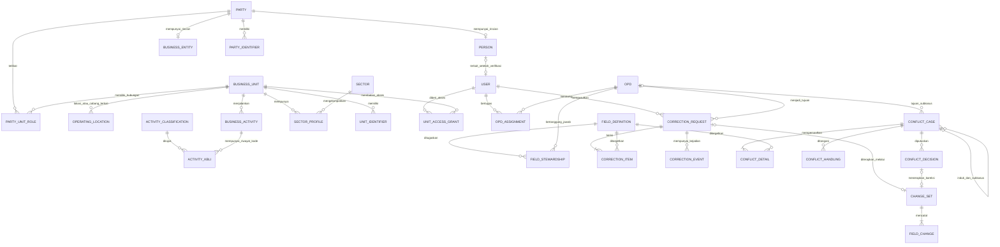
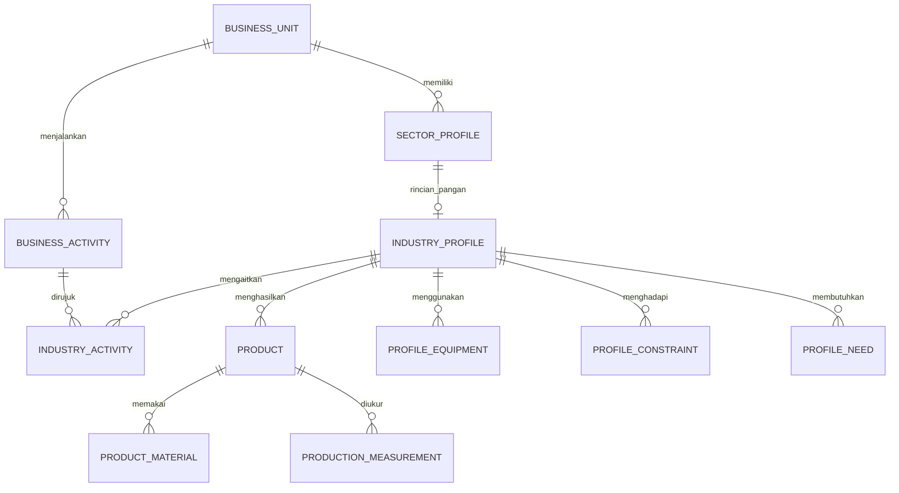
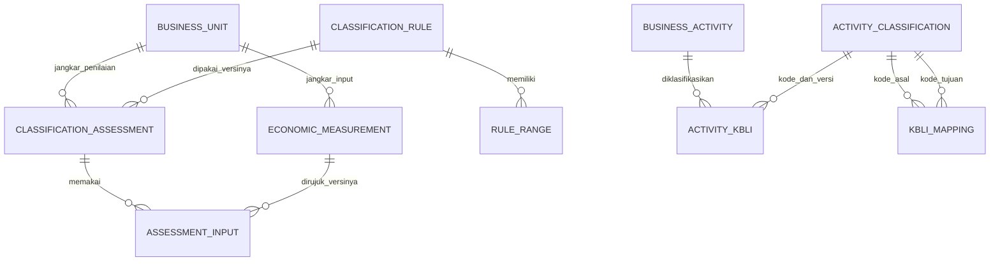

# Entitas dan hubungan data utama

**Status terkini G1-B3.3 — 7 November 2026:** pemilik menerima baseline lokal sampai B3.2 dengan catatan MySQL/HTTP/browser belum diverifikasi independen dan menyetujui pengesahan awal C2 lokal sintetis. Baca [kontrak 36](36-kontrak-pengesahan-awal-c2-g1b33.md), [matriks 37](37-matriks-kewenangan-c2-g1b33.md), [panduan 38](38-panduan-pengesahan-awal-g1b33.md), [hasil 39](39-laporan-hasil-g1b33.md) dan [manifest 40](40-manifest-perubahan-g1b33.md). C2 hanya paket minimum induk, oleh pengesah bermandat berbeda dari pembuat; field/sektor tidak ikut sah. Satu migrasi maju menambah tiga tabel C2; tidak ada paket baru atau rewrite. Hentikan pada B3.3. Field operasional, K1–K4 penuh, pangan lengkap, E1, impor/integrasi, salinan audit eksternal, data nyata, G5/G7 dan deployment tetap tertutup. Model KB/DT dan konflik E1/KB-11 tetap. Pernyataan izin lama di bawah merupakan riwayat fase terkait.

**Riwayat izin G1-B3.2 — 7 November 2026:** pemilik menerima baseline lokal G1-A/B1/B2/B3.1 dengan catatan tes MySQL dan HTTP B3.1 belum diverifikasi ulang independen, lalu menyetujui antarmuka A3/pengajuan sintetis terbatas. Registri, formulir berulang, tinjau, pengajuan/pengembalian/revisi/pengajuan ulang memakai sesi server dan domain B2. Baca [kontrak 32](32-kontrak-antarmuka-registrasi-g1b32.md), [panduan 33](33-panduan-alur-registrasi-g1b32.md), [hasil 34](34-laporan-hasil-g1b32.md) dan [manifest 35](35-manifest-perubahan-g1b32.md). Tidak ada migrasi/paket baru. C2/field operasional, K1–K4 penuh, E1, data nyata, G5/G7, salinan audit eksternal dan deployment tetap tertutup. Hentikan pada B3.2. Model KB/DT tetap; konflik E1/KB-11 terbuka. Pernyataan izin/perencanaan terdahulu di bawah dibaca sebagai riwayat fase terkait, bukan batas izin terbaru atau izin lanjutan.

**Riwayat izin G1-B3.1 — 6 November 2026:** pemilik menerima baseline lokal G1-B2 dengan catatan tes MySQL belum diverifikasi independen, lalu menyetujui autentikasi/otorisasi/penguatan audit lokal sintetis. Login dan profil baca-saja terikat sesi server; mutasi bisnis/C2/field operasional/K1–K4/ekspor tetap ditutup. Baca [kontrak 27](27-kontrak-autentikasi-audit-lokal-g1b31.md), [rancangan audit 28](28-rancangan-salinan-audit-independen.md), [panduan 29](29-operasi-autentikasi-lokal-g1b31.md), [hasil 30](30-laporan-hasil-g1b31.md) dan [manifest 31](31-manifest-perubahan-g1b31.md). G1-B3.2/G5/G7/data nyata/produksi belum diizinkan. Model KB/DT tetap; E1/KB-11 terbuka. Status izin/autentikasi lama di bawah adalah riwayat, bukan mandat fase selanjutnya.

Status: **model konseptual, mempertahankan KB-01–KB-08 dan diselaraskan dengan MVP KB-09 Model B — Industri Pengolahan Pangan**, 5 November 2026. Nama tabel, rincian kolom dan pola penyimpanan tetap usulan teknis, bukan skema final, migrasi atau SQL. OPD/petugas resmi, wilayah pilot, SOP dan standar bukti tidak ditetapkan di sini.

Tambahan KB-10 Model B mendokumentasikan input ekonomi, aturan dan hasil skala berperiode yang disahkan petugas, serta katalog/relasi KBLI berversi. KB-01–KB-09 dipertahankan. Cakupan operasional unit tidak otomatis menentukan cakupan hukum penilaian pelaku; skema fisik tidak dibuat melalui dokumen ini.

KB-12 Model B menetapkan dua lapisan audit dengan event operasional yang sama dan salinan berkontrol terpisah; tidak menggandakan master. Teknologi/organisasi/rincian belum final. KB-01–KB-11 dipertahankan dan rincian KB-17 dan angka dan bukti kapasitas KB-18 belum final.

KB-13 Model C kini memberi rancangan rekonsiliasi otomatis bersyarat; deteksi/pencegahan prioritas MVP, kasus berisiko/substantif oleh petugas. Definisi entitas dan KB-01–KB-12 tetap; rincian/mandat belum final.

KB-15 Model B menambah rancangan sumber/staging/pemetaan/promosi terverifikasi tanpa menggandakan master. Data sumber bukan resmi otomatis, OPD pengunggah bukan pemilik semua field. KB-01–KB-14 tetap; hosting BELUM DAPAT DINILAI.

KB-16 **Model B — Registri Program dan Riwayat Layanan Pembinaan UMKM disepakati sebagai dokumentasi fase lanjutan setelah MVP KB-09**, 5 November 2026. Registri/pangan tetap MVP pertama; program belum boleh dibangun. KB-01–KB-15 dipertahankan; rincian KB-17 dan KB-18, rincian organisasi/SOP dan izin masih terbuka. Hosting KB-14 tetap BELUM DAPAT DINILAI.

KB-17 **Model B — Operasional Terkelola Berbasis Risiko disepakati sebagai kebijakan dan spesifikasi dokumentasi**, 5 November 2026. Frekuensi/retensi backup, angka RPO/RTO, lokasi/teknologi/kunci, SLA dan pengelola belum final; tidak ada izin operasi server. KB-01–KB-16 dipertahankan, angka dan bukti kapasitas KB-18 belum final dan hosting KB-14 BELUM DAPAT DINILAI.

KB-18 **Model C — Perencanaan Kapasitas Skala Kabupaten Sejak Awal disepakati sebagai dokumentasi**, 5 November 2026. Arsitektur mencakup Kabupaten Sinjai dengan satu SSOT; MVP KB-09 tetap registri/pangan. Infrastruktur awal mengikuti kebutuhan terverifikasi, angka contoh hanya asumsi/proyeksi. Hosting dan kapasitas final **BELUM DAPAT DINILAI**; rincian/izin belum final.

## Rujukan istilah dan status baseline

[Baseline konsolidasi](10-baseline-konsolidasi-kb01-kb18.md) merangkum istilah dan KA-01/KA-02/KA-04/KA-07. Pihak/Orang/Badan/Unit/kegiatan/lokasi, akun petugas, NIB bersubjek dan cakupan penilaian hukum tetap berbeda. Catatan badan/usaha atau kesatuan operasional tidak menetapkan sendiri cakupan modal/penjualan legal (DT-010); hubungan kepemilikan bukan rumus agregasi.

HUBUNGAN_KEPEMILIKAN/PENGELOLAAN pada kapasitas adalah fungsi hubungan pihak-usaha yang setara, bukan entitas master tandingan. Nama fungsi konseptual tidak mewajibkan tabel baru. Profil unit-sektor dan pengait kegiatan adalah pola teknis usulan, bukan pilihan bisnis baru yang disahkan oleh konsolidasi.

Status profil/registrasi induk awal, status nilai field/record dan status sektor/pengukuran dibedakan dari ringkasan agregasi. DT-007 Model C final pada pemilihan model berbasis cakupan; DT-003 B A3+B1+C2 kini dipilih, rincian katalog/transisi/enum DT-003/009/033 dan pemilik/mandat DT-005 belum final. Kanonik/alias/ID asal, riwayat dan biaya penyimpanannya tidak dihapus untuk memaksa merge atau laporan.

Tidak mengubah entitas/relasi yang telah disepakati atau membuat skema. Baseline G0 siap ditinjau, tanpa izin implementasi.

## Empat objek bisnis yang berbeda

| Entitas | Pengertian sesuai model yang disepakati | Contoh sintetis |
| --- | --- | --- |
| Orang | Individu yang dapat memiliki, mengelola, atau mewakili usaha | Orang Contoh A |
| Badan usaha | Organisasi usaha, dengan bentuk usaha/legalitas tersendiri; tidak otomatis selalu berbadan hukum | Badan Usaha Contoh B |
| Unit usaha | Kesatuan operasional dengan ID induk bersama sesuai KB-01 Model C; cabang tetap bagian induk jika pemilik sama dan keterkaitannya dengan induk teridentifikasi | Usaha Contoh Utama dengan Cabang Contoh Timur sebagai bagiannya |
| Kegiatan usaha | Jenis aktivitas ekonomi yang dilakukan oleh satu unit, dengan klasifikasi dan masa berlaku | Produksi contoh dan perdagangan contoh |

Satu unit bisa memiliki beberapa kegiatan. Satu badan usaha bisa terkait beberapa unit. Satu unit dapat terkait orang dan badan usaha sekaligus dengan peran berbeda. Usaha perseorangan tidak harus dipaksa mempunyai badan usaha fiktif agar dapat tercatat.

Kegiatan usaha di sini adalah aktivitas ekonomi unit, bukan kegiatan pelatihan atau program OPD. Program pengembangan belum masuk model inti yang boleh diimplementasikan.

Lokasi/cabang tidak otomatis setara unit usaha. Cabang yang memenuhi kedua syarat KB-01 tetap menggunakan profil induk usaha yang sama; detail lokasi dapat dicatat tersendiri. Pemilik sama saja tidak cukup untuk menyimpulkan semua usaha menjadi satu kesatuan. Pembuktian keterkaitan, penilaian pemilik bersama/pergantian pemilik dan kasus batas masih terbuka.

Sesuai KB-03 Model B, ID internal Orang, Badan Usaha dan Unit Usaha terpisah dari NIK/NIB. NIB tidak wajib untuk draf, pengajuan maupun pengesahan induk DT-003. Minimum konseptual A3 sudah dipilih, rincian katalog/bukti/standar verifikasi tetap perlu penetapan; status pendataan, verifikasi dan legalitas tidak boleh disatukan.

## Katalog entitas inti

`1:N` berarti satu ke banyak; `M:N` berarti banyak ke banyak; `0..1` berarti boleh tidak ada atau satu.

| Entitas konseptual | Identitas dan atribut awal | Hubungan utama |
| --- | --- | --- |
| OPD (`opds`) | ID internal, kode, nama, status aktif | 1:N penugasan anggota dan penanggung jawab field |
| Akun pengguna internal (`users`) | ID, identitas login petugas, status; rahasia login tidak masuk audit nilai | 0..1 orang terverifikasi; M:N OPD melalui penugasan; cakupan unit/wilayah mengikuti penugasan; bukan akun pelaku UMKM |
| Penugasan pengguna-OPD | Pengguna, OPD, peran/izin, cakupan, masa berlaku, pemberi penugasan | Menghubungkan pengguna dan OPD; mencegah asumsi hanya satu peran seumur hidup |
| Pihak (`parties`) | ID internal dan jenis pihak: orang atau badan usaha | 1:1 tepat satu rincian sesuai jenis; M:N unit melalui hubungan pihak-unit |
| Orang (`persons`) | ID pihak sebagai penghubung, nama; data identitas sensitif hanya jika disepakati perlu | Tepat satu pihak berjenis orang; dapat terkait banyak unit |
| Badan usaha (`business_entities`) | ID pihak, nama, bentuk usaha dan status | Tepat satu pihak berjenis badan usaha; dapat terkait banyak unit |
| Unit usaha (`business_units`) | ID internal stabil, nama unit, status pendataan, status operasional, versi data | M:N pihak; 1:N kegiatan; 1:N profil sektoral |
| Lokasi/cabang operasional, usulan struktur pendukung | Rujukan unit induk, penanda lokasi/cabang dan dasar keterkaitan; rincian field belum ditetapkan | Usulan unit 1:N lokasi/cabang; cabang yang memenuhi KB-01 bukan profil induk baru. Bentuk penyimpanan perlu dirinci, tidak membuat tabel saat ini |
| Hubungan pihak-unit (`party_unit_roles`) | Pihak, unit, jenis peran, mulai/akhir berlaku, status verifikasi, dasar bukti | Tabel penghubung M:N; peran misalnya pemilik, pengelola, penanggung jawab, masih usulan |
| Pembatasan cakupan akun-unit, jika diperlukan | Akun petugas internal, unit, izin, pemberi dan masa berlaku penugasan | M:N akun petugas-unit; terpisah dari hubungan bisnis pihak-unit dan tidak memberi akun kepada pelaku |
| Kegiatan usaha (`business_activities`) | ID, ID unit, uraian, peran utama/tambahan beserta sumber/masa berlaku; relasi kode dan versi KBLI | N:1 unit; 1:N relasi kegiatan–KBLI historis, tanpa menduplikasi kegiatan untuk setiap versi kode |
| Identitas eksternal pihak | ID, ID pihak, jenis nomor, penerbit, nilai terlindungi, status verifikasi, masa berlaku | N:1 pihak; terpisah dari ID internal sesuai KB-03; pemetaan subjek, keunikan dan bukti per jenis belum final |
| Identitas eksternal unit | ID, ID unit, jenis nomor yang memang ditetapkan untuk unit, penerbit dan verifikasi | N:1 unit; jangan menyalin nomor pihak menjadi identitas unik semua cabang |
| Sektor (`sectors`) | ID, kode, nama, status | 1:N profil sektoral; daftar sektor disepakati terpisah |
| Profil sektoral (`sector_profiles`) | ID, ID unit, ID sektor, status dan versi | N:1 unit dan N:1 sektor; 1:1 rincian sektor sesuai tipe |
| Rincian sektor | Atribut bertipe jelas khusus sektor yang dipilih | Tepat satu profil sektor yang sesuai; tidak menyimpan salinan data master |
| Referensi wilayah | Kode, nama, tingkat dan versi referensi | Dipakai unit atau objek lain sesuai definisi alamat yang disepakati |
| Referensi klasifikasi kegiatan / KATALOG_KBLI | Kode dan versi, judul/uraian asli, status berlaku dan referensi resmi | Memakai katalog yang sama; acuan KBLI 2025, 2020 tetap historis. Kode/versi dirujuk relasi kegiatan dan pemetaan |

Pihak adalah pengenal bersama untuk dua jenis subjek. Jangan menyimpan nama orang dua kali pada pihak dan orang: rincian nama berada pada rincian jenisnya, sementara tampilan pihak membacanya dari sana. Pihak berjenis orang tidak boleh sekaligus mempunyai rincian badan usaha.

Akun operasional adalah akun individual petugas sesuai KB-06 Model A; pelaku UMKM tidak mempunyai akun. Pengaitan ke identitas orang tidak menjadikan petugas pemilik bisnis atau menjadikan orang pemilik usaha sebagai pengguna aplikasi. Pemetaan teknis identitas petugas tetap perlu dirinci; akun bersama tidak diperbolehkan oleh rumusan KB-06.

Alamat orang, alamat terdaftar badan usaha, dan lokasi unit adalah fakta yang berbeda. Model alamat terperinci baru dibuat setelah definisinya disepakati. Perpindahan unit tidak otomatis mengubah alamat badan usaha atau membuat unit baru.

KB-02 Model B menentukan verifikasi terdistribusi menurut kewenangan OPD; pengelola utama berperan sebagai koordinator. Penugasan koordinator merupakan peran pada akun petugas yang ditetapkan secara sah, bukan entitas pihak pelaku usaha atau pemilik seluruh field. Representasi peran dan rincian mandat masih usulan teknis.

## Entitas tata kelola dan penelusuran

| Entitas konseptual | Isi utama | Hubungan dan batas |
| --- | --- | --- |
| Definisi field (`field_definitions`) | Kode field stabil, jenis objek, label, tipe, aturan validasi, klasifikasi sensitivitas, aturan boleh diusulkan | 1:N penugasan penanggung jawab; metadata tidak menyimpan nilai master |
| Penanggung jawab field (`field_stewardships`) | ID field, ID OPD, mulai/akhir berlaku, dasar penetapan | Tepat satu penugasan aktif per field resmi; perubahan penugasan diaudit |
| Usulan koreksi (`correction_requests`) | ID, pengusul, konteks OPD, alasan, OPD tujuan, status, waktu | 1:N butir koreksi; hanya satu OPD tujuan dalam satu usulan |
| Permohonan layanan melalui petugas | Nomor layanan, petugas penerima, pemohon seperlunya, objek, alasan, status dan referensi bukti | Menampung permintaan pelaku tanpa akun sesuai KB-06; gunakan struktur usulan yang sama bila fungsinya sesuai |
| Kasus konflik (`KASUS_KONFLIK`) | ID, kasus induk bila ada, objek, petugas pelapor, pemohon seperlunya, alasan dan status | Kasus induk 1:N subkasus; tiap subkasus diarahkan ke satu OPD pemilik field sesuai KB-08 |
| Detail konflik (`DETAIL_KONFLIK`) | Kasus/subkasus, objek, field, nilai yang dilaporkan dan referensi nilai/versi resmi | Usulan konflik tetap terpisah dari master; tautkan butir koreksi yang sama agar tidak menggandakan informasi |
| Penanganan konflik (`PENANGANAN_KONFLIK`) | Kasus/subkasus, OPD pemilik saat penanganan, petugas, aktivitas dan hasil pemeriksaan | Menjaga sejarah penanganan dan peninjauan kembali, bukan menimpa pemeriksaan lama |
| Keputusan konflik (`KEPUTUSAN_KONFLIK`) | Kasus/subkasus, dasar, pengesah, waktu, hasil, tanggal berlaku dan keputusan yang dikoreksi | Koreksi yang diterapkan terkait kumpulan perubahan resmi; mempertahankan nilai tetap merekam alasan tanpa membuat perubahan nilai palsu |
| Butir koreksi (`correction_items`) | Jenis dan ID objek sasaran, kode field, nilai usulan, nilai/versi dasar, jenis tindakan | N:1 usulan; referensi sasaran harus valid dan diizinkan di server |
| Keputusan/kejadian usulan (`correction_events`) | Usulan, pelaku, status sebelum/sesudah, alasan, waktu | 1:N kejadian per usulan; keputusan penerapan terkait kumpulan perubahan resmi |
| Kumpulan perubahan resmi (`change_sets`) | ID transaksi bisnis, pelaku, OPD konteks, alasan, waktu, sumber usulan bila ada | 1:N perubahan nilai/relasi yang berhasil bersama |
| Riwayat nilai resmi (`field_changes`) | Kumpulan perubahan, objek, field, nilai sebelum/sesudah terlindungi, versi, penanggung jawab saat itu | Mengikuti pemilik objek dan field; tidak dapat diedit lewat fitur biasa |
| Kejadian audit (`audit_events`) | Aktor, aksi, objek, hasil, waktu, ID korelasi permintaan | Mencatat kejadian penting selain perubahan nilai, misalnya perubahan hak dan penolakan akses |
| Referensi bukti konflik/permohonan (`BUKTI_KONFLIK`) | Sumber bukti, referensi terlindungi, pencatat dan akses; metadata berkas bila unggahan disepakati | Terhubung ke kasus/pemeriksaan atau permohonan; data sensitif tidak disalin utuh ke log |

Sesuai RB-08.10, masalah yang menyangkut field beberapa OPD mempunyai satu kasus induk dan beberapa subkasus menurut pemilik field. Usulan koreksi di setiap subkasus tetap hanya menuju OPD yang berwenang atas butirnya. Kasus induk menghubungkan pemeriksaan, bukan memberi satu OPD hak mengesahkan field OPD lain. Kebergantungan urutan dan aturan penutupan kasus induk masih perlu dirinci; tidak diasumsikan satu transaksi pengesahan lintas OPD.

Nama entitas konflik mengikuti rumusan KB-08 dan merupakan fungsi konseptual, bukan perintah membuat tabel baru. `RIWAYAT_NILAI` dipenuhi oleh rancangan riwayat nilai resmi, `AUDIT_LOG` oleh kejadian audit, dan fungsi bukti/keputusan dapat memakai struktur yang sama bila maknanya sesuai. Tambahkan relasi kasus, subkasus, bukti dan keputusan korektif tanpa membuat dua sumber nilai resmi. Belum ada tabel yang diimplementasikan.

Untuk sasaran koreksi yang beragam, implementasi harus menggunakan daftar jenis objek yang diizinkan dan pemeriksaan referensi. Jangan memakai nama tabel bebas dari pengguna. Pilihan foreign key per jenis atau tabel pengikat konseptual akan diputuskan saat skema rinci, dengan jaminan tidak ada rujukan menggantung.

## Diagram relasi inti

Catatan: hubungan opsional pihak-orang dan pihak-badan usaha tunduk pada aturan eksklusif: **tepat satu jenis rincian untuk setiap pihak**. Akun pada diagram hanya akun petugas internal. Hubungan opsional OPD-kasus mengizinkan kasus induk sebagai penghubung; subkasus nilai wajib mempunyai satu pemilik yang sah sebelum pengesahan. Diagram tidak menampilkan semua field, bukti, atau referensi audit. Perubahan yang berasal dari usulan dan konflik dapat merujuk kumpulan perubahan yang sama, bukan menggandakan perubahan.

`OPERATING_LOCATION` adalah usulan representasi lokasi/cabang di bawah satu unit, bukan keputusan nama tabel atau profil induk tambahan. Model penyimpanan rinci belum final. Keputusan bisnis yang wajib dijaga ialah cabang yang memenuhi KB-01 tetap bagian usaha induk; lokasi tidak otomatis menjadi unit hitung UMKM tersendiri.

## Profil Umum dan Profil Sektoral

Profil Umum adalah tampilan logis gabungan `business_units`, hubungan pihak-unit, rincian pihak, dan kegiatan usaha. Tidak perlu entitas master UMKM tambahan yang menggandakan fakta-fakta tersebut.

KB-09 menetapkan Profil Industri Pengolahan Pangan beserta field minimum dan pengukuran produksi per periode. Usulan satu profil sektoral per pasangan unit/sektor tetap menjadi pola teknis. Pengait profil-kegiatan menampung satu atau beberapa kegiatan yang relevan pada unit yang sama; `kegiatan_id` dicatat pada record pengait, bukan daftar dalam satu kolom atau profil induk tandingan. Rincian field W/K/O/B ada pada [kamus data MVP](kamus-data-mvp-kb09.md).

## Entitas sektoral dan laporan dasar KB-09

| Entitas/record konseptual | Hubungan yang diusulkan | Aturan yang dijaga |
| --- | --- | --- |
| PROFIL_INDUSTRI | Rincian bertipe pangan pada PROFIL_SEKTORAL milik satu unit | `profil_industri_id` merujuk profil sektor yang sama; status sektoral tidak disalin menjadi nilai tandingan |
| PROFIL_INDUSTRI_KEGIATAN | Profil 1:N pengait; kegiatan 1:N pengait | Minimal satu kegiatan relevan saat profil lengkap; kegiatan dan profil harus merujuk unit yang sama |
| PRODUK | Profil industri 1:N produk | Satu usaha tiga produk tetap satu unit; nama/merek berbeda bukan identitas usaha baru |
| BAHAN_BAKU_PRODUK | Produk 1:N bahan terkait | Satu record per bahan; bahan utama kondisional sesuai kamus, tidak berupa kolom daftar |
| PERALATAN_PROFIL | Profil industri 1:N record peralatan | Satu record per peralatan/jenis; teknologi dapat dicatat menurut kamus |
| PENGUKURAN_PRODUKSI | Produk 1:N pengukuran; terkait versi/keputusan korektif | Jenis kapasitas/realisasi, nilai numerik, satuan, periode, sumber, tanggal dan status verifikasi; record berkala bukan dua kolom master yang ditimpa |
| KENDALA_PROFIL / KEBUTUHAN_PROFIL | Profil 1:N record masing-masing | Banyak kendala/kebutuhan dicatat terpisah; bukan transaksi bantuan/program |
| Laporan dasar | Tampilan baca dari master, sektor, pengukuran dan status resmi | Tidak membuat master baru; jumlah unit unik tidak berganda oleh produk, kegiatan, pemilik atau cabang |

Diagram menunjukkan rancangan record terkait, bukan tabel yang sudah dibuat. Pada sektor pangan, rincian industri dan minimal satu kegiatan/produk diperlukan sebelum profil dinyatakan lengkap sesuai kamus; draf dapat belum lengkap dan tidak dihitung terverifikasi. Status profil sektoral berbeda dari status verifikasi setiap pengukuran. Usulan pemetaan fungsi pengampu ada pada [matriks kewenangan MVP](matriks-kewenangan-mvp-kb09.md); nama OPD resmi belum ditetapkan.

Kapasitas dan realisasi dipisah menurut jenis pengukuran; angka, satuan dan periode adalah elemen terstruktur. Catatan Februari tidak menimpa Januari; koreksi membuat versi/keputusan baru dengan jejak lama. Satuan berbeda tidak dijumlah tanpa konversi baku. Bulan kalender pada contoh uji tidak menjadikan seluruh pengukuran wajib bulanan. Rincian frekuensi, cakupan lokasi/kegiatan, keunikan record dan aturan agregasi/konversi masih perlu ditetapkan.

KB-10 Model B menetapkan skala sebagai hasil penilaian dengan usulan dan pengesahan berwenang, bukan atribut kategori tetap pada unit. Hasil modal dan penjualan dipisahkan menurut tujuan, periode, cakupan dan versi aturan. Nama aplikasi tidak berarti semua unit memenuhi kategori UMKM; tersedia label di luar batas dan belum dapat diklasifikasikan. Cakupan hukum dan SOP pemeriksaan belum final.

## Tambahan entitas konseptual KB-10

| Objek/record | Relasi yang diusulkan | Aturan yang dijaga |
| --- | --- | --- |
| PENGUKURAN_EKONOMI | N:1 unit jangkar; merujuk cakupan/sumber dan versi | Modal/penjualan moneter berbeda dari pengukuran produksi fisik; periode/tanggal posisi, mata uang, kelengkapan dan verifikasi eksplisit |
| Cakupan penilaian | Rujukan pihak/unit/cabang yang sudah ada, sebagai record/metadata terkait bila diperlukan | Mencegah nilai konsolidasi dihitung ganda; tidak menentukan otomatis cakupan hukum berdasarkan pemilik atau cabang |
| ATURAN_KLASIFIKASI | 1:N detail rentang kategori dan 1:N hasil penilaian | Dasar hukum/tujuan/indikator/versi/masa berlaku; perubahan tidak mengubah sejarah |
| HASIL_KLASIFIKASI | N:1 unit jangkar dan aturan/versi; rujukan input/versi melalui pengait bila beberapa | Kategori usulan, kategori disahkan, status, alasan, pengesah dan waktu dibedakan; hasil modal/penjualan tidak menimpa |
| Relasi input penilaian | Pengait hasil ke input ekonomi yang digunakan | Tidak menggandakan nilai sumber; daftar input/cakupan dan pemilihan versi dapat ditelusuri |
| RELASI_KEGIATAN_KBLI | Menghubungkan kegiatan ke kode/versi katalog yang sama dengan masa berlaku | Peran utama membaca penetapan peran/riwayat kegiatan yang sama, bukan nilai bebas rangkap pada setiap versi |
| Penetapan peran kegiatan | Record/riwayat pada kegiatan/unit yang sama | Satu kegiatan utama aktif pada satu saat tanpa kebijakan khusus yang sah; sumber/periode dan pergantian tercatat |
| PEMETAAN_KBLI | Satu pasangan kode/versi asal–tujuan per record, dengan kelompok/jenis hubungan dan pemeriksaan | Satu-ke-satu, satu-ke-banyak dan banyak-ke-satu tidak disamakan; ambigu ditinjau; tidak mengganti OSS |

Ini relasi konseptual. Detail rentang, cakupan, pengait input dan peran boleh memakai rancangan yang ada bila fungsinya sama; tidak wajib membuat tabel baru untuk tiap label. Riwayat nilai, kumpulan perubahan dan audit yang sudah dirancang tetap dipakai, tanpa audit/master ekonomi tandingan. Kamus pada berkas yang sama memuat nama/tipe/logika field, bukan SQL.

Pengesahan hasil mengikat tujuan, indikator, input/aturan/versi dan cakupan yang diperiksa. Metadata beberapa unit yang dirujuk bukan rumus agregasi legal otomatis. Catatan modal/penjualan tahunan berbeda dari produksi per produk; nilai kg/kemasan tidak otomatis menjadi rupiah omzet. Periode baru, koreksi atau perubahan aturan tidak menimpa hasil lama.

## Prinsip integritas dan usulan teknis

Bagian ini menggabungkan prinsip yang disepakati dengan cara teknis yang diusulkan untuk menjaganya. Pilihan seperti UUID/ULID, skema lokasi dan indeks belum menjadi keputusan bisnis final; ringkasan KB-01–KB-08 pada dokumen keputusan tetap acuan model.

1. Setiap entitas mempunyai ID internal yang stabil; UUID atau ULID masih pilihan teknis terbuka. Nomor dokumen eksternal tetap atribut, bukan primary key.
2. Pihak mempunyai tepat satu jenis rincian. Perubahan jenis pihak bukan edit biasa yang boleh menghapus makna riwayat.
3. Hubungan pihak-unit menyimpan jenis peran dan masa berlaku. Beberapa peran berbeda dapat sah sekaligus. Duplikasi hubungan dengan pihak, unit, dan peran yang sama pada rentang waktu tumpang tindih harus ditolak atau ditinjau menurut aturan final.
4. Status verifikasi hubungan bisnis dan status akses akun terpisah. Pencabutan akses akun tidak menghapus catatan siapa pemilik usaha pada masa lalu.
5. Kegiatan selalu merujuk satu unit. KBLI disimpan sebagai relasi kode/versi dengan sumber, masa berlaku dan verifikasi. KB-10 membedakan kegiatan utama/tambahan; tidak ada kegiatan utama aktif ganda pada unit tanpa kebijakan khusus yang sah. Pergantian kegiatan/kode menjaga riwayat.
6. Profil sektoral selalu merujuk unit yang ada dan sektor yang tepat. Tidak boleh mengulang kolom master sebagai nilai resmi sektoral.
7. Field bisnis yang dapat ditulis harus terdaftar dan mempunyai tepat satu OPD penanggung jawab aktif. ID teknis, cap waktu, dan versi diisi sistem; aturan pengelolanya terdokumentasi dan tidak menjadi input bebas pengguna.
8. KB-04 menetapkan tepat satu OPD penanggung jawab aktif untuk setiap field. Pembatasan wilayah atau objek pada penugasan petugas tidak boleh menghasilkan OPD pemilik aktif ganda untuk field yang sama. Daftar field, penetapan OPD, masa berlaku dan rincian cakupan petugas masih harus ditetapkan.
9. Usulan dan audit menunjuk objek yang sebenarnya, termasuk hubungan, bukan selalu unit. Perubahan atribut orang tidak ditaruh sebagai atribut unit hanya demi kemudahan formulir.
10. Nilai resmi, versi, riwayat, dan hasil persetujuan disimpan atomik. Pemutakhiran tidak boleh terjadi bila sebagian gagal; penerapan ulang usulan yang sama ditolak.
11. Riwayat tidak dihapus otomatis melalui penghapusan berantai objek. Usulan awal memakai status tidak aktif untuk master penting; pemusnahan dan retensi menunggu kebijakan.
12. Keunikan NIK/NIB/NPWP baru ditetapkan berdasarkan jenis, subjek, penerbit dan kebutuhan bisnis. Jangan memberi batas unik NIB pada setiap unit tanpa mengetahui cakupan nomornya.
13. Angka ekonomi KB-10 memakai desimal, mata uang, periode/tanggal posisi, sumber, cakupan dan verifikasi; kosong berbeda dari nol. Nilai badan/konsolidasi tidak disalin sebagai nilai setiap cabang. Cakupan hukum multiunit dan standar tahun buku nonkalender belum final.
14. Foreign key menjaga referensi, indeks mengikuti pencarian yang disepakati, dan pemeriksaan transaksi menjaga aturan lintas baris seperti masa penugasan yang tidak tumpang tindih.
15. Konflik nilai mengikuti RB-08.01–RB-08.23. Keputusan korektif tidak menghapus pengesahan sebelumnya; status kasus, versi, nilai dan audit harus konsisten. Peninjauan kembali menambah riwayat pemeriksaan.
16. Penggabungan identitas tidak otomatis; sengketa kepemilikan menahan perubahan terkait sampai ada dasar sah. SIJAI UMKM mencatat hasil verifikasi, bukan memutus hak hukum atau mengubah dokumen instansi penerbit.
17. Cabang yang memenuhi KB-01 dicatat sebagai bagian kesatuan operasional induk; lokasi berbeda tidak otomatis berarti unit baru. Pemilik sama juga tidak memicu penggabungan otomatis. Aturan hitung, agregasi dan kasus perubahan pemilik masih perlu dirinci.
18. Ketiadaan NIB tidak menghalangi pendataan awal sesuai KB-03; jangan memasang syarat NIB wajib atau memakai NIK/NIB sebagai ID internal. Kelengkapan dan pengesahan tahap selanjutnya mengikuti aturan yang belum ditetapkan secara rinci.

Seluruh model KB-01–KB-08 kini dikonfirmasi langsung oleh pengguna. Rincian yang belum diputuskan tetap terbuka pada [dokumen keputusan](06-keputusan-bisnis.md) dan [laporan audit](08-audit-konsistensi-dokumentasi.md); konfirmasi model tidak mengesahkan seluruh skema konseptual.

## Contoh sintetis untuk memeriksa pemahaman

Orang Contoh A terkait Unit Contoh Utara sebagai pengelola dan Unit Contoh Selatan sebagai pemilik. Badan Usaha Contoh B terkait kedua unit sebagai pihak operator bila peran itu disepakati. Orang Contoh C juga terkait Unit Contoh Utara sebagai penanggung jawab. Dengan demikian satu unit berhubungan dengan beberapa pihak dan satu pihak berhubungan dengan beberapa unit.

Dalam contoh tersebut kedua unit diasumsikan telah diidentifikasi sebagai kesatuan operasional yang berbeda, bukan cabang dari satu usaha induk. Kesamaan pihak terkait tidak dengan sendirinya membuktikan satu atau dua unit; petugas harus memakai kriteria KB-01.

Contoh cabang: Usaha Contoh Utama dan Cabang Contoh Timur mempunyai pemilik yang sama dan cabang teridentifikasi sebagai bagian Usaha Contoh Utama. Keduanya tetap satu profil induk unit; Cabang Contoh Timur dapat mempunyai detail lokasi dalam struktur pendukung yang masih diusulkan. Sebaliknya, pemilik yang sama tanpa bukti keterkaitan cabang tidak cukup untuk menggabungkan dua usaha.

Unit Contoh Utara memiliki dua kegiatan ekonomi dan dua profil sektoral. Kedua profil memakai ID unit yang sama. Bila nama unit dikoreksi oleh OPD penanggung jawab, kedua profil menampilkan nama terbaru dari master. Bila yang dikoreksi adalah nama Orang Contoh A, perubahan itu terjadi pada orang dan terlihat pada seluruh hubungan orang tersebut, tanpa membuat orang baru.

Contoh tidak menggunakan NIK, nomor telepon, alamat nyata atau badan usaha nyata. Arti peran operator/pengelola, bukti pemilik sama dan keterkaitan cabang, kasus batas kesatuan operasional, serta klasifikasi kegiatan tetap perlu dirinci. Model cabang KB-01 dan registrasi bertahap KB-03 sudah disepakati, bukan pertanyaan untuk dipilih ulang.

## Tambahan konseptual KB-11 — layanan hak, kewenangan dan siklus data

**Model B disepakati pada tingkat dokumentasi.** Susunan berikut memakai fungsi/record yang sudah ada bila maknanya sama, bukan tujuh master baru. PIHAK, ORANG, BADAN_USAHA dan UNIT_USAHA tetap terpisah; tidak ada akun masyarakat baru atau penyalinan master per OPD.

| Fungsi konseptual | Pemakaian kembali / hubungan | Isi minimum dan batas |
| --- | --- | --- |
| Permohonan hak subjek data | Jenis pada PERMOHONAN_LAYANAN yang sudah ada; rujuk pihak/objek dan koreksi/konflik terkait | Nomor, jenis hak, penerimaan, pemohon minimum, petugas, dasar, verifikasi pemohon, status, tenggat/hasil aman; tanpa menduplikasi identitas/bukti |
| Riwayat pemeriksaan/keputusan permohonan | Permohonan 1:N kejadian/keputusan; gunakan riwayat layanan/usulan yang sesuai | Pemeriksa, waktu, dasar, keputusan, pengecualian, bukti penyampaian; pisahkan riwayat proses dari nilai resmi |
| Pemberian/pencabutan kewenangan | Penugasan/peran/cakupan yang ada beserta riwayat keputusan | Hak tindakan dan field/OPD/wilayah/tujuan, mulai/akhir, dasar, pemberi/pencabut; bukan mengganti penanggung jawab field dengan daftar pembaca |
| Persetujuan ekspor | Permohonan/persetujuan terkait petugas, tujuan, cakupan dan kejadian audit | Field, OPD, wilayah, objek, batas jumlah, keputusan/masa berlaku bila disahkan, pelaksanaan/unduh; izin baca saja tidak cukup |
| Log akses data sensitif | Jenis kejadian pada audit_events, dengan akses/retensi sesuai kebijakan | Aktor/penugasan, waktu, objek/field, aksi, tujuan, hasil dan korelasi; tidak menyalin NIK utuh/dokumen atau membuat audit kedua tanpa kebutuhan |
| Insiden pelindungan data | Kasus insiden terkait objek/kategori, penanganan, keputusan dan bukti privat | Waktu indikasi/kejadian/diketahui, dampak, pengamanan, eskalasi, penilaian kewajiban/tenggat pemberitahuan dan pemulihan; bukan kasus konflik nilai KB-08 |
| Kebijakan retensi dan tindakan penyusutan | Kebijakan berversi 1:N kategori/seri serta 1:N tindakan pada record/arsip terkait | Referensi JRA sah, pemicu, dasar simpan/penahanan, kelayakan, keputusan, pelaksana, waktu/bukti pemusnahan atau permanen; angka belum ditetapkan |

Delapan atribut metadata KB-11 pada [kamus](kamus-data-mvp-kb09.md) menautkan definisi field, aturan akses, penugasan, tujuan/dasar serta kategori retensi. Metadata tidak menyimpan salinan nilai master. Satu field bisnis tetap memiliki satu pemilik aktif; banyak izin pembaca tidak menambah pemilik. Pengendali/Prosesor/fungsi PDP merupakan penetapan hukum kelembagaan terpisah, tidak disimpulkan dari relasi field–OPD.

Satu layanan dapat memiliki beberapa tenggat/kewajiban relevan; setiap catatan tenggat menyimpan jenis kewajiban, peristiwa mulai, waktu penerimaan, batas, hasil dan eskalasi. Pengalihan, verifikasi identitas atau status menunggu tidak otomatis mengulang waktu hukum. Hak akses pemohon dibatasi ke data yang sah, termasuk saat ada pemilik bersama.

Tidak ada penghapusan berantai otomatis atas riwayat. Penyusutan yang sah mengikuti JRA, penahanan, kewenangan dan bukti tindakan; prinsip riwayat koreksi bukan penyimpanan semua data pribadi selamanya. Data aktif, arsip berdasar sah, penahanan, kelayakan penyusutan dan tindakan akhir dibedakan. Model audit KB-12 kini dipilih, sedangkan detail skema/kriptografi/backup/pengelola dan operasi belum final; rincian KB-17, kapasitas KB-18 serta izin implementasi/data nyata/produksi tetap terbuka.

## Tambahan konseptual KB-12 — audit, pengiriman dan pemeriksaan

Audit operasional memperluas audit_events yang sudah ada; riwayat nilai/keputusan tetap memakai field_changes, change_sets, correction_events dan kasus/keputusan yang sama. Log akses sensitif KB-11 merupakan jenis event pada audit yang sama. Salinan memelihara **ID event yang sama**, bukan event bisnis baru, master pihak kedua atau tabel per OPD.

| Fungsi/record konseptual | Relasi dan penggunaan kembali | Isi/batas rancangan |
| --- | --- | --- |
| Event audit operasional | Audit yang sudah ada, terkait aktor/penugasan, objek internal, versi/keputusan, request/correlation | 21 atribut minimum pada kamus; payload event stabil dan minim data; pengguna biasa tidak mengubahnya |
| Niat pengiriman dan percobaan | Satu event memiliki status/riwayat pengiriman terkait; tiap percobaan merujuk ID asli | Konsisten dengan commit event, catat tujuan terkonfigurasi, waktu/status, retry/kegagalan/konfirmasi; teknologi antrean/outbox belum final |
| Penerimaan salinan terlindungi | Event di kontrol terpisah diterima dengan ID asli; konfirmasi terkait pengiriman | Penerimaan ulang tidak menggandakan, ID sama berisi berbeda ditahan; lokasi/media/produk dan pengelola belum dipilih |
| Pemeriksaan integritas/rekonsiliasi | Pemeriksaan 1:N item/hasil terhadap event dan pengiriman/salinan | Daftar ID/rentang/checkpoint, acuan/bukti, waktu/pelaksana, jumlah dan temuan kehilangan/beda/duplikasi; tidak cukup hitungan/hash lokal |
| Kegagalan/peringatan audit | Kejadian operasional terkait pemeriksaan/kirim/event dan insiden KB-11 bila sesuai | Kode/rujukan error aman, waktu, dampak, tindak lanjut/escalasi; gunakan insiden yang sama bila fungsinya sesuai, bukan kasus konflik nilai baru |
| Operasi pemulihan | Sumber sah, rentang/cakupan, mandat pelaksana, pemeriksaan dan hasil | ID event asli tidak diganti; operasi pulih mempunyai event baru sendiri, termasuk kekurangan yang tidak terpulihkan |
| Retensi/penahanan/penyusutan audit | Gunakan kebijakan/tindakan retensi KB-11 untuk event, salinan dan backup terkait | Dasar JRA, tinjauan/keputusan, lingkup, pelaksana dan bukti tindakan sah membedakan penyusutan dari manipulasi |

Ini fungsi konseptual, **bukan kewajiban tujuh tabel baru**. Record pengiriman, pemeriksaan dan pemulihan boleh memakai struktur operasional terkait yang setara; penamaan fisik/foreign key/indeks ditetapkan pada desain rinci setelah izin. Pembatasan akses dan JRA tetap berlaku, tanpa angka retensi.

Payload audit yang sudah tercatat tidak diedit untuk mengganti hasil/aktor/status kirim. replication_status dibaca dari metadata pengiriman terkait, integrity_reference merujuk bukti integritas yang terkontrol. Event lanjutan/hasil akhir mempunyai ID sendiri dan korelasi yang sama. Tidak memperbarui seluruh event lama ketika penugasan/OPD berubah; konteks saat kejadian tetap terlacak.

Perubahan bisnis kritis dan event operasional harus satu transaksi. Niat pengiriman tahan gangguan wajib konsisten dengan event commit; transactional outbox hanyalah kandidat. Pengiriman setelah commit boleh tertunda dengan retry; tidak menghapus event atau membatalkan bisnis diam-diam. Event keberhasilan yang ikut rollback tidak boleh tinggal sebagai klaim berhasil; catatan gagal menggunakan jalur aman yang tersedia.

Pemulihan audit tidak otomatis memulihkan nilai bisnis/lampiran dan tidak dapat menjamin event yang belum tersalin. Rekonsiliasi memakai daftar ID/isi dan rujukan sah; operasi pulih memeriksa penahanan/penyusutan agar data yang sah dihapus tidak muncul kembali tanpa penilaian. Rincian waktu/salinan/kunci, jadwal/ambang, frekuensi integritas, RPO/RTO serta pengelola/hak administrator menunggu KB-14/KB-17/KB-18 dan penetapan sah. 28 T12 adalah rencana pada [keputusan](06-keputusan-bisnis.md).

## Tambahan konseptual KB-13 — rekonsiliasi identitas

Rancangan memakai entitas/riwayat yang sama, tanpa master UMKM kedua. Sebelas fungsi dan atribut minimum ada pada [kamus](kamus-data-mvp-kb09.md).

| Fungsi / hubungan | Batas integritas |
| --- | --- |
| KANDIDAT_DUPLIKAT merujuk identitas internal sejenis dan ATURAN_PENCOCOKAN berversi | Kandidat bukan identik; nama/skor/nomor eksternal sama tidak menggantikan bukti dan dampak |
| Kandidat 1:N PEMERIKSAAN_REKONSILIASI | Gunakan riwayat pemeriksaan/kasus yang ada; konflik menautkan KB-08, bukan sengketa kedua |
| RENCANA_MERGE terkait sumber/versi dan satu kanonik; 1:N DAMPAK_MERGE | Inventaris tiap referensi, penautan, bukti/periode/versi termasuk sektor/ekonomi; referensi tak dikenal menahan |
| KEPUTUSAN_REKONSILIASI terkait rencana, aturan/versi, petugas atau proses/mandat dan change_set/event | Otomatis teknis tidak memilih nilai resmi berbeda; keputusan substantif tetap petugas/pemilik field |
| RIWAYAT_IDENTITAS_KANONIK dan ALIAS_IDENTITAS memetakan sumber–kanonik dengan periode/keputusan | Satu struktur boleh memenuhi keduanya; ID asal stabil tanpa daur ulang, siklus atau pemetaan aktif ambigu |
| RENCANA_SPLIT terkait sumber, tujuan dan item pembagian referensi | Berdasarkan bukti/keputusan, bukan menyalin semua relasi ke semua tujuan |
| STATUS_ARSIP memakai status/riwayat master dan retensi yang ada | Usia/tidak aktif bukan dasar tunggal; arsip berbeda dari hapus, konflik dan verifikasi |
| RIWAYAT_PEMULIHAN_REKONSILIASI terkait operasi asal, versi/peta/keputusan korektif dan event baru | Perhitungkan perubahan setelah merge; bedakan dari pulih salinan audit KB-12 |

Sumber/dampak/pembagian memakai record terkait. Peta kanonik/alias tidak menyimpan salinan nilai identitas atau NIK mentah sebagai ID. Orang tetap dapat terkait banyak unit dan unit banyak pihak; cabang tetap menurut KB-01.

Referensi aktif hanya dialihkan sesuai rencana aman/keputusan; audit/keputusan sejarah memakai ID sasaran asli dan ditautkan oleh operasi/peta baru. Resolusi ID lama tidak memberi hak baca baru. Produk/kegiatan dan hasil ekonomi/periode/satuan tidak disatukan hanya karena identitas induk dikonsolidasi.

Kontrak program masa depan melestarikan ID peristiwa/transaksi: peristiwa berbeda tetap berbeda, yang benar-benar sama tidak digandakan. T13-12/T13-13 hanya rencana, tanpa entitas program yang diimplementasikan pada MVP.

Sepuluh prasyarat harus benar bersama saat rencana/eksekusi. Gagal/belum diketahui menjadi pemeriksaan petugas; ID operasi/versi seluruh sasaran serta audit kritis menjaga konsistensi/penerapan sekali. Tidak ada referensi setengah pindah. Split/arsip/pulih memerlukan dasar serta keputusan sah.

Pilihan kanonik, bukti, mandat/OPD/otoritas aturan, metode split/pulih/arsip/JRA, algoritme/skor/ambang, teknologi/kapasitas/jadwal/hosting belum final. Rincian KB-17, kapasitas KB-18 serta izin implementasi/data nyata/produksi tetap terbuka; semua konseptual tanpa skema/migrasi.

## Penyelarasan status hosting — KB-14

**KB-14 Model B audit kesiapan sebelum konfigurasi teknis/deployment disepakati; kondisi PDN masih BELUM DIKETAHUI dan hasil hosting BELUM DAPAT DINILAI.** Pilihan model bukan bukti bahwa versi, kapasitas atau konfigurasi final tersedia. Kebutuhan pembuktian hosting yang dirujuk bagian sebelumnya tetap terbuka; rincian operasional KB-17 belum final dan angka dan bukti kapasitas KB-18 belum final.

Gunakan [formulir hosting yang sama](07-checklist-hosting-cpanel.md) untuk bukti tersanitasi oleh pengelola/verifikator berwenang. Tidak menambah entitas aplikasi, field bisnis, OPD/petugas atau hak server melalui penyelarasan ini. Model/atribut/kewenangan KB-01–KB-13 tetap; KB-11 privasi, KB-12 kontrol salinan terpisah dan KB-13 otomatisasi aman tidak dilonggarkan karena batas hosting.

Dokumen lengkap/status Layak sekalipun bukan izin implementasi/data nyata/deployment. Target pemulihan/operasi KB-17, volume/kapasitas KB-18, pengelola resmi dan bukti PDN masih diperlukan. Tidak mengakses server, meminta/membaca rahasia, memasang file uji atau mengubah kode/database/paket/hosting/DNS pada tugas ini.

## Tambahan konseptual KB-15 — sumber, staging dan promosi

Sebelas fungsi minimum dan atributnya ada pada [kamus](kamus-data-mvp-kb09.md). Hubungan di bawah mengait sumber/baris ke perubahan resmi, bukan membuat master per OPD atau menetapkan tabel fisik.

| Fungsi / hubungan | Aturan integritas |
| --- | --- |
| SUMBER_DATA_IMPOR 1:N BATCH_IMPOR | Sumber/dataset/versi/tujuan/dasar/kewenangan tercatat; satu sumber bukan otoritas seluruh field |
| BATCH_IMPOR terkait BERKAS_SUMBER privat dan PEMETAAN_FIELD_IMPOR berversi | Metadata/fingerprint untuk provenans; tidak membuktikan kebenaran isi atau identitas usaha |
| Batch 1:N RECORD_STAGING, tiap record 1:N HASIL_VALIDASI | ID baris asal/revisi/nilai yang diizinkan terlacak; diagnostik tidak menyalin nilai pribadi mentah |
| Record terkait KANDIDAT_PENCOCOKAN | Pengait ke kandidat/pemeriksaan/alias KB-13 yang sama; bukan kandidat mesin kedua atau merge historis berisiko |
| RENCANA_PROMOSI 1:N item record–objek–field dan dependensi | Memakai usulan/correction_items yang setara; banyak pemilik field mempunyai keputusan terpisah |
| KEPUTUSAN_IMPOR terkait item, pemilik/petugas/versi dan change_set/field_changes | Satu pengesah field sah, profil baru verifikator berbeda; sebagian hasil bukan profil terverifikasi seluruhnya |
| RIWAYAT_PEMBALIKAN_IMPOR merujuk perubahan asal dan keputusan korektif baru | Analisis keadaan/rujukan/versi terbaru, bukan hapus batch/restore buta |
| AUDIT_EVENT merujuk batch/sumber/record/pemetaan/keputusan/perubahan | Dipenuhi audit_events KB-12 dengan ID/korelasi yang sama; tidak ada log impor longgar yang terpisah |

Nama fungsi tidak mewajibkan sebelas tabel baru. Bukti/berkas, sumber, kandidat/kasus/usulan, keputusan/riwayat dan audit digunakan kembali bila maknanya sesuai. Staging sementara bukan statistik resmi atau EAV untuk mengganti seluruh model relasional bisnis. Semua relasi tetap menuju master yang sama.

Satu baris sumber bisa mewakili orang, badan, unit, lokasi, beberapa hubungan/periode atau produk; bukan otomatis satu unit/owner_id. Kegiatan/profil pangan/produk/pengukuran harus merujuk unit yang benar, tanpa referensi fiktif atau yatim. Data ekonomi/KBLI berversi dan produksi bersatuan/periode/sumber/verifikasi tidak tertimpa.

Identitas batch/record/operasi, sumber/pemetaan/versi, keputusan serta target/versi menelusuri promosi sekali. Pemeriksaan versi/hak/dependensi pada eksekusi dan transaksi audit kritis berlaku per unit perubahan yang konsisten; batch campuran dapat mempunyai hasil berbeda tanpa setengah referensi dipindah.

Pembalikan pascacommit memakai keputusan/version/event baru yang merujuk perubahan awal dan dampak sesudahnya. Hubungan/pemilik, produk/kegiatan, ekonomi/klasifikasi, ID induk dan kontrak peristiwa masa depan tetap dilindungi. Pembatalan sisa batch tidak membalik otomatis hasil sah yang sudah diterapkan.

Format/dataset/OPD/SOP/bukti/transformasi, ukuran/frekuensi, retensi serta pembalikan belum final. API OSS/Dukcapil/OPD dan modul program tidak ditambahkan ke MVP. Hosting KB-14 BELUM DAPAT DINILAI, rincian KB-17, kapasitas KB-18 serta izin implementasi/data nyata/produksi tetap terbuka. Tidak ada tabel/migrasi dibuat.

## Hubungan program dan riwayat layanan — KB-16, sesudah MVP

Hierarki enam tingkat mempunyai identitas independen, bukan satu baris formulir atau satu ID yang dipakai semua objek:

PROGRAM → KEGIATAN/LAYANAN → PELAKSANAAN/SESI → PARTISIPASI/PENERIMAAN → REALISASI → TINDAK LANJUT.

| Hubungan konseptual | Kardinalitas dan batas |
| --- | --- |
| PROGRAM_PEMBINAAN → KEGIATAN_PROGRAM | 1:N; nama/tahun bukan kunci tunggal. Kode/nomenklatur hanya referensi sah, bukan kode anggaran buatan |
| KEGIATAN_PROGRAM → PELAKSANAAN_KEGIATAN | 1:N; satu kegiatan dapat beberapa angkatan/sesi, terpisah dari KEGIATAN_USAHA/KBLI ekonomi |
| Program/kegiatan → PERAN_OPD_PROGRAM | 1:N peran berperiode dengan banyak OPD; penanggung jawab record tunggal tidak berarti semua field dimiliki satu OPD |
| PELAKSANAAN_KEGIATAN → PARTISIPASI_LAYANAN | 1:N; tiap partisipasi merujuk Orang, peran/konteks dan Unit penerima bila diperlukan |
| PIHAK/ORANG ↔ UNIT_USAHA | Melalui hubungan pihak-usaha/perwakilan yang sah dan berperiode, bukan satu owner_id atau NIK program |
| PARTISIPASI_LAYANAN/penerima → REALISASI_LAYANAN | Dapat banyak realisasi; satu kejadian nyata dapat terkait banyak penerima tanpa menggandakan kejadian |
| PROGRAM_PEMBINAAN/kegiatan → INDIKATOR_PROGRAM → OBSERVASI_HASIL | Indikator mempunyai definisi/versi; banyak observasi objek/periode, bukan menimpa nilai sebelum dengan sesudah |
| Penerima/realisasi → TINDAK_LANJUT_PROGRAM | 1:N sesuai cakupan; setiap tindak lanjut memiliki ID, waktu/status/hasil sendiri |
| Record/keputusan → REFERENSI_BUKTI | Rujukan dokumen privat yang sudah setara dipakai ulang; bukan NIK/lampiran terbuka yang disalin ke setiap tabel |

Sepuluh fungsi konseptual beserta atribut minimum ada pada [kamus](kamus-data-mvp-kb09.md). Hubungan antara kejadian layanan bersama dengan penerima harus dapat ditelusuri tersendiri; bentuk fisiknya belum dipilih. Layanan langsung tanpa kelas tidak dipaksa mempunyai kehadiran kelas fiktif. Bila sasaran program secara sah Orang atau Badan Usaha, gunakan referensi objek bertipe yang tepat, tanpa mengarang Unit Usaha agar formulir terisi.

Pendaftaran dan kehadiran berbeda catatan/status. Kosakata partisipasi tetap Didaftarkan, Dikonfirmasi, Hadir, Tidak Hadir, Mengundurkan Diri, tetapi riwayat daftar tidak ditimpa status hadir. Status realisasi, verifikasi, program dan tindak lanjut berbeda lagi. Daftar saja tidak menjadi hadir, dan hadir tidak otomatis menjadi realisasi Selesai.

Duplikasi teknis orang–sesi–peran–konteks yang sama dicegah, tanpa kunci global orang–program/unit–tahun yang melarang pengulangan sah. Detail kunci dan batas penerima harus ditetapkan dari konteks program, bukan dugaan. Ahmad dan Budi (contoh fiktif) mewakili satu unit pada dua kegiatan menghasilkan satu UMKM unik, dua Orang unik dan dua partisipasi sah. Jumlah kejadian layanan dihitung dari kejadian yang benar-benar dicatat, bukan diasumsikan sama dengan partisipasi.

Pengukuran KB-09/KB-10 dirujuk beserta identitas/versi/periode/satuan/sumber/verifikasinya. Riwayat layanan tidak menjadi master produksi/ekonomi kedua atau mengganti klasifikasi legal. Merge sah merujuk identitas kanonik dengan asal tetap terlacak; split mengalokasikan partisipasi/penerimaan/observasi dengan bukti, tanpa membuat kejadian historis ganda atau menulis ulang target audit.

Pembatalan, koreksi dan arsip mempertahankan referensi dan keputusan historis yang wajib disimpan menurut JRA sah; ini bukan penyimpanan data pribadi selamanya. Konflik KB-08 dan audit KB-12 berlaku. Tidak ada migrasi/tabel/database dibuat; rancangan program ini untuk fase setelah MVP KB-09.

## Konsistensi identitas dan referensi saat pemulihan — KB-17

KB-17 Model B memilih kebijakan operasi/pemulihan berbasis risiko, bukan perubahan entitas induk. Database, dokumen privat/metadata, audit operasional, status pekerjaan penting dan artefak/konfigurasi yang diperlukan harus membentuk titik pemulihan yang konsisten. Rancangan metadata operasi pada [kamus](kamus-data-mvp-kb09.md) memakai sumber/versi/keputusan/operasi audit yang setara, bukan master UMKM atau skema baru.

Pemulihan harus memeriksa Pihak/Orang/Badan/Unit, hubungan M:N/peran/masa berlaku, kanonik/alias/ID asal, cabang/lokasi/kegiatan/profil pangan/produk/pengukuran, klasifikasi/aturan/versi dan keputusan konflik/pengesahan/koreksi. Dokumen cocok dengan referensi/versi database; hilang relasi pemilik atau produk-unit membuat validasi gagal, tidak diperbaiki dengan data fiktif/ID baru.

Salinan audit terlindungi KB-12 berbeda dari backup seluruh data bisnis. Pertahankan ID kejadian/target historis, catat operasi pulih sebagai kejadian baru, rekonsiliasi keadaan bisnis dengan kedua lapisan dan transaksi sesudah titik backup. Tidak mendaur ulang ID, menghapus audit lebih baru, menjumlah versi koreksi sebagai data baru atau menganggap nilai lengkap dapat direkonstruksi dari setiap event audit.

Status/ID batch/record/operasi staging KB-15 dan rencana/hasil rekonsiliasi KB-13 harus konsisten sebelum pekerjaan dilanjutkan; jangan replay ganda atau menaikkan data staging menjadi resmi. Riwayat program KB-16 diperhitungkan jika fasenya kelak diizinkan; tetap tidak menambah program ke MVP. Koreksi bisnis tetap keputusan/versi baru dari pemilik field, bukan restore buta.

Hak akun terkini, pembatasan/penghapusan yang sah dan retensi/JRA diperiksa agar backup lama tidak membuka kembali hak/data yang sudah dicabut/dibatasi. Hasil validasi, selisih, keputusan dan kekurangan dikaitkan pada operasi pemulihan. [Formulir/tata kelola](04-tata-kelola-data.md) dan [matriks](matriks-kewenangan-mvp-kb09.md) masih rancangan tanpa data nyata.

Angka dan bukti kapasitas KB-18 belum final, hosting KB-14 BELUM DAPAT DINILAI; jadwal/target/retensi/kunci/teknologi/OPD/SOP belum final. Tidak membuat tabel/skema atau menjalankan akses database, backup/restore maupun pengujian.

## Volume data, relasi dan sejarah pada skala kabupaten — KB-18

Model C menyiapkan arsitektur kabupaten, tanpa mengubah arti entitas KB-01–KB-17 atau cakupan MVP KB-09. [Matriks 18 kelompok volume](09-perencanaan-kapasitas.md#matriks-entitas-relasi-dan-volume) merujuk struktur yang setara pada dokumen ini; bukan tabel/database baru. HUBUNGAN_KEPEMILIKAN/PENGELOLAAN pada perencanaan berarti fungsi hubungan pihak-usaha yang sudah ada.

Orang unik berbeda dari jumlah hubungan: satu Orang dengan dua Unit sah berarti satu Orang, dua Unit dan hubungan/peran yang relevan. Badan Usaha, kegiatan, lokasi, pemilik/pengelola, produk/bahan/peralatan mempunyai input volume tersendiri. Cabang KB-01 tidak menambah Unit otomatis, dan produk/merek tidak menjadi usaha baru. Rasio skenario hanya ASUMSI agregat, bukan aturan kardinalitas bisnis atau angka resmi.

Histori pengukuran/periode/klasifikasi/KBLI/versi/keputusan/konflik dan kanonik/alias merge/split menambah penyimpanan; rekonsiliasi tidak otomatis menghapus biaya sejarah. Biaya dokumen privat, audit operasional, salinan independen, staging dan backup berbeda. Metadata/file berulang dihitung menurut cakupan fisik/reference yang jelas.

Ukuran terstruktur agregat contoh pada model sudah mencakup relasi/produk sederhana; pendekatan rinci menggantikan bagian yang setara, bukan ditambahkan ulang. Histori/overhead yang belum tercakup tetap input belum diketahui. Audit tahunan adalah aliran, stok tersimpan perlu horizon/retensi sah. Tidak menjumlah unit/satuan berbeda atau menimpa periode untuk menghemat ruang.

Program/layanan/partisipasi/observasi KB-16 hanya volume fase lanjutan. Identitas referensial dipersiapkan, tanpa modul/program impor di MVP. Model C bukan master data per OPD, pelonggaran field owner/pengesahan atau kewenangan merge otomatis baru.

Jumlah resmi/rasio/ukuran/retensi/pertumbuhan dan fasilitas belum final; hosting/kapasitas akhir **BELUM DAPAT DINILAI**. Tidak ada akses data nyata/database, skema/migrasi atau uji pembebanan untuk memperoleh angka.

## Lingkup, versi persyaratan dan hasil evaluasi — DT-007

Model C memisahkan status registrasi induk, field, sektor dan hasil evaluasi per objek/lingkup/tahap. Gunakan identitas internal serta versi/keputusan yang sudah ada. Nama fungsi berikut **konseptual**, bukan tabel/kolom fisik atau fitur yang diimplementasikan.

| Fungsi konseptual | Informasi minimum untuk rancangan | Batas pemisahan |
| --- | --- | --- |
| Lingkup dan tahap penilaian | ID/rujukan objek internal, sektor bila relevan, tahap/tujuan, konteks waktu | Bukan satu status global Unit atau sektor tambahan yang otomatis aktif |
| Katalog persyaratan minimum berversi | Identitas katalog/versi, lingkup/tahap, dasar keputusan sah, tanggal efektif, rujukan persyaratan wajib/pilihan yang benar-benar ditetapkan | DT-003 memilih minimum konseptual A3/B1/C2; rincian katalog per lingkup/versi dan sektoral DT-033 belum final, data kosong bukan katalog sah |
| Rujukan field/versi/keputusan efektif | Field/record yang relevan, versi efektif/calon terpisah, keputusan pengesahan, mandat/pemilik dan periode yang berlaku | Pakai riwayat/keputusan yang ada; tidak menduplikasi master/nilai pribadi ke hasil |
| Penghalang dan dependensi lingkup | Konflik/bukti/periode/kewenangan relevan sesuai aturan, hubungan field–lingkup, alasan aman/rujukan bukti | Tidak menetapkan masa berlaku/ambang/transisi atau semua field jadi wajib |
| Hasil dan riwayat evaluasi | Rujukan hasil, objek/lingkup/tahap, aturan/versi, referensi versi data, konteks waktu, kesimpulan/alasan/penghalang dan hubungan evaluasi terdahulu | Hasil evaluasi bukan pengesahan; evaluasi ulang tidak menulis ulang hasil historis |
| Jejak akses/audit dan klasifikasi | Tujuan/cakupan/hak baca ringkasan/alasan, klasifikasi sensitif, rujukan audit/keputusan relevan | Gunakan KB-11/KB-12, tanpa NIK lengkap/kredensial atau bukti pribadi mentah |

Satu katalog versi dapat menetapkan persyaratan pada lingkup/tahap yang sah, dan satu field dapat dirujuk beberapa lingkup. Hubungan field–lingkup mengarahkan penilaian ulang saat versi berubah tanpa mengubah seluruh sektor. Jumlah/kardinalitas fisik/ID/indeks/pemicu belum ditetapkan; minimum konseptual kini DT-003 A3+B1+C2, rincian katalog/bukti DT-003/009/033 dan kewenangan pemilik DT-005 masih perlu penetapan.

Rujukan kandidat draf terpisah dari nilai resmi efektif. Usulan baru tidak otomatis membatalkan nilai lama, tetapi konflik aktif relevan menjadi penghalang hasil positif. Hasil evaluasi mempertahankan referensi aturan/data/keputusan/waktu yang dipakai; pengesahan lama bukan pengesahan nilai baru dan evaluasi ulang tidak membuat pengesahan ganda.

Alih pemilik yang sah, rekonsiliasi kanonik/asal KB-13 dan koreksi nilai KB-08 menjaga sejarah/ref yang tepat. Staging KB-15 tidak menjadi resmi karena dinilai, dan banyak profil sektoral pada contoh tidak menambah sektor aktif atau modul program KB-16 ke MVP.

Katalog tidak sah/daftar kosong tanpa aturan eksplisit tidak lulus otomatis. Hasil/alasan sensitif tetap KB-11, audit relevan KB-12. Rincian/lengkap 28 RB/28 T/15 kasus ada pada [DT-007](06-keputusan-bisnis.md#dt-007--verifikasi-bertingkat-berbasis-cakupan). Tidak ada tabel/database/kode/uji teknis atau data nyata.

## Implikasi entitas DT-003 dan sumber historis

Minimum draf baru A3 menghubungkan **UNIT_USAHA ↔ HUBUNGAN_PIHAK_USAHA ↔ PIHAK (ORANG/BADAN_USAHA)**, minimal satu pihak dengan jenis/peran jelas; **UNIT_USAHA → LOKASI_USAHA** minimal satu yang dapat dibedakan; **UNIT_USAHA → KEGIATAN_USAHA** minimal satu yang dikenali. Penanda usaha, sumber, petugas dan waktu pencatatan melengkapi A3. Ini batas minimum konseptual, bukan rancangan tabel/kolom fisik baru.

Peran pengurus tidak otomatis pemilik pribadi. Dua pihak pemilik satu unit disimpan sebagai hubungan terpisah, satu pihak dapat terkait beberapa unit. Cabang mengikuti KB-01; dua lokasi tidak otomatis dua unit. Semua ID internal tetap terpisah dari NIK/NIB; keduanya bukan kunci Unit. NIB tidak wajib sampai pengesahan induk.

Sumber historis dan catatan staging adalah bahan penelusuran/validasi KB-15, **bukan draf registrasi resmi atau Unit unik**. Identitas sumber/lembar/baris/versi bukan identitas Unit otomatis. Alamat pemilik berbeda dari lokasi usaha; nama pihak bukan nama Unit, nomor izin bukan bukti B1 sah, Kuliner bukan otomatis profil pangan. [Lampiran 11](11-audit-baseline-data-historis.md) merinci pemetaan yang masih belum pasti tanpa record per orang.

B1 bukti formal relevan dan C2 paket minimum induk/verifikator berbeda mengacu [DT-003](06-keputusan-bisnis.md#dt-003--registrasi-model-b-kombinasi-a3b1c2), tidak mengesahkan semua field/sektor DT-007. Riwayat relasi/keputusan/koreksi dan audit tetap terlacak, pengarsipan mengikuti dasar/JRA sah. Tidak ada entitas fisik, migrasi, impor atau merge dibuat; rincian DT-005/006/009/011/019/033 tetap terbuka.

## Relasi katalog definisi dan penetapan pemilik — DT-005

**6 November 2026:** Model C+F+H2 DISEPAKATI pada bisnis. Katalog definisi field mengidentifikasi entitas/kode/arti/jenis/sumber/sensitivitas/bukti/cakupan/versi. Katalog penetapan pemilik merujuk kode/versi tersebut dan menyimpan fungsi, OPD setelah ditetapkan, mandat, cakupan, efektif/masa berlaku, versi/status, pemberi mandat, audit serta peralihan. [Kamus](kamus-data-mvp-kb09.md#dua-lapisan-katalog-kewenangan--dt-005) memuat 9+12 unsur; keduanya daftar konseptual, bukan tabel fisik atau master UMKM tambahan.

Satu kode field dapat dirujuk beberapa profil/lingkup serta mempunyai riwayat penetapan. Pada kombinasi kode/cakupan/waktu efektif hanya satu OPD aktif; irisan cakupan juga harus dicegah. Satu entitas tidak berarti satu pemilik seluruh atribut. Penugasan pengguna menghubungkan petugas dengan tindakan/cakupan/masa tugas yang sah, bukan semua pegawai OPD otomatis pengesah.

Pemilik OPD, pemasok, pembuat, pengesah awal, pengesah field, admin dan koordinator berbeda fungsi. Multi-penugasan tidak melewati pembuat/pengesah awal berbeda. H2 tidak menulis ulang riwayat pengesahan/mandat; ID/versi/keputusan tetap dapat ditelusuri. Status induk/field/sektor/agregasi tetap DT-007 C dan A3+B1+C2 DT-003 tidak berubah.

Kode pada matriks merujuk atribut kamus; kode calon untuk atribut yang semula prosa ditandai usulan. Konsep catatan aset/tenaga kerja berperiode dan status registrasi tidak membentuk tabel/fitur baru atau aktivasi mesin skala/impor. Nama OPD/mandat nyata, standar bukti/akses/versi operasional dan DT-004/006/008/009/011/012/019/033 belum final. Tidak membuat skema/migrasi/database atau memindah data.

## Relasi klaim–bukti–keputusan–nilai/versi — DT-009

[DT-009 C+B2+V2+K2](06-keputusan-bisnis.md#dt-009--bukti-dan-koreksi-model-cb2v2k2) final model bisnis, 6 November 2026. Gunakan kembali objek sumber/bukti/usulan/keputusan/riwayat yang fungsinya sama. Penamaan di sini relasi konseptual, **bukan tabel, ORM, migrasi atau master tambahan**.

| Hubungan konseptual | Kardinalitas/makna bisnis dan batas |
| --- | --- |
| Objek/field/versi → klaim | Klaim menunjuk nilai/objek/versi yang tepat; identitas pihak berbeda dari relasi kepemilikan atau lokasi usaha |
| Klaim ↔ bukti | Satu klaim dapat punya beberapa bukti, satu bukti dapat mendukung beberapa klaim; kecukupan/akses dinilai per hubungan, tidak menyalin dokumen menjadi master per OPD |
| Klaim/bukti → katalog versi/penilaian | Penilaian menaut sumber/versi/waktu bukti, katalog sah, tujuan, hasil/alasan/pemeriksa/mandat/waktu; MEMADAI belum pengesahan |
| Usulan koreksi → nilai/versi dasar dan kandidat | Kandidat tidak menimpa nilai resmi; catat jalur K1–K4, alasan/status/riwayat dan periode/efektif yang relevan |
| Keputusan → versi/nilai efektif | Keputusan baru menaut versi lama/baru, tanggal/periode sah dan mandat; berlaku mendatang tidak dimajukan, koreksi historis tidak menghapus versi asli |
| Keputusan pembatasan V2 → nilai/lingkup | Rujuk target versi, alasan/otoritas/lingkup/waktu/audit; pembatasan bukan hapus nilai atau status usulan |
| Perubahan nilai/aturan/pembatasan → evaluasi DT-007 | Nilai efektif dan penghalang relevan dinilai ulang pada lingkup terdampak, hasil/rujukan sebelumnya terlacak; bukan pengesahan otomatis |
| H2 → mandat dan pengajuan tertunda | Pergantian pemilik organisasi tetap DT-005, bukan jalur koreksi K1–K4; sejarah dan hak aktif diperiksa |

Waktu penerimaan bukti, periode fakta, tanggal efektif dan waktu keputusan berbeda. Bukti terlambat tidak dibuat seolah ada saat keputusan lama; dua usulan berbasis versi sama diperiksa ulang setelah salah satunya sah. Penolakan tidak memulihkan nilai yang sudah tidak sah.

Status koreksi delapan nama terpisah status induk/field/sektor, hasil penilaian bukti dan kasus konflik. Kode BKT-01–16 hanya penghubung baris katalog usulan, bukan keputusan atau kode field bisnis baru. Daftar W/K/O/B dan 96 kode DT-005 tetap. Data pribadi/bukti privat serta seluruh salinan dibatasi KB-11, perubahan kritis/audit operasional atomik KB-12. Semua KB, DT-003/005/007 dan MVP tetap, tanpa data nyata/pembangunan.

## Relasi pengguna, penugasan dan cakupan — DT-011

[C+D1+M1+E1](06-keputusan-bisnis.md#dt-011--otorisasi-model-cd1m1e1) dipilih 6 November 2026 dengan status konsistensi/implementasi TERBUKA. Relasi berikut konseptual, bukan tabel/ORM/migrasi atau akun nyata.

| Relasi | Makna dan batas |
| --- | --- |
| Pengguna ↔ keterkaitan OPD → katalog D1 | Keterkaitan sah/bermasa/diaudit merujuk paket dasar fungsi yang ditetapkan; paket belum ada tidak dikarang, bukan D2 |
| Pengguna → beberapa penugasan/mandat | Satu pengguna boleh beberapa penugasan aktif sah; peran/cakupan/masa/pencabutan masing-masing terlacak |
| Penugasan → izin beserta scope/tujuan/sensitivitas/masa | M1 menggabungkan semua sumber utuh, bukan memilih satu sesi atau menyilangkan potongan cakupan |
| Pemilik field OPD → mandat Pengesah Field orang | Kode/cakupan/efektif DT-005 tetap, bukan semua pegawai OPD atau akun global |
| Tindakan/objek/field → sumber hak/larangan | Tiap bagian permintaan didukung sumber yang mencakupnya, pembuat/pengesah awal berbeda tetap |
| Hak baca/proyeksi → turunan E1 | Hubungan otomatis dicatat sesuai pilihan, tetapi konflik izin terpisah KB-11 TERBUKA/BLOKIR; bukan izin aktif |
| Pekerjaan hasil → hak terkini/penerima | Identitas/tujuan/masa/scope diperiksa ketika proses dan penyerahan; pencabutan tidak diabaikan |
| Penilaian akses → jejak audit | Alasan aman/sumber hak/versi/konteks minimal, bukan isi NIK/bukti mentah atau kebocoran penolakan |

E1 tidak mengesahkan nilai, membuka seluruh database atau memberi akses bukti dari hak profil saja. Pemilik OPD berbeda dari orang pengesah; pemasok/admin/koordinator bukan hak global. Akun pengguna tetap bukan Orang/Badan/Unit dan pelaku tetap tanpa akun. Status DT-007/K1–K4 DT-009 tidak membuka detail sensitif.

Kode 19 tindakan dan metadata kamus konseptual. KB/DT lama tetap; konflik E1/KB-11 tidak ditutup lewat relasi ini. Tidak menambah entitas fisik/fitur MVP atau mengubah data nyata.

## Pemetaan fisik lokal G1-B2

Model konseptual sebelumnya tetap. Subset lokal kini memakai pihak/Orang/Badan/Unit, hubungan M:N serta lokasi/kegiatan ber-ID stabil dengan snapshot per revisi. Daftar tabel dan alur ada pada [model 24](24-model-dan-alur-registrasi-g1b2.md). Domisili pihak tidak menjadi lokasi usaha; cabang dapat berupa lokasi Unit induk; NIB opsional dan tidak unik sebagai identitas Unit.

Penggunaan pihak lama memerlukan izin baca dan tidak boleh menimpa identitas bersama. Hubungan yang diganti berakhir pada waktu server, sementara referensi revisi lama tetap ada. Catatan draf belum merupakan nilai resmi disahkan; pihak/lokasi/kegiatan berulang tidak ditumpuk dalam satu kolom. Belum mengaktifkan profil pangan, C2, koreksi resmi atau seluruh kamus field operasional.

## Pemetaan G1-B3.1 — akun dan proyeksi profil

Tidak ada schema/migrasi baru. Akun petugas tetap users, bukan PIHAK/ORANG atau pemilik usaha; sesi autentikasi bukan mandat. Sembilan migrasi dan relasi B1/B2 dipertahankan. Tampilan profil membaca revisi registrasi dan relasi terkait melalui proyeksi berizin, tanpa mengirim nilai field yang disembunyikan. Command demo hanya membuat contoh fiktif melalui layanan A3 dan audit, bukan registri kedua atau penetapan OPD. Lihat [panduan 29](29-operasi-autentikasi-lokal-g1b31.md) dan [hasil 30](30-laporan-hasil-g1b31.md).

## Pemakaian entitas oleh UI G1-B3.2

UI memakai entitas dan sembilan migrasi B1/B2 yang sama, tanpa menambah skema. Satu penyimpanan A3 membuat satu Unit beserta revisi dan referensi pihak/lokasi/kegiatan. Orang/Badan terpisah; beberapa pemilik/pengelola memakai hubungan M:N. Pihak yang sudah diizinkan dapat dipakai Unit lain tanpa mengubah identitas bersama. Domisili bukan lokasi usaha; cabang yang terkait induk bukan Unit otomatis.

Pengembalian dan revisi draf menambah riwayat/versi, bukan koreksi nilai resmi K1–K4. Penilaian bukti mengacu versi draf dan metadata objek/klaim; revisi memerlukan penilaian ulang. Tidak ada C2 atau pengesahan sektoral. [Alur penggunaan](33-panduan-alur-registrasi-g1b32.md).

## Tambahan fisik C2 G1-B3.3

Tiga entitas terkait ditambah tanpa mengganti Registri Induk: katalog minimum C2 merujuk katalog B2 berversi; keputusan awal merujuk registrasi/revisi, versi diperiksa/hasil, katalog, aktor/waktu/alasan; rujukan bukti keputusan merujuk penilaian klaim/dokumen/checksum. Record keputusan dan bukti tidak menyalin master per OPD atau isi dokumen. Keunikan registrasi/versi diperiksa serta status final mencegah keputusan sah ganda. Ketiganya append-only.

Migrasi 010 menghasilkan total 10 migrasi/42 tabel/35 trigger lokal; sembilan migrasi lama dipertahankan. C2 hanya mengubah state registrasi menjadi INITIAL_APPROVED/INITIAL_REJECTED atau mengembalikan ke NEEDS_CORRECTION. Field DRAFT_UNVERIFIED dan sektor NOT_STARTED tidak berubah. Label ini kontrak teknis sintetis, bukan enum/SOP resmi DT-033. [Kontrak 36](36-kontrak-pengesahan-awal-c2-g1b33.md).
