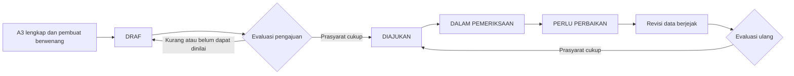

# Model data dan alur registrasi G1-B2

Tanggal **6 November 2026**. Implementasi lokal/sintetis melalui layanan domain internal, sesuai [kontrak 23](23-kontrak-registrasi-lokal-g1b2.md). Tidak tersedia rute bisnis, pengesahan C2 atau pengesahan field operasional.

## Entitas dan hubungan

| Entitas | Penyimpanan dan arti |
| --- | --- |
| Pihak | parties dengan ULID; jenis PERSON atau LEGAL_ENTITY; akun petugas tetap entitas berbeda |
| Orang | people, satu record per pihak orang; domisili sintetis terpisah dari lokasi usaha |
| Badan Usaha | legal_entities, satu record per pihak badan; bentuk badan sintetis bukan penetapan legalitas |
| Unit Usaha | business_units dengan ULID; nama tidak unik, pembuat/wilayah/sektor dari konteks server; bukan NIB/NIK |
| Hubungan Pihak–Usaha | party_unit_links, banyak-ke-banyak; peran, awal/akhir hubungan; versi registrasi merujuk link yang digunakan saat itu |
| Lokasi Usaha | business_locations adalah identitas stabil per Unit; atribut label/cabang/referensi klaim ada pada registration_revision_locations |
| Kegiatan Usaha | business_activities adalah identitas stabil per Unit; uraian pada registration_revision_activities; tidak mengarang kode KBLI resmi |
| Registrasi | registrations mengikat satu Unit, katalog, pembuat/waktu, state, version dan data_version |
| Revisi data | registration_revisions menyimpan nama/sumber/referensi NIB pada versi data tertentu; record terkait menyimpan pihak, lokasi dan kegiatan berulang |
| Status field/sektor | registration_field_states per revisi/field tetap DRAFT_UNVERIFIED; sector_state tetap NOT_STARTED, terpisah dari state registrasi |
| Katalog uji | registration_catalogs, versi/cakupan/tujuan/peran/pemetaan field/standar klaim sintetis; konfigurasi tidak berarti penetapan resmi |
| Penilaian klaim | registration_claim_reviews per revisi/katalog/klaim/dokumen/petugas/hasil; urutan ditentukan nomor versi registrasi, bukan tebakan dari ID atau waktu yang sama |
| Kandidat | registration_duplicate_reviews menyimpan hasil pemeriksaan, versi data dan fingerprint himpunan kandidat; tidak menyimpan master duplikat kedua |
| Riwayat dan izin | registration_history, registration_commands serta registration_authorizations menyimpan transisi, idempotensi dan sumber mandat/definisi yang dipakai |
| Penguncian | registration_mutexes dan registry_name_mutexes berisi kunci teknis, tanpa data pribadi/nilai bisnis mentah |

Kolom JSON hanya untuk konfigurasi katalog. Pihak/hubungan, lokasi, kegiatan dan penilaian berulang disimpan sebagai record terkait, bukan daftar menumpuk dalam satu kolom. Snapshot revisi adalah riwayat satu registri, bukan master per OPD. Unit B1 untuk tes fondasi tidak otomatis dikonversi menjadi draf A3.

Pengubahan draf membuat revisi baru. Lokasi/kegiatan yang tetap sama mempertahankan ID. Hubungan yang dilepas diberi waktu akhir dan referensi revisi lamanya dipertahankan. Identitas pihak bersama tidak dapat ditimpa lewat edit draf Unit. Penyuntingan memakai `version` untuk menolak permintaan usang; `data_version` bertambah hanya bila data A3 berubah. Pemeriksaan/pengajuan meningkatkan version tanpa menciptakan versi data baru.

## Alur yang tersedia

Status tersimpan teknis: DRAFT, SUBMITTED, IN_REVIEW dan NEEDS_CORRECTION. READY/INCOMPLETE/UNKNOWN adalah hasil perhitungan kelengkapan. RESUBMITTED adalah alasan event pengajuan ulang menuju SUBMITTED. Label teknis lokal ini bukan finalisasi seluruh enum/transisi operasional DT-033. Tidak ada state APPROVED atau VERIFIED pada alur B2.

Pengajuan awal/ulang memerlukan mandat SUBMIT_REGISTRATION atas field alur, hak baca atas semua kelompok yang dievaluasi, standar sintetis sah, penilaian klaim memadai pada revisi berjalan dan hasil pemeriksaan kandidat yang cukup. Draf tanpa NIB dapat mencapai pengajuan dengan standar klaim sintetis yang relevan. Pengajuan tidak mengesahkan induk, NIB, field atau sektor. Pemisahan pembuat dan verifikator C2 tetap dijaga pada fondasi B1 dan harus diterapkan ketika C2 mendapat izin; B2 belum menyediakan transisi itu.

## Migrasi dan hak lokal

Tiga migrasi baru menambah **16 tabel**, sehingga total sembilan migrasi dan 39 tabel termasuk migrations pada setiap database dev/test khusus.

| Migrasi | Fungsi |
| --- | --- |
| 2026_11_06_000007_create_a3_registration | Registrasi/revisi/relasi lokasi-kegiatan, katalog/penilaian/riwayat/izin/kunci; tambahan domisili/bentuk badan sintetis, indeks nama, metadata bukti |
| 2026_11_06_000008_protect_registration_history | 22 trigger UPDATE/DELETE untuk katalog dan riwayat baru yang hanya boleh ditambah |
| 2026_11_06_000009_order_registration_reviews_by_version | Urutan penilaian dengan registration_version; menolak backfill otomatis bila penilaian lama sudah terisi |

Enam migrasi B1 dipertahankan. Migrasi 009 ditambahkan setelah pemeriksaan menemukan bahwa waktu/ULID bukan urutan transaksi yang memadai untuk penilaian dari proses berbeda. Tidak menulis ulang migrasi yang sudah diterapkan atau mengarang urutan riwayat. Tabel penilaian masih kosong saat migrasi lokal diterapkan.

Runtime tidak mendapat CREATE/DROP/GRANT atau DELETE. Hak tambahan hanya pada tabel baru di sijai_umkm_g1b1_dev dan sijai_umkm_g1b1_test dengan akun runtime masing-masing:

| Tabel baru | Hak runtime |
| --- | --- |
| registrations, registration_mutexes, registry_name_mutexes | SELECT, INSERT, UPDATE; diperlukan untuk versi/kunci transaksi |
| registration_catalogs, registration_revisions, business_locations, business_activities, registration_revision_parties, registration_revision_locations, registration_revision_activities, registration_field_states, registration_claim_reviews, registration_duplicate_reviews, registration_history, registration_commands, registration_authorizations | SELECT, INSERT |

Hak tambahan telah diterapkan lokal melalui admin privat yang sama dengan B1; tidak mengubah akun/schema aplikasi lain. Trigger immutable tetap menjadi lapisan tambahan. Privilege per tabel bertahan saat tabel test dibangun ulang. Pada komputer lain, penyiapan akun/hak harus dilakukan admin lokal dengan file kredensial privat sesuai [panduan 20](20-operasi-mysql-lokal-g1b1.md); aplikasi tidak memberikan GRANT dan ZIP tidak membawa akun/kata sandi.

Jalankan migrasi melalui mysql_migrations. `composer test:mysql` menyiapkan migrasi test lalu menguji seluruh suite; suite melakukan fresh/rollback hanya pada database test khusus. Jangan menjalankan dua suite sekaligus pada schema test yang sama. Database dev hanya menerima migrasi maju. Tidak ada seeder, impor atau dokumen nyata.

## Batas berikutnya

Pemetaan field kelompok pencatatan bukan kamus field resmi akhir, standar bukti uji bukan daftar dokumen wajib, dan nama peran sintetis bukan OPD/petugas resmi. Kandidat nama bukan pencocokan menyeluruh NIK/NIB/lokasi/pihak. Katalog operasional, KBLI resmi berversi, SOP, standar bukti, autentikasi, hak nyata serta kesiapan hosting tetap membutuhkan keputusan/bukti dan izin tahap terkait.
