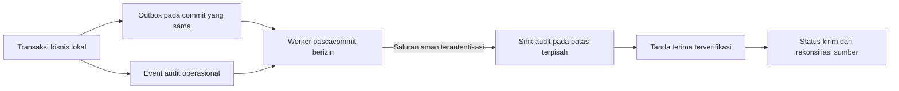

# Rancangan teknis salinan audit independen KB-12

Disusun **6 November 2026**, difinalisasi **7 November 2026**. Status **DIUSULKAN/TERDOKUMENTASI UNTUK PENINJAUAN**, dalam batas G1-B3.1. Tidak membuat worker/sink baru, migrasi, kunci, layanan atau koneksi eksternal. Teknologi/lokasi/pengelola/jadwal/retensi/angka kapasitas tetap belum ditetapkan. Ini bukan bukti salinan independen atau backup telah tersedia.

## Titik awal dan arti independen

Saat ini perubahan kritis, event audit operasional dan niat pengiriman pada audit_outbox disimpan dalam satu transaksi MySQL. Event audit immutable dan outbox pending lokal. Bila penulisan audit/outbox wajib gagal, transaksi terkait dibatalkan. Kontrol ini telah diuji, tetapi dua tabel pada instance yang sama **belum merupakan salinan independen**.

Salinan yang diusulkan berada pada batas administrasi, kredensial, hak tulis/hapus dan kegagalan yang dipisahkan dari runtime sumber. Pilihan media/produk/lokasi/infrastruktur harus dibuktikan terhadap KB-12/14/17/18 dan persetujuan operasi. Tidak otomatis memilih cloud/vendor, server PDN, database lain di instance yang sama atau folder lain sebagai bukti independensi.

## Alur usulan setelah izin terpisah

1. Sumber menghasilkan ID event stabil, versi schema payload dan referensi instance sumber yang dikelola server. Event tidak berisi kredensial, NIK/dokumen/nilai bisnis mentah. Metadata aktor/objek tetap dapat sensitif dan bukan data publik.
2. Niat pengiriman tersimpan atomik pada transaksi sumber. Worker hanya membaca event yang telah commit; tidak memakai payload tak tepercaya dari browser atau draf transaksi yang batal.
3. Payload dibentuk melalui proyeksi metadata yang diizinkan, dengan serialisasi kanonis/versi yang jelas. Rancangan integritas memakai digest dan tanda terima; mekanisme tanda tangan/kunci/algoritme final memerlukan kajian/penetapan, belum dipilih di sini. Hash saja tidak membuktikan pengirim sah atau kebal administrator.
4. Pengiriman diasumsikan dapat berulang. Sink melakukan idempotensi berdasarkan identitas sumber + event ID; payload identik tidak menggandakan event, ID sama dengan isi berbeda menjadi insiden integritas, bukan overwrite.
5. Sink menyimpan catatan append-only dan tanda terima yang dapat diverifikasi. Sumber baru menandai terkirim setelah tanda terima cocok dengan identitas/hash/versi event. Timeout setelah sink commit dipulihkan lewat pengiriman ulang/rekonsiliasi, bukan menebak gagal atau membuat ID baru.
6. Kegagalan jaringan/sink setelah commit tidak diam-diam membatalkan bisnis yang sudah sah. Outbox tetap tertunda/gagal dengan alasan minimum dan retry/rekonsiliasi. Kebijakan antrean penuh atau pembatasan operasi memerlukan keputusan risiko; tidak dibuat angka ambang, frekuensi, retensi atau SLA resmi.
7. Koreksi hasil bisnis membuat event baru yang merujuk riwayat, tidak mengedit event lama/salinannya. Urutan dan event hilang diperiksa melalui metadata sumber/versi/rekonsiliasi, bukan mengandalkan kedatangan jaringan atau urutan ULID antarproses.

Status kirim/usulan metadata seperti claim/lease, next_attempt_at, receipt/hash, delivered_at dan error_code memerlukan kontrak serta migrasi pada tahap berizin. Kolom tersebut **belum ditambahkan** pada outbox saat ini. Tidak mengklaim retry/penjadwalan/recovery worker sudah berjalan.

## Pemisahan akses yang perlu ditinjau

| Komponen/fungsi usulan | Hak minimum dan batas |
| --- | --- |
| Runtime aplikasi | Tambah event sumber/outbox dalam transaksi; tidak diberi hak hapus/ubah audit atau kredensial sink |
| Worker pengiriman | Baca proyeksi event dan kelola status outbox yang diperlukan; tidak mengubah nilai resmi UMKM atau isi event |
| Penerima/sink | Menerima event dari sumber terautentikasi, validasi schema/integritas/idempotensi; tidak memberi akses master bisnis sumber |
| Pemantau/rekonsiliasi | Metadata antrean/receipt/gap sesuai mandat; bukan semua bukti/pribadi atau ekspor bebas |
| Pengelola kunci/infrastruktur | Pemisahan tanggung jawab/pencabutan/rotasi serta audit pengelolaan; bukan pengesah bisnis/superuser data |
| Pengawasan/PDP/retensi | Penilaian sensitivitas, dasar pemrosesan, penahanan dan penyusutan sah; identitas/fungsi resmi belum ditetapkan |

Tidak menetapkan OPD/petugas/Pengendali/Prosesor secara hukum. JRA, penahanan sah dan akses salinan mengikuti keputusan hukum/organisasi; riwayat bukan alasan menyimpan semua data selamanya. Salinan audit berbeda dari backup; kebutuhan pemulihan aplikasi dan RPO/RTO tetap KB-17.

## Pengujian yang diusulkan, belum dijalankan pada sink

| Kondisi | Hasil yang harus dibuktikan pada tahap berizin |
| --- | --- |
| Audit/outbox sumber gagal | Bisnis kritis rollback, tidak ada event berhasil sebagian; bukti lokal saat ini ada pada laporan 30 |
| Sink/jaringan tidak tersedia | Event sumber tetap, antrean terpantau, tidak ada status terkirim palsu |
| Terkirim ulang/timeout setelah commit sink | Satu salinan yang sama dan receipt konsisten |
| ID sama/isi berbeda atau proyeksi rusak | Ditolak/ditahan dengan jejak insiden, tidak overwrite |
| Kredensial worker dicabut/kedaluwarsa | Pengiriman ditolak, tanpa jalur admin bisnis pengganti |
| Worker berhenti atau lease kedaluwarsa | Dapat diambil ulang secara aman; klaim ganda tidak menggandakan salinan |
| Event tidak berurutan/hilang | Rekonsiliasi mendeteksi gap, tidak mengubah kejadian historis |
| Kapasitas terlampaui | Kebijakan kegagalan/eskalasi sesuai mandat, belum ada ambang resmi |
| Retensi/penahanan/pemusnahan sah | Konsistensi sumber/salinan/bukti dan jejak keputusan tanpa hapus sewenang-wenang |

Prasyarat sebelum implementasi berikutnya: pilihan lokasi/teknologi dan bukti independensi, kontrak payload/receipt/ancaman, hak/penugasan, saluran/kunci, kebijakan risiko/antrean, retensi/operasi dan izin teknis yang eksplisit. G1-B3.1 tidak mencakup keputusan atau pemasangannya.
