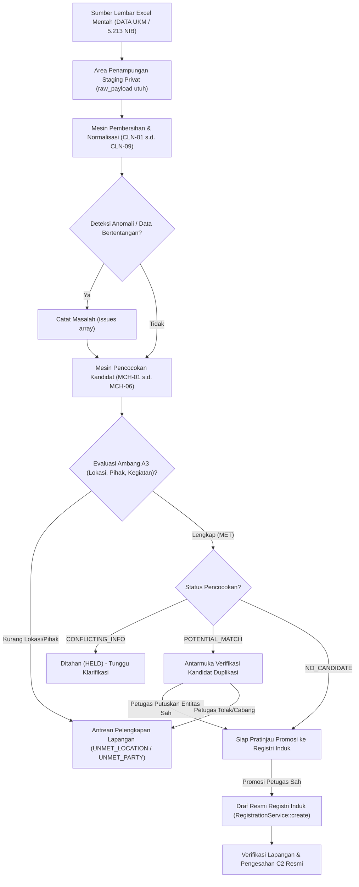

# Katalog Aturan Pembersihan dan Pencocokan Data Historis SIJAI UMKM

**Kode Dokumen:** `SIJAI-DOC-50`  
**Versi:** 1.0.0  
**Tanggal Efektif:** 7 November 2026  
**Status:** DOKUMENTASI RESMI IMPLEMENTASI FASILITAS PERSIAPAN IMPOR  
**Dasar Keputusan Bisnis:** KB-01 s.d. KB-18, DT-003 (Model B A3+B1+C2), DT-005 (C+F+H2), DT-007 (Model C), DT-009 (C+B2+V2+K2), DT-011 (C+D1+M1+E1), DT-015 (Pembersihan Data Historis), DT-019 (Dasar Penggunaan Staging Privat).

---

## 1. Pendahuluan dan Prinsip Tata Kelola

Katalog ini mendokumentasikan secara rinci seluruh aturan komputasi pembersihan (*cleaning rules*), penyeragaman format (*normalization rules*), deteksi anomali (*anomaly detection rules*), serta aturan pencocokan kandidat (*candidate matching rules*) yang diterapkan pada fasilitas persiapan impor data historis SIJAI UMKM.

Fasilitas ini memproses dua dataset historis Kabupaten Sinjai dengan sidik digital resmi:
1. `DATA UKM(2).xlsx` (Dinas Koperasi dan UKM Kabupaten Sinjai, SHA-256: `697da71fd297483829ae7a30c300860451634aa569a02eff2ba1f258d5ca97a5`, ~42.730 baris pembukuan historis)
2. `5.213 NIB(2).xlsx` (Dinas Penanaman Modal dan Pelayanan Terpadu Satu Pintu Kabupaten Sinjai, SHA-256: `3f4a65ae9686f52dec17d0ee5ae3d6c527b6ebd62c189b25a816247e8851a738`, 5.213 baris pada lembar utama, lembar `perubahan`, dan `Sheet3`)

### Prinsip Utama (Guardrails)
1. **Preservasi Nilai Asli (Immutability of Raw Data):** Nilai mentah dari lembar Excel sumber disimpan secara utuh pada kolom `raw_payload` (JSON) dan tidak pernah ditimpa atau dihapus.
2. **Tidak Ada Koreksi Otomatis yang Mengubah Makna Bisnis:** Mesin pembersihan hanya menormalisasi format representasi teknis. Mesin dilarang membuat tebakan nilai bisnis (misalnya mengarang nama pemilik, mengasumsikan alamat rumah adalah lokasi toko, atau mengubah sektor usaha secara sepihak).
3. **Keterlacakan dan Versi Aturan (Traceability):** Setiap transformasi dan deteksi masalah dicatat dengan kode aturan (`CLN-xx`, `MCH-xx`), tingkat keparahan (`INFO`, `WARNING`, `ERROR`), deskripsi masalah dalam bahasa Indonesia, dan timestamp audit.
4. **Perlindungan Data Pribadi (KB-11):** NIK dan nomor kontak yang ditampilkan pada antarmuka web, log audit, atau laporan disamarkan (*masked*). Format valid NIK bukan bukti keabsahan identitas hukum resmi (wajib verifikasi fisik/lapangan B1).
5. **Larangan Penggabungan Otomatis (Anti Auto-Merge):** Mesin pencocokan hanya menandai kandidat dan mendeteksi konflik. Penggabungan entitas, penetapan keabsahan, atau promosi ke Registri Induk wajib melalui penetapan petugas berwenang dengan hak akses sah.

---

## 2. Katalog Aturan Pembersihan Data (Cleaning Rules)

| Kode Aturan | Nama Aturan | Komponen Sasaran | Tingkat Keparahan | Deskripsi Transformasi dan Validasi |
| :--- | :--- | :--- | :--- | :--- |
| **CLN-01** | Penyeragaman Format Teks & Spasi | Nama Unit, Nama Pemilik, Alamat, Wilayah, KBLI | `INFO` | Menghapus spasi ganda, spasi di awal/akhir (*trim*), karakter non-pencetak (*control characters*), serta menyeragamkan penulisan huruf besar (*uppercase*) pada entitas nama dan wilayah administratif. |
| **CLN-02** | Normalisasi Angka dan Nilai Finansial | Modal Usaha, Omzet Penjualan, Total Aset, Jumlah Tenaga Kerja | `WARNING` / `ERROR` | Mengonversi pemisah ribuan (titik/koma) ke format numerik standar sistem. Memeriksa nilai negatif (dilarang dalam akuntansi dasar usaha mikro) dan mendeteksi anomali desimal atau karakter mata uang (`Rp`). |
| **CLN-03** | Pemeriksaan Format NIK (16 Digit) | Nomor Induk Kependudukan (NIK) Pemilik | `WARNING` / `ERROR` | Memeriksa string 16 digit numerik. Mendeteksi NIK tidak lengkap (< 16 digit), bukan angka, atau berawalan non-Sinjai/Sulsel (misal bukan `7307...`). NIK valid secara format diberi catatan: *bukan bukti hukum keabsahan identitas tanpa bukti fisik*. Menghasilkan nilai tersamar (*masked*). |
| **CLN-04** | Pemeriksaan Format NIB (13 / 12 Digit) | Nomor Induk Berusaha (NIB) | `WARNING` / `INFO` | Mengklasifikasikan NIB: 13 digit numerik (format OSS RBA PP 5/2021) atau 12 digit numerik (format OSS 1.0 / 1.1 lama). Menandai NIB dengan panjang tidak standar atau karakter non-numerik. NIB tetap bersifat opsional (DT-003). |
| **CLN-05** | Pemeriksaan Format Tanggal & Periode | Tanggal Terbit NIB, Tanggal Perubahan, Tahun Mulai Usaha | `WARNING` | Mendeteksi variasi format tanggal (DD/MM/YYYY, YYYY-MM-DD, integer nomor seri Excel). Menandai tanggal di masa depan (*future date* > tahun berjalan) atau tahun pendirian yang tidak masuk akal (< 1945). |
| **CLN-06** | Penanganan Nilai Kosong, Nol, & Tidak Diketahui | Seluruh Atribut Sumber | `INFO` / `WARNING` | Membedakan secara tegas nilai: `NULL` (tidak diisi), string kosong `""`, teks harfiah `"N/A"`, `"-"`, `"TIDAK ADA"`, `"NIHIL"`, dan angka nol `0`. Angka nol pada tenaga kerja atau omzet ditandai untuk klarifikasi lapangan. |
| **CLN-07** | Pemisahan Alamat Domisili vs Lokasi Operasional | Alamat Pemilik, Alamat Usaha | `ERROR` / `WARNING` | Menegakkan batasan bahwa alamat KTP pemilik **tidak boleh otomatis dijadikan lokasi fisik operasional usaha**. Jika kolom alamat usaha kosong di sumber, baris ditandai `UNMET_LOCATION` sehingga tidak memenuhi ambang A3. |
| **CLN-08** | Normalisasi Kategori Usaha & Pemetaan Sektor | Kategori Sumber, Sektor Pilot Pangan (KB-09) | `WARNING` | Menormalisasi teks bebas kategori (misal `KULINER`, `MAKANAN MINUMAN`, `JASA`). Menegakkan aturan: kategori `KULINER` **tidak otomatis dianggap Sektor Pengolahan Pangan Resmi**; wajib verifikasi lapangan untuk KBLI 10xxx/11xxx. |
| **CLN-09** | Deteksi Anomali Nilai & Inkonsistensi Bisnis | Seluruh Atribut Terkait | `ERROR` | Mendeteksi ketidakkonsistenan substantif, antara lain: tenaga kerja bernilai ekstrem (contoh baris sumber dengan tenaga kerja 2.109 orang pada usaha mikro), aset bernilai negatif, modal > aset tanpa catatan liabilitas, atau omzet miliaran rupiah dengan tenaga kerja 0. |

---

## 3. Rincian Teknis Aturan Pembersihan

### CLN-01: Penyeragaman Format Teks dan Spasi
- **Masukan Mentah:** String teks bebas dari sel Excel (misal: `"   WARUNG   BERKAH   \t\n"`).
- **Proses Transformasi:**
  1. Hapus karakter escape dan whitespace di awal/akhir menggunakan `trim()`.
  2. Gantikan deretan whitespace berulang (`\s+`) dengan satu spasi tunggal.
  3. Konversi nama pihak, nama unit, kecamatan, dan kelurahan menjadi format huruf kapital standar (`mb_strtoupper`).
  4. Konversi alamat jalan menjadi format Title Case (`mb_convert_case(..., MB_CASE_TITLE)`).
- **Keluaran:** String bersih tersanitasi.

### CLN-02: Normalisasi Angka dan Nilai Finansial
- **Masukan Mentah:** Nilai numerik/string dari sel Excel (contoh: `"Rp 15.000.000,-"`, `"15,000,000"`, `"-5000000"`, `2109`).
- **Proses Transformasi:**
  1. Hapus simbol mata uang (`Rp`, `IDR`, `rp`), spasi, dan akhiran `,-`.
  2. Identifikasi pemisah desimal dan ribuan.
  3. Konversi menjadi nilai integer/desimal standar basis data.
  4. Periksa batas kewajaran:
     - Jika nilai < 0: catat masalah `ISSUE_FINANCIAL_NEGATIVE` (tingkat `ERROR`).
     - Jika tenaga kerja > 100 untuk kategori mikro/kecil: catat masalah `ISSUE_WORKFORCE_ANOMALY` (tingkat `WARNING`).
- **Keluaran:** Nilai numerik bersih dan flag status anomali.

### CLN-03: Pemeriksaan Format NIK (16 Digit)
- **Masukan Mentah:** Nilai kolom NIK (contoh: `"7307011205850001"`, `7307011205850001`, `"730701120585000"`, `"0"`).
- **Proses Transformasi:**
  1. Bersihkan karakter spasi atau tanda hubung (`-`).
  2. Periksa panjang karakter dan tipe data numerik (`ctype_digit`).
  3. Jika panjang != 16 digit: catat masalah `ISSUE_NIK_INVALID_LENGTH` (`ERROR`).
  4. Jika panjang == 16 digit:
     - Format dinyatakan valid secara teknis.
     - Simpan versi tersamar (*masked*) untuk tampilan layar: `730701******0001`.
     - Tetapkan catatan kepatuhan: *Validitas format bukan bukti keabsahan identitas tanpa verifikasi dokumen fisik (DT-003 B1)*.
- **Keluaran:** NIK normal, NIK tersamar, flag keabsahan format.

### CLN-04: Pemeriksaan Format NIB (13 / 12 Digit)
- **Masukan Mentah:** Nilai kolom NIB (contoh: `"9120001234567"`, `"123456789012"`, `"BELUM ADA"`, `null`).
- **Proses Transformasi:**
  1. Jika kosong atau teks penanda ketiadaan (`"-"`, `"0"`, `"TIDAK ADA"`): tandai `NIB_NOT_PROVIDED`. NIB bersifat opsional (DT-003).
  2. Jika panjang 13 digit numerik: klasifikasikan sebagai `NIB_OSS_RBA_13_DIGIT`.
  3. Jika panjang 12 digit numerik: klasifikasikan sebagai `NIB_OSS_LEGACY_12_DIGIT` (memerlukan migrasi OSS RBA).
  4. Jika panjang di luar 12 atau 13 digit numerik: catat masalah `ISSUE_NIB_NON_STANDARD_FORMAT` (`WARNING`).
- **Keluaran:** NIB normal, klasifikasi versi NIB, flag status format.

### CLN-05: Pemeriksaan Format Tanggal dan Tahun
- **Masukan Mentah:** Sel tanggal (bisa berupa teks string `"12/05/2021"`, `"2021-05-12"`, atau serial integer Excel `44328`).
- **Proses Transformasi:**
  1. Deteksi apakah nilai berupa integer serial Excel (> 20000); konversi menggunakan kalkulasi epoch spreadsheet (1900-01-01).
  2. Parsing format string menggunakan pola regex standar (d/m/Y, Y-m-d).
  3. Validasi batas kalender (`checkdate`).
  4. Periksa apakah tahun > tahun berjalan (2026): tandai `ISSUE_DATE_FUTURE` (`ERROR`).
  5. Periksa apakah tahun pendirian usaha < 1945: tandai `ISSUE_YEAR_SUSPICIOUS` (`WARNING`).
- **Keluaran:** Tanggal terstandarisasi ISO-8601 (`YYYY-MM-DD`) atau NULL jika tidak valid.

### CLN-06: Penanganan Nilai Kosong, Nol, dan Tidak Diketahui
- **Masukan Mentah:** Sel kosong atau representasi placeholder.
- **Proses Transformasi:**
  1. Nilai dievaluasi terhadap daftar nilai khusus: `['', 'null', 'nil', '-', '--', 'n/a', 'na', 'tidak ada', 'nihil', 'none', 'unknown', '0']`.
  2. Jika kolom berupa entitas teks dan bernilai dalam daftar di atas: simpan sebagai `NULL` terstruktur.
  3. Jika kolom berupa numerik finansial dan bernilai `0`: simpan sebagai `0` dengan flag `ZERO_OR_UNSPECIFIED` untuk verifikasi apakah usaha benar-benar nihil aset/omzet atau belum mencatat pembukuan.
- **Keluaran:** Nilai terstandarisasi yang membedakan nilai kosong dari nilai nol faktual.

### CLN-07: Pemisahan Alamat Domisili vs Lokasi Operasional Usaha
- **Masukan Mentah:** Kolom `ALAMAT` pada `DATA UKM(2).xlsx` (catatan historis menunjukkan kolom ini bersumber dari domisili KTP pemilik, bukan lokasi usaha).
- **Proses Transformasi:**
  1. Nilai kolom `ALAMAT` dialokasikan ke entitas pihak (`party.domicile_address`).
  2. Periksa apakah terdapat kolom spesifik `LOKASI_USAHA` atau `ALAMAT_USAHA`.
  3. Jika kolom lokasi operasional usaha tidak tersedia:
     - Set status `operational_address` = `NULL`.
     - Catat masalah `ISSUE_MISSING_OPERATIONAL_LOCATION` (`ERROR`).
     - Set evaluasi ambang A3: `UNMET_LOCATION`.
  4. Cegah pengisian otomatis alamat usaha menggunakan alamat domisili pemilik.
- **Keluaran:** Data pihak terisi, lokasi operasional tertahan, status A3 terkunci.

### CLN-08: Normalisasi Kategori Usaha dan Pemetaan Sektor
- **Masukan Mentah:** Kolom `SEKTOR`, `BIDANG USAHA`, `JENIS USAHA` (contoh: `"KULINER"`, `"MAKANAN & MINUMAN"`, `"PERDAGANGAN"`).
- **Proses Transformasi:**
  1. Bersihkan string teks dan mapping ke kelompok kegiatan umum.
  2. Uji relevansi terhadap Sektor Percontohan MVP (KB-09: Industri Pengolahan Pangan):
     - Kategori `"KULINER"` atau `"MAKANAN"` **TIDAK OTOMATIS** dipetakan ke Industri Pengolahan Pangan.
     - Berikan penanda: `REQUIRES_SECTOR_FIELD_VERIFICATION`.
     - Pisahkan antara penyedia makanan-minuman siap saji (KBLI 56xxx - Jasa Kuliner/Restoran/Warung) dengan pengolahan industri pangan kemasan (KBLI 10xxx/11xxx).
- **Keluaran:** Kategori usaha ternormalisasi dan flag kewajiban verifikasi sektoral.

### CLN-09: Deteksi Anomali Nilai dan Inkonsistensi Bisnis
- **Masukan Mentah:** Kombinasi beberapa atribut dalam satu baris.
- **Proses Transformasi:**
  1. **Anomali Tenaga Kerja Ekstrem:** Jika baris terdaftar sebagai Usaha Mikro namun tenaga kerja tercatat ratusan/ribuan (misal: 2.109 orang), tandai `ANOMALY_WORKFORCE_EXTREME`. Nilai disimpan apa adanya di raw payload, tetapi dinetralkan di staging untuk verifikasi lapangan.
  2. **Anomali Omzet vs Tenaga Kerja:** Omzet > Rp 500.000.000 tetapi tenaga kerja = 0. Tandai `ANOMALY_FINANCIAL_WORKFORCE_MISMATCH`.
  3. **Anomali NIB Tanpa Nama Usaha:** Memiliki NIB 13 digit tetapi nama usaha berupa placeholder kosong. Tandai `ANOMALY_INCOMPLETE_NIB_RECORD`.
- **Keluaran:** Koleksi daftar anomali terstruktur pada atribut `issues` baris staging.

---

## 4. Evaluasi Ambang Batas Minimum Registrasi (A3 Readiness)

Sesuai keputusan **DT-003 Model B (kombinasi A3+B1+C2)**, data historis yang berada di area staging tidak dapat dipromosikan menjadi Draf Registri Induk sebelum memenuhi kriteria minimum **A3 (Ambang Batas Minimum Draf Usaha)**:

$$\text{Memenuhi A3} \iff \text{Pihak Jelas} \land \text{Lokasi Usaha Teridentifikasi} \land \text{Kegiatan Dikenali} \land \text{Penanda Usaha Ada} \land \text{Sumber \& Petugas Sah}$$

### Status Kesiapan A3 pada Baris Staging
1. `MET`: Seluruh syarat A3 terpenuhi. Baris siap diajukan untuk promosi ke draf resmi Registri Induk.
2. `UNMET_LOCATION`: Lokasi fisik operasional usaha belum ada atau masih mengandalkan alamat KTP pemilik. Wajib pelengkapan lapangan.
3. `UNMET_ACTIVITY`: Kegiatan usaha utama / KBLI tidak teridentifikasi. Wajib pelengkapan lapangan.
4. `UNMET_PARTY`: Nama pemilik / penanggung jawab atau identitas pihak tidak tersedia secara sah.
5. `UNMET_MULTIPLE`: Mengalami lebih dari satu kekurangan syarat pokok di atas.

---

## 5. Katalog Aturan Pencocokan Kandidat (Candidate Matching Rules)

| Kode Aturan | Nama Aturan | Objek Evaluasi | Kriteria Pencocokan | Status Hasil yang Dihasilkan |
| :--- | :--- | :--- | :--- | :--- |
| **MCH-01** | Pencocokan Identitas Orang | Orang / Pihak | NIK 16 digit sama persis ATAU Nama Lengkap ternormalisasi sama dengan domisili/tanggal lahir sama. Mendeteksi jika NIK sama memiliki nama berbeda (*konflik identitas*). | `POTENTIAL_MATCH` (jika konsisten) / `CONFLICTING_INFO` (jika nama berbeda) |
| **MCH-02** | Pencocokan Badan & Penanda Usaha | Badan Usaha / Izin | NIB sama persis (13 digit atau 12 digit). Mendeteksi jika NIB sama diklaim oleh pemilik yang berbeda atau nama unit berbeda. | `POTENTIAL_MATCH` / `CONFLICTING_INFO` |
| **MCH-03** | Pencocokan Unit Usaha | Unit Usaha | Nama Unit ternormalisasi sama persis dan berlokasi di desa/kelurahan serta kecamatan yang sama. | `POTENTIAL_MATCH` / `NEEDS_MANUAL_REVIEW` |
| **MCH-04** | Pencocokan Lintas Dataset (Cross-Dataset) | Seluruh Entitas | Membandingkan baris pada `DATA UKM(2).xlsx` dengan baris pada `5.213 NIB(2).xlsx`. Menandai baris yang mewakili usaha yang sama di kedua dinas. | `POTENTIAL_MATCH` / `CONFLICTING_INFO` |
| **MCH-05** | Pencocokan Terhadap Registri Induk Resmi | Registri Induk (SSOT) | Memeriksa apakah kandidat sudah terdaftar sebelumnya pada unit usaha aktif di tabel `business_units` atau pendaftaran resmi di `official_registrations`. | `POTENTIAL_MATCH` (mencegah duplikasi pendaftaran resmi) |
| **MCH-06** | Klasifikasi Status Pencocokan & Anti Auto-Merge | Hasil Konsolidasi | Mengelompokkan status akhir baris dan mengunci larangan penggabungan otomatis oleh mesin. | `NO_CANDIDATE`, `POTENTIAL_MATCH`, `CONFLICTING_INFO`, `NEEDS_MANUAL_REVIEW` |

---

## 6. Rincian Empat Status Hasil Pencocokan

1. **`NO_CANDIDATE` (Tidak Ditemukan Kandidat):**
   - Tidak ada entitas serupa yang ditemukan baik di dalam dataset sendiri, dataset pembanding, maupun Registri Induk resmi.
   - Jika baris ini memenuhi kriteria A3 (`a3_readiness = MET`), baris ini memenuhi syarat untuk dipromosikan sebagai draf registrasi baru yang berdiri sendiri.

2. **`POTENTIAL_MATCH` (Kandidat Kemungkinan Sama):**
   - Ditemukan kemiripan kuat pada penanda kunci (misal NIK sama dan nama konsisten, atau nama unit dan lokasi desa sama).
   - **Tindakan Sistem:** Ditampilkan di antarmuka verifikasi kandidat duplikasi. Mesin **dilarang menggabungkan baris**. Petugas verifikator yang ditugaskan harus memeriksa apakah data ini merupakan unit yang sama, unit cabang, atau pembaruan berkas izin.

3. **`CONFLICTING_INFO` (Kandidat dengan Informasi Bertentangan):**
   - Ditemukan klaim identitas yang tumpang tindih tetapi atribut substantifnya saling bertentangan secara tajam (contoh: NIK 16 digit sama persis tetapi nama pemilik di Dinas Koperasi berbeda dengan nama di Dinas PMPTSP, atau NIB sama tetapi lokasi usaha di kecamatan berbeda).
   - **Tindakan Sistem:** Baris ditahan (*HELD*). Sistem menolak promosi otomatis ke draf resmi sampai konflik diselesaikan melalui mekanisme pembuktian fisik / klarifikasi lapangan.

4. **`NEEDS_MANUAL_REVIEW` (Memerlukan Pemeriksaan Manual):**
   - Data memiliki kemiripan fonetik atau teks parsial (misal nama warung mirip di kecamatan yang sama, tetapi tanpa NIK atau penanda unik).
   - **Tindakan Sistem:** Memerlukan konfirmasi lapangan oleh petugas pembina wilayah atau verifikator sebelum status kelayakan dapat ditentukan.

---

## 7. Penegakan Kepatuhan Audit dan Non-Destruktif (KB-12 & DT-009)

1. **Trigger Basis Data Pelindung Histori:**
   Tabel `historical_staging_history` dilindungi oleh pemicu basis data (*database triggers*):
   - `trg_historical_staging_history_no_update`: Menolak instruksi `UPDATE` dengan pesan galat SQL.
   - `trg_historical_staging_history_no_delete`: Menolak instruksi `DELETE` dengan pesan galat SQL.
2. **Setiap Transisi Status Baris Staging Tercatat:**
   Setiap perubahan status peninjauan petugas (`PENDING`, `IN_REVIEW`, `VERIFIED_VALID`, `REJECTED`, `HELD`) atau promosi ke draf resmi Registri Induk wajib menghasilkan satu baris riwayat *append-only* yang memuat:
   - ID baris staging target.
   - Aksi operasional (`INITIAL_STAGING_IMPORT`, `REVIEW_STATUS_UPDATE`, `PROMOTE_TO_REGISTRY_DRAFT`).
   - Status sebelum dan sesudah perubahan.
   - Aktor petugas dan instansi penanggung jawab.
   - Alasan dan justifikasi keputusan dalam bahasa Indonesia.
   - Timestamp presisi tinggi.

---

## 8. Ringkasan Matriks Alur Pemrosesan

