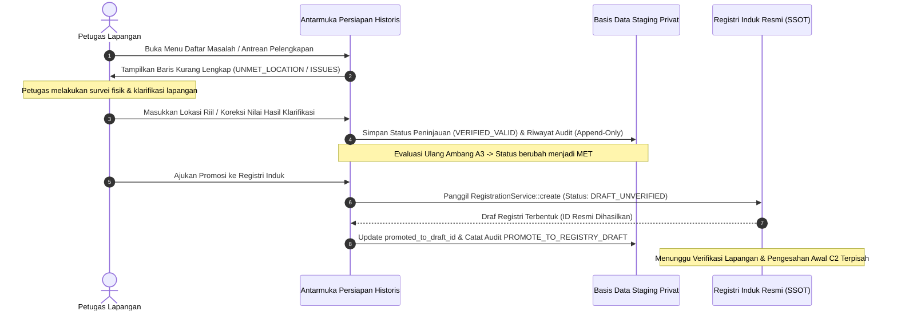

# Daftar Masalah dan Pelengkapan Lapangan Data Historis SIJAI UMKM

**Kode Dokumen:** `SIJAI-DOC-51`  
**Versi:** 1.0.0  
**Tanggal Efektif:** 7 November 2026  
**Status:** DOKUMENTASI RESMI DAFTAR MASALAH DAN PETUNJUK TINDAK LANJUT LAPANGAN  
**Kaitan Dokumen:** `docs/49-laporan-profiling-dan-kualitas-data-historis.md`, `docs/50-katalog-aturan-pembersihan-dan-pencocokan.md`, `docs/11-audit-baseline-data-historis.md` (AH-01 s.d. AH-06).

---

## 1. Latar Belakang dan Tujuan

Berdasarkan hasil pemetaan dan profiling terhadap dataset historis Kabupaten Sinjai (`DATA UKM(2).xlsx` dan `5.213 NIB(2).xlsx`), ditemukan berbagai masalah substantif, ketidaklengkapan data, anomali input, dan potensi konflik informasi.

Dokumen ini disusun untuk:
1. Menginventarisasi seluruh masalah kualitas data yang terdeteksi pada area penampungan sementara (*staging*).
2. Membedakan masalah yang dapat ditangani secara teknis (*data cleaning*) dengan masalah yang **wajib diselesaikan melalui verifikasi faktual di lapangan atau penetapan kebijakan dinas**.
3. Memberikan panduan operasional bagi petugas verifikator lapangan (*surveyor*) dan koordinator registri mengenai tindakan korektif yang sah.

---

## 2. Register Masalah Utama dan Klasifikasi Penanganan

| ID Masalah | Nama Masalah | Dataset Terdampak | Klasifikasi Penanganan | Dampak terhadap Status Registrasi | Tindakan Operasional Lapangan |
| :--- | :--- | :--- | :--- | :--- | :--- |
| **ISS-01** | Diskrepansi Denominator NIB (AH-01) | `5.213 NIB(2).xlsx` | Kebijakan & Rekonsiliasi Berkas | Tidak memengaruhi validitas baris individu, dicatat sebagai observasi audit terbuka. | Rekonsiliasi internal antara DPMPTSP dan Administrator SIJAI terhadap perbedaan 5 baris (5.213 judul vs 5.218 baris terisi) pada lembar perubahan dan sheet3. |
| **ISS-02** | Alamat Domisili KTP vs Lokasi Operasional | `DATA UKM(2).xlsx` | Wajib Pelengkapan Lapangan | Menahan pemenuhan syarat A3 (`UNMET_LOCATION`). Data tidak dapat dipromosikan ke draf resmi. | Petugas lapangan mendatangi tempat tinggal pemilik atau menghubungi pemilik untuk melakukan peninjauan fisik lokasi tempat usaha sebenarnya beroperasi. |
| **ISS-03** | Klasifikasi Usaha "KULINER" vs Industri Pangan (KB-09) | `DATA UKM(2).xlsx` | Wajib Klarifikasi Lapangan & KBLI | Data tidak otomatis dimasukkan ke profil sektor pangan sebelum diverifikasi. | Petugas memeriksa apakah usaha melakukan proses pengolahan bahan mentah menjadi produk kemasan berizin (KBLI 10xxx/11xxx) atau merupakan jasa penyedia makanan siap saji (KBLI 56xxx). |
| **ISS-04** | Anomali Nilai Tenaga Kerja Ekstrem (Angka 2.109) | `DATA UKM(2).xlsx` | Verifikasi Lapangan | Baris ditandai memiliki anomali; dinetralkan di staging, tidak boleh mencemari statistik resmi. | Petugas menanyakan langsung kepada pemilik berapa jumlah tenaga kerja riil yang dipekerjakan dan memeriksa apakah angka 2.109 merupakan salah ketik dari tanggal atau kode lokal. |
| **ISS-05** | Nilai Finansial Negatif & Inkonsistensi Neraca | `DATA UKM(2).xlsx` & `5.213 NIB(2).xlsx` | Verifikasi Lapangan & Edukasi | Baris ditandai `ISSUE_FINANCIAL_NEGATIVE`; nilai negatif ditolak sistem. | Petugas membantu pelaku usaha mikro mencatat estimasi nilai modal awal dan aset secara wajar, memisahkan utang dari aset. |
| **ISS-06** | Format NIB 12-Digit (OSS 1.0 / 1.1 Lama) | `5.213 NIB(2).xlsx` | Fasilitasi Layanan Perizinan | Data tetap sah sebagai bukti historis, tetapi ditandai untuk pemutakhiran OSS RBA. | DPMPTSP memfasilitasi pelaku usaha untuk memutakhirkan hak akses OSS dan menerbitkan NIB 13-digit berbasis risiko (PP 5/2021). |
| **ISS-07** | Konflik Identitas Pemilik Lintas Instansi | Kedua Dataset | Wajib Investigasi Fisik & Verifikasi KTP | Status pencocokan menjadi `CONFLICTING_INFO`, baris ditahan (*HELD*). Promosi dilarang. | Petugas mempertemukan bukti identitas fisik (KTP elektronik asli dan Kartu Keluarga) untuk memastikan siapa pemilik sah yang sebenarnya atau apakah terjadi penyalahgunaan NIK. |
| **ISS-08** | Usaha Mikro Tanpa Penanda Izin Formal (B1) | `DATA UKM(2).xlsx` | Fasilitasi Pendampingan Usaha | Tidak menghalangi draf A3, tetapi menahan persetujuan akhir jika bukti formal belum cukup. | Dinas Koperasi & UKM mendampingi pelaku usaha untuk memperoleh NIB atau surat keterangan usaha resmi dari desa/kelurahan. |
| **ISS-09** | Hubungan Multi-Unit (Satu Orang Banyak Usaha) | Kedua Dataset | Penataan Struktur Relasi Data | Mesin dilarang menggabungkan baris menjadi satu unit. Tetap dipertahankan sebagai unit terpisah. | Petugas memverifikasi apakah setiap unit usaha beroperasi secara mandiri di lokasi berbeda dengan kegiatan berbeda di bawah pemilik yang sama (Relasi 1:N). |
| **ISS-10** | Inkonsistensi Ejaan Desa/Kelurahan & Kecamatan | Kedua Dataset | Normalisasi Berbasis Standar Wilayah | Normalisasi teks otomatis (CLN-01) diselaraskan dengan kodifikasi Kemendagri. | Mengaitkan alamat usaha dengan master wilayah Kabupaten Sinjai (9 Kecamatan, 80 Desa/Kelurahan). |
| **ISS-11** | Ketiadaan Penanda Usaha pada Berkas NIB | `5.213 NIB(2).xlsx` | Wajib Pelengkapan Lapangan (A3) | Menahan syarat A3 (`UNMET_PARTY`/`UNMET_UNIT`). Data tidak dapat dipromosikan sebelum nama usaha ditetapkan. | Berkas NIB hanya memuat nama pelaku usaha, bukan nama komersial unit. Petugas mengonfirmasi nama usaha riil kepada pelaku usaha tanpa mengarang nama fiktif. |

---

## 3. Rincian dan Prosedur Penanganan Masalah Lapangan

### ISS-02: Pemisahan Alamat Domisili KTP vs Lokasi Operasional Usaha
- **Deskripsi Masalah:**
  Pada lembar `DATA UKM(2).xlsx`, kolom `ALAMAT` merupakan alamat tempat tinggal pemilik usaha sebagaimana tercantum pada KTP. Dalam banyak kasus di Kabupaten Sinjai, pemilik usaha mikro tinggal di Desa A, namun tempat usaha fisiknya berada di Pasar Sentral Sinjai (Kecamatan Sinjai Utara) atau di tepi jalan poros antar-kecamatan.
- **Risiko Bisnis jika Diabaikan:**
  Jika alamat KTP langsung dijadikan lokasi operasional usaha secara otomatis, maka sebaran geografis UMKM Sinjai pada dashboard peta tematik akan menyesatkan, serta berisiko menimbulkan salah sasaran dalam pembinaan, penagihan retribusi, maupun pengawasan higiene sanitasi pangan.
- **SOP Tindak Lanjut Petugas Lapangan:**
  1. Petugas membuka menu **Antrean Pelengkapan** (`/persiapan-historis/antrean`).
  2. Petugas mengunduh formulir survei verifikasi lapangan untuk unit bersangkutan.
  3. Petugas mendatangi lokasi atau menghubungi nomor telepon pemilik yang terdaftar.
  4. Petugas menanyakan: *"Di manakah kegiatan operasional usaha sehari-hari dilakukan?"*
  5. Jika usaha dilakukan di rumah tinggal: petugas mencatat konfirmasi bahwa domisili dan lokasi usaha adalah identik.
  6. Jika usaha dilakukan di lokasi terpisah: petugas mencatat alamat fisik lengkap lokasi usaha (Nama jalan/pasar, RT/RW, Dusun/Lingkungan, Desa/Kelurahan, dan Kecamatan).
  7. Petugas memasukkan data lokasi operasional tersebut ke sistem, sehingga status kesiapan berubah dari `UNMET_LOCATION` menjadi `MET`.

---

### ISS-03: Klasifikasi Usaha "KULINER" vs Industri Pengolahan Pangan (KB-09)
- **Deskripsi Masalah:**
  Dataset `DATA UKM(2).xlsx` memuat ribuan baris dengan kategori teks bebas `"KULINER"`, `"MAKANAN"`, atau `"MINUMAN"`. Sementara itu, Sektor Percontohan MVP SIJAI UMKM yang ditetapkan pada **KB-09** adalah **Industri Pengolahan Pangan**. Industri pengolahan pangan mensyaratkan adanya proses produksi transformasi bahan baku menjadi barang olahan/kemasan (KBLI 10xxx/11xxx), bukan sekadar penyajian makanan siap santap di meja makan (KBLI 56xxx - restoran, warung makan, kedai kopi, penjual gorengan pinggir jalan).
- **Risiko Bisnis jika Diabaikan:**
  Mencampuradukkan jasa boga siap saji dengan industri pengolahan pangan kemasan akan merusak integritas indikator profil pangan (komposisi bahan, metode pengawetan, perizinan P-IRT / BPOM, dan sertifikasi halal pangan kemasan).
- **SOP Tindak Lanjut Petugas Lapangan:**
  1. Petugas melakukan peninjauan proses produksi:
     - Apakah pelaku usaha memproduksi makanan/minuman dalam kemasan yang diedarkan ke pihak ketiga (warung, toko oleh-oleh, swalayan)?
     - Apakah produk memiliki daya simpan lebih dari 7 hari dan memerlukan izin edar P-IRT / MD BPOM?
  2. Jika YA: unit usaha diklasifikasikan ke dalam **Sektor Percontohan Industri Pengolahan Pangan (KB-09)**. Petugas mendampingi pengisian profil pangan lengkap.
  3. Jika TIDAK (hanya warung nasi, penjual bakso keliling, atau kedai minuman segar): unit usaha diklasifikasikan ke dalam sektor umum **Penyediaan Makanan dan Minuman (Kuliner Jasa)** dan tidak dimasukkan ke dalam modul pendataan profil industri pangan KB-09.

---

### ISS-04: Anomali Tenaga Kerja Ekstrem (Nilai 2.109)
- **Deskripsi Masalah:**
  Pada lembar kerja `DATA UKM(2).xlsx` ditemukan baris unit usaha dengan status usaha mikro namun kolom tenaga kerja terisi angka `2109`. Secara operasional dan statistik, usaha mikro di Kabupaten Sinjai mempekerjakan antara 1 hingga 4 orang tenaga kerja. Nilai 2109 diduga kuat merupakan kesalahan ketik (*typo*) dari tanggal `21/09` atau salah memasukkan kode wilayah/registrasi ke kolom numerik.
- **SOP Tindak Lanjut Petugas Lapangan:**
  1. Petugas tidak boleh menghapus baris sumber atau mengubah nilai `raw_payload`.
  2. Pada antarmuka verifikasi staging, petugas mencatat hasil klarifikasi:
     - Berapa jumlah anggota keluarga yang membantu usaha?
     - Berapa jumlah karyawan yang digaji tetap?
  3. Petugas memasukkan nilai hasil verifikasi faktual (misal: 2 orang) pada atribut hasil peninjauan (*reviewed values*).
  4. Sistem menyimpan riwayat perubahan dengan referensi petugas dan catatan alasan koreksi.

---

### ISS-07: Konflik Identitas Pemilik Lintas Instansi (NIK Sama, Nama Berbeda)
- **Deskripsi Masalah:**
  Mesin pencocokan mendeteksi satu nomor NIK (16 digit) yang sama persis tercatat pada dataset Dinas Koperasi & UKM dengan nama pemilik "Budi Santoso", namun pada dataset Dinas PMPTSP (NIB) tercatat atas nama "Siti Aminah".
- **Penegakan Aturan (DT-009 & KB-13):**
  - Mesin pencocokan mengunci status baris menjadi `CONFLICTING_INFO`.
  - Tombol promosi ke draf resmi **dinonaktifkan** (*disabled*).
  - Sistem menolak penggabungan data secara otomatis.
- **SOP Tindak Lanjut Petugas Lapangan:**
  1. Petugas memanggil atau mendatangi kedua pihak terkait.
  2. Meminta bukti fisik KTP-el asli dan Kartu Keluarga (KK).
  3. Meneliti apakah:
     - Terjadi salah ketik pada salah satu digit NIK saat pendataan manual terdahulu; ATAU
     - Istri mendaftarkan izin NIB atas nama suami (atau sebaliknya) dalam satu kartu keluarga; ATAU
     - Terjadi pergantian kepemilikan/pengelola usaha antaranggota keluarga tanpa pembaruan data dinas.
  4. Hasil klarifikasi dituangkan dalam Berita Acara Klarifikasi Data (BAKD) yang ditandatangani oleh petugas verifikator dan pihak pemilik usaha sebelum status baris staging diubah menjadi `VERIFIED_VALID`.

---

## 4. Matriks Kewenangan Tindak Lanjut Masalah

| Jenis Tindakan | Pelaksana Lapangan (*Surveyor*) | Verifikator Dinas (Koperasi / PTSP) | Koordinator Registri Induk |
| :--- | :---: | :---: | :---: |
| Melakukan survei fisik lokasi dan wawancara pemilik | **Wajib** | Pengawas | Pembina |
| Memasukkan data lokasi operasional hasil survei | **Boleh** | Verifikasi | - |
| Mengubah status peninjauan baris (`IN_REVIEW`) | - | **Boleh** | **Boleh** |
| Menetapkan penyelesaian status konflik (`CONFLICTING_INFO` $\to$ `VERIFIED_VALID`) | - | Rekomendasi | **Persetujuan Akhir** |
| Menyetujui promosi baris staging menjadi Draf Resmi Registri Induk | - | - | **Berwenang Sah (C2)** |

---

## 5. Ringkasan Siklus Penyelesaian Masalah

